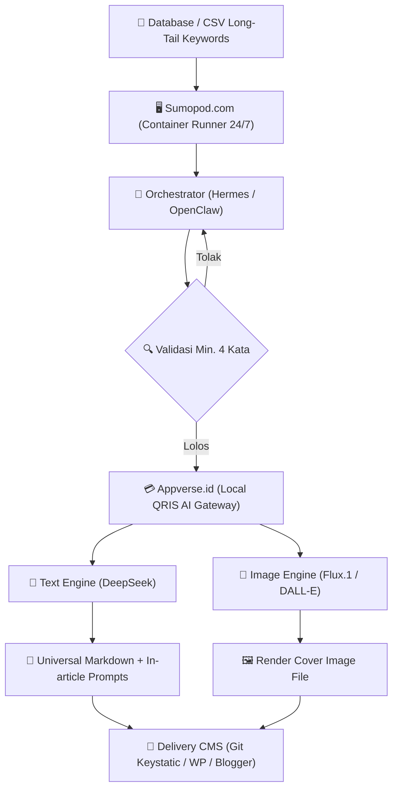

# Ayo SEO - AI Agent Senior SEO & Content Strategist

[](https://opensource.org/licenses/MIT)
[]()
[](https://github.com/ndrean-id)
[](https://github.com/ndrean-id)
[](https://www.linkedin.com/in/ndrean-id/)
[](https://www.youtube.com/@ndrean_id)
[]()
[]()
[]()
[-emerald.svg)]()

> 💡 **TL;DR / Ringkasan Cepat:**  
> **Ayo SEO** adalah open-source AI Agent plugin untuk **Google Antigravity** yang bertindak sebagai *Second Brain* (Otak SEO) sekaligus *Living SEO Library* (Perpustakaan Pengetahuan Hidup) milik **Andre Wahyu Hermawan**. Didesain khusus untuk memproduksi artikel berstandar **Google E-E-A-T**, membangun hierarki **Topical Authority** (Pilar, Cluster, Glossary), serta mendistribusikan konten (*Repurposing*) ke media sosial dan infografis visual. Teroptimasi penuh untuk konversi bisnis nyata (Leads & Conversion Organik) pada SERP tradisional maupun mesin pencari generatif (**GEO & AEO** seperti Google AI Overviews, Perplexity, dan ChatGPT Search).

> 🧠 **Filosofi Proyek: The Living Library & Open Second Brain**  
> Di era pencarian modern, ilmu SEO bermutasi sangat cepat. Menyimpan wawasan di catatan pribadi yang terisolasi sering berujung pada kelusuhan strategi. Repositori ini dibangun secara terbuka (*public open-source*) sebagai **Living Library & Second Brain**: wadah hidup di mana setiap prinsip algoritma resmi, teknik data praktikum, dan eksperimen lapangan dikodifikasikan, diuji, dan diperbarui secara berkelanjutan. Siapa pun yang menemukan repositori ini dapat menggunakannya sebagai cetak biru optimasi berstandar industri kelas dunia.

---

## Profil Inisiator dan Arsitek Proyek (Author Showcase)

Repositori dan AI Agent ini dirancang serta dikurasi oleh:

| Profil Profesional | Detail & Reputasi Digital |
| :--- | :--- |
| **Author / Inisiator** | **Andre Wahyu Hermawan** |
| **Spesialisasi Utama** | **WordPress Technical SEO Specialist & AI Search Strategist (GEO/AEO)** |
| **Website Resmi** | *(Dalam proses pembaruan / Coming Soon)* |
| **LinkedIn** | **[linkedin.com/in/ndrean-id](https://www.linkedin.com/in/ndrean-id/)** |
| **GitHub Portfolio** | **[@ndrean-id](https://github.com/ndrean-id)** |
| **YouTube Channel** | **[@ndrean_id](https://www.youtube.com/@ndrean_id)** |
| **Instagram** | **[@andrean.lp](https://www.instagram.com/andrean.lp/)** |
| **Positioning Statement** | Membantu pemilik bisnis dan kreator membangun aset web berkinerja tinggi yang siap mendominasi pencarian Google dan dikutip oleh AI Search Engine (*ChatGPT, Gemini, Perplexity, Claude*). |
| **Nilai Unik (UVP)** | Sinergi langka antara pemahaman strategi bisnis/konversi (*ex-digital marketing*) dan kemampuan eksekusi teknis langsung (*coding Astro JS, arsitektur headless WordPress, Cloudflare edge, dan Schema JSON-LD*). |

### Mengapa Repositori Ini Bersifat Terbuka untuk Publik?

1. **Transparansi & Pembuktian Kompetensi Nyata (Skin in the Game):**
   - Bukti nyata E-E-A-T (*Experience, Expertise, Authoritativeness, Trustworthiness*). Tidak ada rahasia di balik pintu tertutup; seluruh logika riset, arsitektur pilar-cluster, dan protokol adaptasi algoritma disajikan terbuka untuk diuji oleh siapa pun.
2. **Teknik Feynman (Mengajarkan untuk Mematangkan Keahlian):**
   - Sesuai prinsip praktikum SEO (*CH01-07: Berbagi Pengetahuan*), mengkodifikasikan ilmu ke dalam dokumentasi terstruktur adalah cara terbaik mempertajam intuisi teknis dan pemahaman analitik.
3. **Pintu Kolaborasi & Kemitraan Profesional:**
   - Sebagai etalase personal branding terbuka bagi pemilik bisnis, agensi pemasaran, atau calon mitra teknologi yang mencari spesialis teknis yang mampu menggabungkan strategi konten dengan arsitektur web modern.

---

## 📌 Sekilas Tentang Ayo SEO (Entity Snapshot)

| Parameter | Spesifikasi & Arsitektur |
| :--- | :--- |
| **Kategori** | AI Agent Plugin / SEO Strategy, Content Generation & Visual Repurposing Engine |
| **Sumber Rujukan Utama** | **[Google Search Central](https://developers.google.com/search)**, **[Moz Learn SEO](https://moz.com/learn/seo)**, **[Search Engine Journal](https://www.searchenginejournal.com/)**, **[Backlinko](https://backlinko.com/)**, **[Semrush Blog](https://www.semrush.com/blog/)**, & **[AIOSEO Blog](https://aioseo.com/blog/)** |
| **Platform Host** | Google Antigravity IDE & Antigravity CLI |
| **Model LLM Optimal** | Gemini 3.8 Flash High (Pilar, Cluster, Glossary, Repurpose) |
| **Standar Kualitas** | Google Helpful Content System, Quality Rater Guidelines (QRG), E-E-A-T |
| **Target Engine** | SERP Tradisional (Google, Bing) + AI Search Engines (Perplexity, Google AI Overviews, ChatGPT Search) |
| **Format Output** | Universal Markdown siap posting (termasuk Slug, Meta Title Title Case, Key Takeaways, FAQ Schema, Prompt DALL-E 3) |
| **Standar Visual** | **Syar'i Compliant (Default):** Karakter manusia *faceless* (tanpa mata, alis, hidung, mulut) & dilarang menampilkan hewan |
| **Integrasi CMS** | Headless Git-based (Keystatic, PagesCMS), WordPress REST API, Blogger API v3 |
| **Autopilot Stack** | Sumopod.com (Container Host) + Appverse.id (Local QRIS Gateway) + DeepSeek + Flux/DALL-E |

---

## 🌟 Kenapa Ayo SEO? (GEO & Information Gain)

Di era *Google Helpful Content System* dan menjamurnya *AI Search Engines*, memproduksi artikel menggunakan AI biasa sering kali menghasilkan teks klise (*AI slop*) yang rawan de-indexing dan diabaikan oleh mesin pencari generatif. 

**Ayo SEO memecahkan masalah ini dengan mengedepankan Information Gain, riset berbasis entitas, dan ekosistem multi-format:**

### Perbandingan: Generator AI Biasa vs. Ayo SEO

| Aspek Evaluasi | Generator Konten AI Biasa | Ayo SEO (Senior Specialist Mode) |
| :--- | :--- | :--- |
| **Alur Kerja** | Langsung membuat artikel tanpa analisis mendalam | Riset Search Intent, Entity Mapping, dan gap kompetitor sebelum menulis |
| **Hierarki Konten** | Artikel acak tanpa arsitektur SEO | Membangun ekosistem *Topical Authority* (Pilar ⇄ Cluster ⇄ Glossary) |
| **Gaya Bahasa (Tone)** | Kaku dan klise (*"Di era digital saat ini...", "Kesimpulannya..."*) | Bahasa santai, mengalir natural ("aku-kamu"), humanis, tanpa *wall-of-text* |
| **Strategi Judul** | Sering memakai clickbait murahan atau judul generik | **Hook Penasaran Etis (Curiosity Gap)**: CTR tinggi dan janji ditepati (anti *pogo-sticking*) |
| **GEO / AEO Ready** | Format polos tanpa struktur kutipan AI | Dilengkapi **Key Takeaways (TL;DR)** & **Skema FAQ** siap kutip oleh AI Search |
| **Visual & Gambar** | Tidak ada arahan visual atau menyarankan foto stock pasaran | Menyertakan **Prompt DALL-E 3 siap salin** (Inline + Cover 16:9) berstandar syar'i |
| **Distribusi Konten** | Berhenti setelah artikel teks selesai | Fitur **Content Repurposing** ke Carousel IG (3:4), Single Image AEO (3:4), & Infografis (9:16) |

---

## 🎓 Blueprint Belajar SEO Efisien: Dari Fondasi Menuju Leads & Konversi Organik

SEO modern bukan sekadar mengejar *vanity metrics* (lonjakan impresi atau ranking kata kunci tanpa hasil bisnis). Berdasarkan silabus praktikum **"Efektif Tingkatkan Leads & Conversion Organik dengan Data SEO"**, esensi utama SEO adalah menghasilkan prospek nyata (*qualified leads*) dan konversi penjualan melalui keputusan berbasis data (*data-driven SEO*).

Berikut adalah kurikulum komprehensif dari silabus praktikum tersebut yang diadopsi ke dalam arsitektur dan filosofi kerja Ayo SEO:

### 1. Pengertian SEO Modern: Dari Mesin Pencari Konvensional Menuju AI Search Engines (Perplexity.ai)

Di materi pembuka silabus praktikum **"Efektif Tingkatkan Leads & Conversion Organik dengan Data SEO"**, **Search Engine Optimization (SEO)** didefinisikan secara komprehensif, relevan, dan berorientasi masa depan:

> *"Search Engine Optimization (SEO) adalah serangkaian teknik yang digunakan untuk meningkatkan visibilitas dan peringkat sebuah situs web di halaman hasil pencarian mesin pencari seperti Google, Bing, Yahoo, dan bahkan mesin pencari berbasis AI seperti Perplexity.ai. Tujuannya adalah untuk mendapatkan lalu lintas organik (Organic Traffic) yang lebih banyak dari pengguna internet yang mencari informasi terkait dengan kata kunci yang relevan. SEO mencakup berbagai aspek, mulai dari perancangan dan pengoptimalan konten hingga aspek teknis dari situs web itu sendiri."*

#### A. Tiga Pilar Definisi Berdasarkan Silabus Praktikum

1. **Cakupan Multi-Engine (Lintas Mesin Pencari Konvensional & Generatif AI):**
   - Optimasi tidak lagi terkungkung pada Google semata, melainkan mencakup ekosistem pencarian global seperti **Bing**, **Yahoo**, dan mesin pencari berbasis AI generasi baru seperti **Perplexity.ai**, **ChatGPT Search**, dan **Google AI Overviews**.
   - Visibilitas di mesin pencari AI menuntut konten yang kaya sintesis jawaban langsung (*Answer Engine Optimization / AEO*), struktur data bersih, serta otoritas entitas yang kuat (*Generative Engine Optimization / GEO*).
2. **Tujuan Hakiki: Organic Traffic Berkualitas untuk Leads & Konversi:**
   - Mendatangkan audiens yang secara sadar dan aktif mencari solusi menggunakan kata kunci spesifik (*high-intent keywords*).
   - Trafik organik ini memiliki tingkat kepercayaan dan rasio konversi jauh lebih tinggi dibanding iklan berbayar karena berbasis kebutuhan murni pengguna (*inbound demand* vs *interruption marketing*).
3. **Spektrum Ganda: Arsitektur Konten & Keunggulan Teknis Situs:**
   - **Perancangan & Pengoptimalan Konten:** Menghadirkan artikel bernilai tinggi (*Helpful Content*), menjawab intensi pencari (*Search Intent*), dan menyajikan kebaruan informasi (*Information Gain*).
   - **Aspek Teknis Situs Web:** Kesiapan performa kecepatan (*Core Web Vitals*), keterindeksan bersih (*Crawlability & Indexability*), arsitektur siloing, hingga struktur data (*Schema JSON-LD*).

#### B. Perbandingan: SEO Klasik vs SEO Modern (Era Perplexity & GEO)

| Dimensi Perbandingan | Era SEO Klasik (2010-2022) | Era SEO Modern & AI Search (2023-2026+) |
| :--- | :--- | :--- |
| **Target Hasil Pencarian** | Memperebutkan posisi pada daftar tautan biru (*10 Blue Links*). | Menjadi sumber rujukan kutipan utama pada kotak sintesis AI (*AI Answer Engines & Citation Links*). |
| **Mesin Pencari Sasaran** | Google, Yahoo, Bing tradisional. | Google SERP + AI Overviews, Perplexity.ai, ChatGPT Search, Claude. |
| **Metrik Keberhasilan** | *Vanity metrics*: Lonjakan ranking dan impresi kata kunci semata. | *Business impact*: Lalu lintas organik tertarget, *qualified leads*, dan konversi penjualan. |
| **Fokus Pengoptimalan** | Kepadatan kata kunci (*keyword density*) dan jumlah tautan mentah. | Kejelasan konteks entitas semantik, standar E-E-A-T, dan performa teknis arsitektur web. |
| **Karakter Audiens** | Pembaca pasif yang mengklik judul sensasional (*clickbait*). | Pengambil keputusan yang mencari solusi spesifik, terpercaya, dan tuntas (*high-intent problem solver*). |

---

### 2. Mengapa SEO Penting? Kredibilitas, Rantai Konversi Bisnis, dan Efisiensi Jangka Panjang vs SEM

Pada silabus praktikum lanjutan bertajuk **"Mengapa SEO Penting?"**, diuraikan fondasi rasionalitas mengapa optimasi mesin pencari merupakan investasi digital paling berharga bagi bisnis dan personal branding:

> *"SEO penting karena sebagian besar pengguna internet memulai pencarian mereka di mesin pencari. Dengan peringkat yang lebih tinggi, situs web Anda akan lebih terlihat oleh pengguna atau pengunjung potensial, yang dapat meningkatkan lalu lintas (traffic), konversi, dan pada akhirnya berujung pada peningkatan keuntungan. Selain itu, SEO dapat membantu membangun kredibilitas dan kepercayaan dengan pengguna, karena situs yang muncul di halaman pertama hasil pencarian cenderung dianggap lebih terpercaya. Dengan memahami dan menerapkan strategi SEO yang tepat, Anda dapat meningkatkan visibilitas dan daya saing situs web Anda di pasar digital yang semakin ketat dalam jangka panjang dengan biaya yang jauh lebih efisien dibandingkan dengan penerapan Strategi SEM."*

#### A. Empat Pilar Strategis Mengapa SEO Menjadi Fondasi Bisnis Digital

1. **Pintu Gerbang Utama Perilaku Konsumen (Search as the Primary Gateway):**
   - Mayoritas perjalanan konsumen (*customer journey*) di internet bermula dari kotak pencarian (*Search Engine*). Pengguna yang mengetikkan kata kunci tertentu berada dalam fase aktif mencari jawaban atau solusi (*high-intent state*). Berada di posisi teratas berarti menangkap calon pembeli tepat pada saat kebutuhan mereka memuncak.
2. **Rantai Kausalitas Konversi & Keuntungan (The Profit Conversion Loop):**
   - SEO bukan sekadar pencapaian teknis, melainkan motor penggerak pertumbuhan laba bisnis:
     ```text
     [Peringkat Teratas SERP / AI Citation]
                     │
                     ▼
     [Visibilitas Maksimal ke Pengunjung Potensial]
                     │
                     ▼
     [Lonjakan Lalu Lintas Organik (Qualified Traffic)]
                     │
                     ▼
     [Tingkat Konversi Tinggi (Leads & Penjualan)]
                     │
                     ▼
     [Peningkatan Keuntungan Bersih (Net Profit) Berkelanjutan]
     ```
3. **Efek Halo Kredibilitas & Kepercayaan (The Page 1 Trust Factor):**
   - Muncul di halaman pertama Google atau dikutip mesin pencari AI memberikan validasi instan (*social proof*). Secara psikologis, audiens cenderung menganggap situs di halaman pertama lebih kredibel, profesional, dan terpercaya dibanding kompetitor yang berada di halaman belakang atau iklan bersponsor (*ad skepticism*).
4. **Daya Saing Jangka Panjang & Efisiensi Biaya vs SEM (Compounding Asset vs Pay-to-Play):**
   - Strategi **SEM (Search Engine Marketing / Iklan Berbayar Google Ads)** menuntut anggaran terus-menerus; ketika anggaran iklan habis, trafik dan penjualan seketika berhenti total.
   - Sebaliknya, **SEO** adalah pembangunan aset digital berulang (*compounding digital asset*). Investasi awal pada konten berkualitas dan arsitektur teknis yang kuat akan terus mengalirkan trafik gratis bertahun-tahun ke depan dengan biaya per akuisisi (*Cost Per Acquisition / CPA*) yang semakin lama semakin murah.

#### B. Perbandingan Komprehensif: Strategi SEO vs Strategi SEM

| Dimensi Parameter | Strategi SEO (Organic Search Asset) | Strategi SEM (Paid Search Advertising) |
| :--- | :--- | :--- |
| **Model Biaya** | Investasi awal pada konten & teknis, trafik gratis berkelanjutan. | Biaya per klik (*Pay Per Click / PPC*) yang terus berulang dan mengalami inflasi lelang. |
| **Dampak Saat Anggaran Dihentikan** | Trafik dan leads tetap mengalir secara stabil (*evergreen & compounding*). | Trafik, klik, dan prospek seketika anjlok ke angka nol (*zero residual value*). |
| **Persepsi & Kredibilitas Audiens** | Dianggap sebagai rekomendasi objektif terpercaya (*high trust & organic authority*). | Sering diabaikan akibat fenomena kebutaan iklan (*banner blindness / sponsored skepticism*). |
| **Ketahanan Daya Saing Jangka Panjang** | Membangun parit pertahanan (*moat*) otoritas domain yang sulit digeser kompetitor instan. | Bersifat transaksional sementara; rentan kalah jika ada kompetitor dengan modal belanja iklan lebih besar. |
| **Jangkauan Mesin Generatif (GEO/AEO)** | Menjadi sumber referensi rujukan pada jawaban AI (Perplexity, ChatGPT, Google AI Overviews). | Terbatas pada slot banner sponsor konvensional, jarang disitasi dalam sintesis logika generatif. |

#### C. Biaya Jangka Panjang yang Lebih Efektif: Anatomi Finansial SEO vs SEM

Pada materi pendalaman kurikulum bertajuk **"Biaya Jangka Panjang yang Lebih Efektif"**, dipaparkan perbedaan fundamental struktur biaya operasional (*Unit Economics*) antara SEO dan SEM:

> - **SEO:** *Setelah situs web Anda dioptimalkan dan mencapai peringkat tinggi, lalu lintas organik yang dihasilkan biasanya berkelanjutan tanpa memerlukan biaya tambahan. Meskipun upaya awal untuk SEO bisa mahal dan memakan waktu, manfaatnya dapat berlangsung lama tanpa biaya per klik yang terus menerus.*
> - **SEM:** *SEM membutuhkan anggaran yang berkelanjutan untuk kampanye iklan. Setiap kali seseorang mengklik iklan Anda, Anda dikenakan biaya. Ketika anggaran iklan berhenti, lalu lintas juga berhenti.*

##### 1. Struktur Biaya SEO: Investasi Awal Tinggi Menuju Biaya Marjinal Rp 0 (Zero Marginal Cost)
- **Investasi di Awal (Upfront Capital Expenditure):**
  - Pada 1-3 bulan pertama, SEO membutuhkan sumber daya intensif: riset topik semantik, produksi konten pilar dan cluster berstandar E-E-A-T, optimasi *Core Web Vitals*, audit teknis keterindeksan, serta arsitektur internal link.
- **Efek Akumulatif (The Compounding Effect):**
  - Begitu artikel menembus peringkat 1-3 Google atau menjadi sumber rujukan utama mesin AI (Perplexity & AI Overviews), **biaya marjinal per pengunjung tambahan adalah Rp 0**.
  - Mau ada 100, 10.000, atau 1.000.000 orang yang mengklik halaman websitemu setiap bulan, kamu tidak dikenakan biaya sepeser pun. Biaya per akuisisi pelanggan (*Cost Per Acquisition / CPA*) akan menyusut mendekati nol seiring waktu.

##### 2. Struktur Biaya SEM: Jebakan Treadmill Iklan & Jurang Trafik Seketika (The Instant Cliff)
- **Ketergantungan Anggaran Tetap (Operational Expenditure Drain):**
  - Setiap klik yang masuk langsung memotong saldo kredit iklan (*Pay Per Click / PPC*). Bisnis terjebak pada roda *treadmill*: untuk mempertahankan omzet, anggaran iklan wajib terus dipompa tanpa henti.
- **Jurang Trafik Seketika (The Instant Traffic Cliff):**
  - Saat anggaran iklan dihentikan atau saldo habis, seluruh arus pengunjung, leads, dan konversi seketika mati total (*0 traffic, 0 leads*). SEM tidak meninggalkan aset sisa (*zero residual equity*).
- **Inflasi Lelang Kata Kunci (Auction Inflation):**
  - Biaya per klik pada kata kunci komersial cenderung naik dari tahun ke tahun karena semakin banyak kompetitor yang ikut bertarung dalam lelang Google Ads. Akibatnya, margin keuntungan bersih bisnis perlahan tergerus.

##### 3. Simulasi Finansial 12 Bulan: Perjalanan Biaya SEO vs SEM

| Periode Waktu | Strategi SEO (Aset Organik) | Strategi SEM (Iklan Google Ads) |
| :--- | :--- | :--- |
| **Bulan 1 - 3** | Biaya awal terasa mahal (waktu & tenaga optimasi konten/teknis). Trafik organik baru mulai merangkak naik (*CPA awal tinggi*). | Trafik langsung mengalir deras seketika, namun saldo iklan langsung terpotong jutaan rupiah per bulan. |
| **Bulan 4 - 6** | Artikel mulai menempati halaman 1. Trafik melonjak 3x lipat tanpa ada biaya klik tambahan (*CPA mulai menurun drastis*). | Trafik stabil selama saldo terus disetor. Begitu kompetitor menaikkan tawaran lelang, biaya per klik mulai membengkak. |
| **Bulan 7 - 12+** | **Fase Keuntungan Murni (Pure Yield):** Trafik organik eksponensial dan mandiri. Biaya per klik adalah Rp 0 (*CPA mendekati nol*). | Bisnis tetap harus menyetor anggaran yang sama atau lebih besar. Jika anggaran disetop, trafik seketika 0. |

##### 4. Panduan Transisi Strategis: The Hybrid Runway Strategy
Pendekatan paling cerdas bagi bisnis modern:
1. **Fase Peluncuran (Bulan 1-2):** Jalankan SEM dengan anggaran terukur semata-mata untuk menguji validasi penawaran, mengukur rasio konversi halaman penjualan, dan menemukan kata kunci yang paling menghasilkan uang.
2. **Fase Pembangunan (Bulan 2-6):** Gunakan data kata kunci pemenang dari SEM tersebut untuk membangun Artikel Pilar dan Cluster SEO secara agresif menggunakan Ayo SEO.
3. **Fase Kemandirian (Bulan 6 ke Atas):** Saat peringkat organik berhasil mendominasi halaman 1 Google dan mesin pencari AI, kurangi atau hentikan ketergantungan pada iklan berbayar. Amankan margin laba bersih tertinggi dari aliran trafik organik berkelanjutan.

#### D. Kualitas Trafik yang Lebih Bertarget: Kesenjangan Relevansi SEO vs SEM

Pada materi kurikulum lanjutan bertajuk **"Traffic yang Lebih Bertarget"**, diuraikan perbedaan mendasar antara kualitas trafik organik dan trafik iklan berbayar:

> - **SEO:** *Dengan menargetkan kata kunci yang relevan dan spesifik sesuai search intent, SEO menarik pengunjung yang benar-benar tertarik dengan produk atau layanan Anda. Ini meningkatkan kemungkinan konversi karena lalu lintas lebih tertarget dan relevan.*
> - **SEM:** *Meskipun SEM juga dapat menargetkan kata kunci tertentu, sering kali ada kemungkinan mendapatkan lalu lintas yang tidak relevan karena iklan ditampilkan berdasarkan tawaran dan bukan relevansi konten.*

##### 1. Search Intent vs Bidding Power: Mengapa Trafik SEO Menghasilkan Konversi Lebih Tinggi
- **Penyaringan Alami Berbasis Relevansi Murni (Organic Relevance Filter):**
  - Mesin pencari seperti Google dan AI Answer Engines hanya akan menempatkan sebuah halaman di peringkat teratas jika konten tersebut dinilai paling tuntas, mendalam, dan akurat menjawab kebutuhan spesifik pencari (*Search Intent Match*).
  - Peringkat organik tidak bisa dibeli dengan uang; ia adalah pengakuan atas otoritas dan kualitas jawaban. Akibatnya, audiens yang datang lewat hasil organik adalah **pengunjung yang sudah terkualifikasi sejak awal (*Pre-Qualified Visitors*)**. Mereka datang secara sadar untuk mencari pemecahan masalah nyata, sehingga rasio konversi (*conversion rate*) menjadi prospek (*leads*) atau pembeli jauh lebih tinggi.
- **Distorsi Bidding & Kebocoran Anggaran SEM (The Wasted Ad Spend Leakage):**
  - Pada SEM (Google Ads), penayangan iklan sangat ditentukan oleh **kekuatan tawaran anggaran (*Bidding Power / Ad Rank*)**, bukan semata-mata kecocokan substansi konten.
  - Akibat pengaturan pencocokan otomatis (*broad match* atau algoritma platform iklan), iklan sering kali tayang pada kueri yang salah konteks. Pengguna yang sekadar penasaran atau salah mengira isi iklan akan mengklik, merasa tertipu, lalu langsung keluar (*high bounce rate*).
  - Setiap klik yang keliru ini tetap memotong saldo iklan secara penuh, memicu pemborosan anggaran (*wasted ad spend*) tanpa menghasilkan konversi nyata.

##### 2. Matriks Perbandingan Kualitas Trafik: SEO vs SEM

| Parameter Evaluasi | Trafik Organik SEO | Trafik Iklan Berbayar SEM |
| :--- | :--- | :--- |
| **Penentu Penayangan Utama** | Relevansi semantik mendalam, otoritas E-E-A-T, & kepuasan *Search Intent*. | Besaran tawaran saldo iklan (*Bidding Price*) & anggaran harian. |
| **Karakter Pengunjung** | *Active problem-solver* yang mencari solusi spesifik secara sadar (*Pre-qualified*). | Campuran antara prospek riil dan pengklik penasaran/salah klik (*Curiosity clickers*). |
| **Risiko Biaya Klik Salah Sasaran** | **Nol rupiah (Rp 0):** Jika ada pengunjung yang salah klik, saldo tidak terpotong. | **Tinggi:** Setiap klik salah sasaran tetap memotong saldo anggaran iklan secara penuh. |
| **Sikap Psikologis Audiens** | *Earned Trust:* Menganggap halaman sebagai rekomendasi objektif terbaik dari Google/AI. | *Ad Skepticism:* Cenderung waspada dan bersikap kritis karena menyadari halaman tersebut memasang iklan. |
| **Stabilitas Kualitas Leads** | Konsisten tinggi karena intent kata kunci terkunci rapat di struktur konten. | Fluktuatif; kualitas leads sering merosot saat platform iklan memperluas penayangan ke jaringan mitra (*partner networks*). |

##### 3. Implementasi Intent Matching pada Arsitektur Konten Ayo SEO
Prinsip trafik bertarget ini diterjemahkan ke dalam hierarki produksi konten Ayo SEO:
1. **Informational Intent (Tahap Eksplorasi):**
   - Dilayani oleh skill `/ayo-seo-glossary` (definisi cepat istilah) dan `/ayo-seo-cluster` (pembahasan detail masalah spesifik).
2. **Commercial / Investigational Intent (Tahap Evaluasi):**
   - Dilayani oleh artikel cluster perbandingan, studi kasus penerapan riil, dan pembuktian *Experience*.
3. **Transactional Intent (Tahap Keputusan/Aksi):**
   - Diarahkan secara elegan melalui jaringan *internal link* sarang laba-laba menuju Artikel Pilar `/ayo-seo-pilar` dan halaman penawaran produk/jasa utama dengan tingkat relevansi 100%.

---

### 3. Glosarium Fundamental: 11 Istilah Inti SEO & Mekanika Mesin Pencari

Pada materi silabus praktikum bertajuk **"Istilah SEO"** (Bagian 1 & Bagian 2), dikodifikasikan 11 istilah paling mendasar yang menyusun kosakata teknis, arsitektur data, dan mekanika cara kerja mesin pencari:

```text
                                [SIKLUS LENGKAP PENCARIAN & PERINGKAT]

  [01. ROBOTS.TXT] ──> [02. SITEMAP XML] ──> [03. CRAWLING] ──> [04. INDEXING] ──> [05. CANONICAL URL]
  (Izin Akses Bot)      (Daftar Halaman)      (Penelusuran Bot)    (Database Google)    (Halaman Utama)
                                                                                            │
  ┌─────────────────────────────────────────────────────────────────────────────────────────┘
  ▼
  [06. HTTPS] ────────> [07. BACKLINKS] ────> [08. ANCHOR TEXT] ──> [09. KATA KUNCI]
  (Sinyal Keamanan)     (Vote of Confidence)  (Konteks Tautan)       (Search Intent)
                                                                            │
  ┌─────────────────────────────────────────────────────────────────────────┘
  ▼
  [10. SERP / AI OVERVIEW] ──> [11. CTR (CLICK-THROUGH RATE)] ──> [LEADS & KONVERSI BISNIS]
  (Peringkat Hasil Pencarian)   (Rasio Klik Judul/Meta)            (Hasil Finansial)
```

#### A. Bagian 1: Fondasi Penemuan, Akses, & Perayapan

1. **Kata Kunci (Keywords):**
   - *Definisi Praktikum:* Istilah atau frasa yang digunakan pengguna internet saat mencari informasi di mesin pencari. Pemilihan kata kunci yang tepat sangat penting untuk mengarahkan lalu lintas yang relevan ke situs web.
   - *Perspektif SEO Modern:* Kata kunci bukan sekadar pencocokan string teks kaku (*exact match*), melainkan representasi dari niat pencarian manusia (*Search Intent*). Di era AI Search, penargetan kata kunci berevolusi menjadi pemetaan **entitas semantik (*Entity-Based SEO*)** yang menjawab konteks masalah secara menyeluruh.
2. **SERP (Search Engine Results Page):**
   - *Definisi Praktikum:* Halaman hasil pencarian yang ditampilkan oleh mesin pencari setelah pengguna memasukkan kueri pencarian. Posisi dan visibilitas di SERP sangat penting untuk mendapatkan lalu lintas organik.
   - *Perspektif SEO Modern:* Halaman 1 SERP adalah lokasi di mana 90%+ klik pengguna terjadi, dengan 3 posisi teratas mendominasi lebih dari 55% rasio klik-tayang (*Click-Through Rate / CTR*). Saat ini, SERP telah bertransformasi dari sekadar 10 tautan biru konvensional (*10 Blue Links*) menjadi lanskap dinamis yang memuat *Google AI Overviews*, *Featured Snippets*, *People Also Ask*, dan *Knowledge Panels*.
3. **Backlinks ("Vote of Confidence" & Otoritas Eksternal):**
   - *Definisi Praktikum:* Tautan dari situs web lain yang mengarah ke situs web Anda. Tautan ini dianggap sebagai "vote of confidence" (suara kepercayaan) dan dapat meningkatkan otoritas serta peringkat situs Anda di mesin pencari.
   - *Perspektif SEO Modern:* Backlink adalah pilar utama algoritma PageRank Google. Namun, Google modern mengutamakan **kualitas editorial dan relevansi topik** dibanding kuantitas mentah. Satu tautan dofollow bernilai dari situs bereputasi tinggi di industri sejenis jauh lebih berharga daripada ratusan tautan spam PBN (*Private Blog Network*).
4. **Sitemap XML (Peta Navigasi Mesin Pencari):**
   - *Definisi Praktikum:* File yang mencantumkan semua halaman di situs web Anda yang ingin diindeks oleh mesin pencari. Ini membantu mesin pencari menemukan dan merayapi halaman situs Anda lebih efisien.
   - *Perspektif SEO Modern:* Sitemap XML adalah direktori panduan resmi bagi bot perayap. Sitemap yang bersih, terstruktur rapi, diperbarui secara otomatis setiap kali ada artikel baru (*lastmod tag*), dan bebas dari URL error (404/301/noindex) sangat krusial untuk mengoptimalkan anggaran perayapan (*Crawl Budget*).
5. **Crawling (Perayapan Bot Mesin Pencari):**
   - *Definisi Praktikum:* Proses di mana mesin pencari menggunakan bot untuk menemukan dan membaca halaman web di seluruh internet. Mesin pencari kemudian mengindeks halaman yang ditemukan selama proses crawling.
   - *Perspektif SEO Modern:* Crawling adalah langkah pertama dari trilogi mesin pencari: **Crawling -> Indexing -> Ranking**. Jika sebuah halaman tidak dapat dijangkau oleh bot (misal akibat salah konfigurasi `robots.txt`, tautan putus, atau server lambat *time out*), maka halaman tersebut mustahil untuk diindeks dan tidak akan pernah muncul di SERP.

#### B. Bagian 2: Pengindeksan, Sinyal Relevansi, & Kontrol Teknis

6. **Pengindeksan (Indexing):**
   - *Definisi Praktikum:* Pengindeksan adalah proses di mana mesin pencari menambahkan halaman web ke database mereka sehingga dapat muncul di hasil pencarian. Pastikan halaman Anda diindeks untuk muncul di SERP.
   - *Perspektif SEO Modern:* Merupakan tahap kedua di mana bot mengurai (*parse*), merender kode HTML/JavaScript, mengevaluasi standar kualitas (*Helpful Content & E-E-A-T*), lalu menyimpannya di Google Search Index. Jika halaman berstatus *"Crawled - currently not indexed"*, ini menandakan adanya evaluasi kualitas konten atau otoritas domain yang belum memadai.
7. **CTR (Click-Through Rate):**
   - *Definisi Praktikum:* CTR adalah rasio jumlah klik yang diterima tautan (links) dibandingkan dengan jumlah tampilan (impressions). CTR yang tinggi menunjukkan bahwa meta deskripsi dan tag judul Anda menarik dan relevan dengan pengguna.
   - *Perspektif SEO Modern:* CTR dihitung dengan rumus: `(Total Klik / Total Impresi) x 100%`. Merupakan indikator utama daya pikat di SERP. Penulisan judul dengan teknik *Curiosity Gap* etis berformat *Title Case* dan meta description solutif terbukti mampu mendongkrak CTR 2x–3x lipat pada posisi ranking yang sama tanpa perlu menunggu kenaikan peringkat.
8. **Anchor Text (Teks Jangkar Tautan):**
   - *Definisi Praktikum:* Anchor text adalah teks yang dapat diklik dalam hyperlink. Penggunaan anchor text yang relevan dan deskriptif dapat membantu mesin pencari memahami konteks dan konten halaman yang dituju.
   - *Perspektif SEO Modern:* Google secara tegas melarang penggunaan anchor text generik seperti "klik di sini", "link ini", atau "baca selengkapnya". Anchor text wajib deskriptif, kontekstual, dan bervariasi (*semantic contextual anchor*). Di Ayo SEO, anchor text internal berfungsi merajut siloing pilar-cluster menjadi sarang laba-laba yang kokoh.
9. **Robots.txt (Direktori Pengendalian Perayapan):**
   - *Definisi Praktikum:* Robots.txt adalah file teks yang digunakan untuk memberi petunjuk kepada mesin pencari halaman atau bagian dari situs web mana yang boleh dan tidak boleh diindeks/dirayapi. Ini membantu mengarahkan bot mesin pencari untuk merayapi situs Anda dengan cara yang Anda inginkan.
   - *Perspektif SEO Modern:* Berada di direktori root domain (`domain.com/robots.txt`) sebagai penjaga gerbang utama *Crawl Budget*. Digunakan untuk memblokir bot dari halaman admin (`/wp-admin/`), script privat, atau URL internal search (`/?s=`). *Catatan teknis:* `robots.txt` mengontrol perayapan (*crawling*), bukan pengindeksan (*indexing*); gunakan tag `<meta name="robots" content="noindex">` untuk mencegah indeks secara mutlak.
10. **Canonical URL (`rel="canonical"`):**
    - *Definisi Praktikum:* Canonical URL adalah URL preferensial yang ditentukan untuk menghindari masalah duplikasi konten. Tag canonical memberitahu mesin pencari halaman mana yang harus diindeks sebagai halaman utama.
    - *Perspektif SEO Modern:* Menjadi penentu *Single Source of Truth* untuk mencegah pecahnya otoritas (*Link Equity*) akibat URL tracking parameter (`?utm_...`), variasi produk e-commerce, atau variasi HTTP/HTTPS dan www/non-www. Tag canonical mengonsolidasikan seluruh bobot sinyal ranking ke satu URL kanonikal resmi.
11. **HTTPS (Hypertext Transfer Protocol Secure):**
    - *Definisi Praktikum:* HTTPS adalah versi aman dari HTTP, protokol untuk mengirim data antara browser dan situs web. Menggunakan HTTPS meningkatkan keamanan dan dipercaya oleh mesin pencari, yang dapat meningkatkan peringkat situs web Anda.
    - *Perspektif SEO Modern:* Google secara resmi menjadikan HTTPS sebagai sinyal peringkat (*Ranking Factor*) sejak 2014, dan kini menjadi bagian dari *Page Experience Signals*. Sertifikat SSL/TLS aktif melindungi data pengguna dan mencegah munculnya peringatan menakutkan *"Not Secure"* di Google Chrome yang dapat menghancurkan kredibilitas konversi.

#### C. Matriks Mekanika 11 Istilah SEO & Siklus Mesin Pencari

| No | Istilah Kunci | Peran Teknis dalam Siklus Mesin Pencari | Komponen Terkait | Tolok Ukur Keberhasilan |
| :--- | :--- | :--- | :--- | :--- |
| **01** | **Robots.txt** | Mengontrol izin akses perayapan bot pada direktori situs. | Technical SEO | File valid di root domain, tidak ada halaman penting yang terblokir (*blocked by robots.txt*). |
| **02** | **Sitemap XML** | Direktori daftar seluruh URL yang siap diindeks. | Technical SEO | Status submit *"Success"* di GSC, sinkron otomatis dengan pembaruan konten (*lastmod*). |
| **03** | **Crawling** | Penemuan dan pembacaan kode halaman web oleh bot crawler. | Technical SEO | Respon server cepat (<300ms), *crawl stats* stabil di GSC, zero 5xx server errors. |
| **04** | **Pengindeksan (Indexing)** | Evaluasi kualitas dan penyimpanan halaman ke database Google. | Technical & On-Page | Berstatus *"Indexed"* di GSC (lolos inspeksi URL), bebas error kanonikal dan noindex tak sengaja. |
| **05** | **Canonical URL** | Penunjuk halaman master untuk konsolidasi otoritas duplikat. | Technical SEO | Tag `rel="canonical"` menunjuk ke URL preferensial secara konsisten di semua variasi URL. |
| **06** | **HTTPS** | Enkripsi keamanan transfer data browser-server (SSL/TLS). | Technical SEO | Gembok hijau aman di browser, zero mixed content warnings, ranking signal aktif. |
| **07** | **Backlinks** | Sinyal suara kepercayaan (*vote of confidence*) eksternal. | Off-Page SEO | Domain Rating (DR), Citation Flow, dan tautan masuk editorial dofollow industri sejenis. |
| **08** | **Anchor Text** | Teks deskriptif penjelas konteks halaman tujuan tautan. | On-Page & Off-Page | Relevansi kontekstual semantik tinggi, bebas frasa generik "klik di sini", variasi anchor sehat. |
| **09** | **Kata Kunci (Keywords)** | Jembatan pencarian antara kebutuhan manusia dan topik konten. | On-Page & Content | Peringkat kata kunci, relevansi *Search Intent*, impresi dan kueri pencarian di GSC. |
| **10** | **SERP** | Halaman etalase hasil pencarian (organik & AI Overview). | All SEO Pillars | Posisi Top 1-3 SERP organik dan kemunculan di kotak sitasi generatif Google AI Overview. |
| **11** | **CTR (Click-Through Rate)** | Rasio persentase tayangan judul/meta yang menghasilkan klik riil. | On-Page & Copywriting | Rata-rata CTR > 3%-5% di GSC, judul *Title Case* menarik berbasis *Curiosity Gap* etis. |

#### D. Tiga Tahapan Utama Cara Kerja Mesin Pencari (Google Search Lifecycle)

Pada materi silabus praktikum **"3 Tahapan Utama Mesin Pencari"**, dijelaskan fondasi bagaimana Google memproses miliaran halaman di internet:

> *"Pada dasarnya mesin pencari seperti Google Search ini akan bekerja dalam tiga tahap, meskipun tidak semua halaman yang ada di internet akan berhasil melewati setiap tahap ini. Karena itu pada google search console nanti akan ada status halaman berupa 'Crawled - currently not indexed'."*

Tiga tahap berurutan tersebut mencakup:

```text
  [TAHAP 1: PERAYAPAN (CRAWLING)]
  Googlebot mengunduh kode teks, gambar, & video dari web via tautan & sitemap.
                 |
                 v (Lolos Seleksi Kualitas & Aksesibilitas)
  [TAHAP 2: PENGINDEKSAN (INDEXING)]
  Google menganalisis konteks semantik konten & menyimpannya ke basis data indeks raksasa.
                 |
                 v (Relevansi Kueri Pencari)
  [TAHAP 3: PENYAJIAN HASIL (SERVING SEARCH RESULTS)]
  Google menyajikan halaman paling relevan & berotoritas tinggi ke SERP pengguna.
```

1. **Perayapan (Crawling):**
   - *Definisi Resmi Modul:* Google Bot atau search engine bot yang lain mengunduh teks, gambar, dan video dari halaman-halaman yang ditemukan di internet dengan program otomatis yang disebut crawler (Crawler Bot).
   - *Standar Praktisi:* Merupakan fase penemuan awal (*discovery*). Bot menjelajah internet seperti laba-laba raksasa yang merayap dari satu tautan ke tautan berikutnya. Jika halamanmu tidak memiliki tautan internal (*orphan page*) atau diblokir oleh file `robots.txt`, Googlebot bahkan tidak akan pernah tahu bahwa halaman tersebut ada.
2. **Pengindeksan (Indexing):**
   - *Definisi Resmi Modul:* Google menganalisis teks, gambar, dan file video di halaman, dan menyimpan informasi tersebut dalam indeks Google, yang merupakan basis data besar.
   - *Standar Praktisi:* Merupakan fase pemahaman semantik (*understanding & storage*). Google membedah struktur DOM, mengevaluasi kanonikal, mendeteksi duplikasi, dan menilai apakah konten tersebut memberikan nilai tambah (*Information Gain*).
   - *Membedah Masalah "Crawled - currently not indexed":* Ini adalah status paling umum di Google Search Console yang sering membingungkan praktisi pemula. Status ini membuktikan bahwa **Googlebot sukses merayapi halamanmu (Tahap 1 lolos), tetapi algoritma Google memutuskan untuk menolak menyimpannya ke dalam indeks (Gagal di Tahap 2)**. Penyebab utamanya adalah konten dianggap dangkal (*thin content*), duplikat artikel lain tanpa kebaruan, atau otoritas domain (*Domain Authority*) situs masih terlalu rendah untuk bersaing di topik tersebut.
3. **Penyajian Hasil Pencarian (Serving Search Results):**
   - *Definisi Resmi Modul:* Ketika seorang pengguna melakukan pencarian di Google, Google mengembalikan informasi yang relevan dengan kueri pencarian tersebut.
   - *Standar Praktisi:* Merupakan fase perang peringkat (*ranking*). Dari miliaran halaman yang sudah tersimpan di database indeks, algoritma Google memilih beberapa halaman paling relevan, cepat dimuat, aman (HTTPS), dan memiliki reputasi eksternal terpercaya (*E-E-A-T & Backlinks*) untuk ditampilkan di halaman 1 SERP dan kotak *Google AI Overviews*.

#### E. Pendalaman Tahap 1: Perayapan (Crawling, Sumber Data, & Prioritas Bot)

Pada materi lanjutan modul **"Perayapan (Crawling)"**, dibedah secara spesifik mekanisme teknis bagaimana bot penjelajah bekerja di lapangan:

1. **Crawler, Bot, atau Spider (Mekanisme Link-Following):**
   - *Definisi Resmi Modul:* Mesin pencari mengirim program otomatis yang disebut crawler atau bot untuk menjelajahi web. Crawler ini mengikuti tautan dari satu halaman ke halaman lain, mengumpulkan informasi tentang konten setiap halaman yang mereka temukan.
   - *Standar Praktisi:* Mesin pencari tidak menggunakan formulir penelusuran manual untuk menemukan halaman baru. Mereka bergantung 100% pada tautan (*hyperlinks*). Inilah alasan teknis mengapa arsitektur **Internal Linking (Sarang Laba-Laba)** antara Artikel Pilar, Cluster, dan Glosarium di Ayo SEO menjadi sangat vital. Satu tautan internal yang hilang dapat memutus rantai penelusuran bot dan membuat artikel baru terisolasi.

2. **Tiga Sumber Data Utama Perayapan (Data Sources):**
   - *Definisi Resmi Modul:* Crawler mengunjungi berbagai sumber seperti situs web, file XML sitemap, dan konten yang diperbarui secara dinamis.
   - *Standar Praktisi:* Googlebot mengumpulkan daftar antrean URL yang akan dirayapi (*Crawl Queue*) dari tiga pintu masuk:
     - **Grafik Tautan Web (Web Hyperlinks):** Tautan masuk dari website lain (*backlinks*) serta rajutan tautan internal situs sendiri.
     - **Peta Situs XML (XML Sitemap):** File direktori resmi yang di-submit langsung oleh pemilik web melalui Google Search Console untuk memastikan halaman baru terdaftar secara formal.
     - **Sinyal Konten Dinamis (APIs & Feed):** Pembaruan berkala via protokol pengindeksan instan seperti *IndexNow*, RSS/Atom Feed, atau Google Indexing API (untuk jenis konten khusus seperti lowongan kerja dan live streaming).

3. **Prioritas Perayapan (Crawling Priority & Crawl Budget):**
   - *Definisi Resmi Modul:* Tidak semua halaman web dijelajahi dengan frekuensi yang sama. Halaman yang sering diperbarui atau memiliki otoritas tinggi biasanya lebih sering dijelajahi.
   - *Standar Praktisi:* Google memiliki keterbatasan sumber daya komputasi server, sehingga mereka menerapkan sistem kuota yang disebut **Crawl Budget**. Dua faktor penentu frekuensi kunjungan Googlebot ke websitemu adalah:
     - **Frekuensi Pembaruan (Freshness & Update Frequency):** Website berita atau blog aktif yang konsisten menerbitkan dan menyegarkan konten (*Content Refresh 80/20*) akan dikunjungi Googlebot setiap beberapa menit atau jam sekali.
     - **Otoritas Domain (Domain Authority & Backlink Popularity):** Semakin banyak backlink otoritatif yang menunjuk ke situsmu, semakin tinggi nilai kepercayaan (*Crawl Demand*) yang diberikan Googlebot, sehingga artikel baru yang kamu terbitkan bisa di-crawl dan diindeks dalam hitungan detik.

#### F. Pendalaman Tahap 2: Pengindeksan (Indexing, Struktur Data Indeks, & Eliminasi Duplikasi)

Pada materi lanjutan modul **"Pengindeksan (Indexing)"**, dibedah secara komprehensif apa yang terjadi setelah bot berhasil mengunduh konten dari web:

1. **Proses Pengindeksan (The Indexing Pipeline):**
   - *Definisi Resmi Modul:*
     > *"Data yang dikumpulkan oleh crawler disimpan dan diatur dalam database besar yang disebut indeks. Indeks ini mencakup informasi tentang konten halaman, tag HTML, metadata, kata kunci, dan lainnya."*
   - *Standar Praktisi:* Pengindeksan adalah proses di mana Googlebot menganalisis teks, media, dan struktur kode dari halaman yang telah dirayapi. Google membedah elemen-elemen penting: tag Title, Heading hierarkis (H1-H3), atribut kata kunci semantik, teks alternatif gambar (`alt text`), data terstruktur (*Schema JSON-LD*), dan sinyal kepatuhan kanonikal. Hanya halaman yang lolos dari penilaian kelayakan kualitas dan aksesibilitas yang akan disimpan ke dalam database raksasa Google (*Google Index*).

2. **Struktur Data Indeks (The Inverted Index Architecture):**
   - *Definisi Resmi Modul:*
     > *"Mesin pencari mengorganisasi data sedemikian rupa sehingga dapat diakses dan dicari dengan cepat. Struktur ini memungkinkan mesin pencari untuk mengidentifikasi konten yang relevan dengan cepat."*
   - *Standar Praktisi:* Google tidak menelusuri miliaran website dari nol setiap kali pengguna mengetikkan kata kunci di kolom pencarian. Sebagai gantinya, Google menggunakan struktur data khusus yang dikenal sebagai **Inverted Index (Indeks Terbalik)**, mirip indeks di halaman belakang buku tebal. Mesin pencari memetakan setiap kata dan entitas semantik ke daftar seluruh halaman web yang memuat kata tersebut beserta bobot relevansinya. Berkat arsitektur indeks terbalik ini, Google mampu memindai miliaran dokumen dan mengembalikan hasil pencarian paling relevan dalam waktu **sub-detik (0.2 hingga 0.4 detik)**.

3. **Penghapusan Duplikasi (Deduplication & The Canonicalization Filter):**
   - *Definisi Resmi Modul:*
     > *"Mesin pencari juga mengidentifikasi dan menghapus konten duplikat untuk memastikan bahwa hasil pencari[an tidak] berisi halaman yang identik atau sangat mirip."*
   - *Standar Praktisi:* Google sangat membenci pemborosan ruang database dan penurunan pengalaman pengguna akibat hasil pencarian yang menampilkan halaman kembar. Pada tahap pengindeksan, Google menjalankan filter deduplikasi (*Deduplication Engine*):
     - Jika ditemukan beberapa URL dengan konten yang sama persis (*exact duplicate*) atau sangat mirip (*near-duplicate*), Google akan mengelompokkannya ke dalam satu klaster duplikat.
     - Google kemudian memilih **satu URL utama sebagai Halaman Kanonikal (Canonical Page)** berdasarkan sinyal tag `rel="canonical"`, sitemap XML, konsistensi internal link, dan protokol HTTPS.
     - URL duplikat lainnya akan disaring keluar (*filtered out*) dan tidak ditampilkan di SERP. Inilah alasan mengapa disiplin tag kanonikal, struktur siloing yang rapi, dan keunikan konten (*Information Gain*) di Ayo SEO menjadi kunci mutlak agar artikel tidak tereliminasi di tahap pengindeksan.

#### G. Pendalaman Tahap 3: Penyajian Hasil Pencarian & Faktor Penentu Peringkat (Serving Results, Kualitas Konten, & Interaksi Pengguna)

Pada materi lanjutan modul **"Penyajian Hasil Pencarian (Serving Search Results)"**, dibedah secara komprehensif faktor-faktor krusial yang dipertimbangkan Google dalam menyajikan dan menyusun urutan peringkat di SERP:

```text
               [PENGGUNA MENGETIKKAN KUERI PADA GOOGLE / AI SEARCH]
                                        │
                                        ▼
                      [TAHAP 3: SERVING SEARCH RESULTS]
                      (Google Menyajikan Daftar Peringkat)
                                        │
             ┌──────────────────────────┼──────────────────────────┐
             ▼                          ▼                          ▼
  [FAKTOR 2: KUALITAS KONTEN] [FAKTOR 3: USER EXPERIENCE]  [FAKTOR 4: BACKLINKS & ANCHOR]
  - Panjang vs Search Intent  - Kecepatan LCP/INP/CLS      - Suara Kepercayaan (Vote)
  - Standar Otoritas E-E-A-T  - Responsivitas Mobile-First - Otoritas Relevan vs Spam
  - Content Freshness (QDF)   - Paradoks Bounce Rate       - Distribusi Teks Jangkar
             │                          │                          │
             ├──────────────────────────┼──────────────────────────┤
             ▼                          ▼                          ▼
  [FAKTOR 5: KEAMANAN SITUS]  [FAKTOR 6: STRUKTUR SITUS]   [FAKTOR 7: INTERAKSI SERP]
  - Enkripsi Protokol HTTPS   - Hierarki Heading (H1-H3)   - Click-Through Rate (CTR)
  - Eliminasi Konten Spam     - Internal Link Sarang Laba  - Dwell Time & Anti-Pogo
  - Proteksi Anti-Hacking/WAF - Anti-Orphan & Topic Silo   - Navboost System Voting
             │                          │                          │
             └──────────────────────────┴──────────────────────────┘
```

---

##### 1. Faktor 2: Kualitas Konten (Content Quality, E-E-A-T, & Freshness)

Berdasarkan slide materi **"2. Kualitas Konten"**:
> *"Google memprioritaskan halaman yang menyediakan informasi berharga dan otoritatif.*  
> *Faktor yang Dipertimbangkan:*  
> *- Panjang Konten: Artikel yang lebih panjang dan mendalam cenderung memiliki nilai lebih tinggi. Tapi bukan berarti artikel pendek tidak bernilai. Kuncinya adalah, artikel tersebut bisa menjawab 'User Search Intent'.*  
> *- Pengalaman, Keahlian, Otoritas, dan Kepercayaan (E-E-A-T): Penulis dan sumber konten harus memiliki keahlian dan otoritas di bidangnya.*  
> *- Pembaharuan Konten: Konten yang diperbarui secara berkala lebih diutamakan."*

* **A. Panjang Konten (Content Length & Search Intent Alignment):**
  * *Mitos Jumlah Kata:* Terdapat kesalahpahaman umum bahwa artikel dengan 5.000 kata otomatis selalu mengalahkan artikel 1.000 kata. Google tidak menghitung jumlah kata secara buta (*word count is not a ranking factor*).
  * *Prinsip Ketuntasan Topik (Topical Depth):* Yang dinilai algoritma adalah seberapa tuntas konten menjawab kebutuhan spesifik pencari (*Search Intent*).
  * *Hierarki Konten Ayo SEO:*
    * **Artikel Pilar (2.500 - 4.000+ kata):** Dibuat mendalam dan luas untuk memayungi topik industri besar yang membutuhkan panduan menyeluruh.
    * **Artikel Cluster (1.200 - 2.000 kata):** Fokus tajam menjawab satu pertanyaan spesifik (*long-tail keywords*).
    * **Artikel Glossary (500 - 800 kata):** Ringkas, padat, dan langsung menjawab definisi "Apa itu X" tanpa basa-basi (*zero fluff*). Jika kueri hanya membutuhkan definisi cepat, artikel glosarium 600 kata jauh lebih memuaskan pengguna dibanding artikel 3.000 kata yang berputar-putar.

* **B. Standar E-E-A-T (Experience, Expertise, Authoritativeness, Trustworthiness):**
  * Sesuai pedoman resmi *Google Search Quality Rater Guidelines (QRG)*:
    * **Experience (Pengalaman Nyata):** Menunjukkan bukti bahwa penulis pernah menggunakan produk, menjalankan eksperimen, atau mengalami langsung topik yang dibahas (misal: menyertakan tangkapan layar asli, data praktikum, dan studi kasus lapangan).
    * **Expertise (Keahlian Mendalam):** Penyajian analisis yang berbobot, akurat, dan menggunakan terminologi teknis yang tepat tanpa terkesan kaku.
    * **Authoritativeness (Otoritas & Reputasi):** Diakui oleh industri melalui profil penulis terverifikasi (*Author Showcase*) dan rujukan *outbound link dofollow* ke sumber otoritatif dunia (Google Search Central, Moz, SEJ, Backlinko, Semrush, AIOSEO).
    * **Trustworthiness (Kepercayaan & Validitas):** Fondasi tertinggi dari E-E-A-T; informasi wajib faktual, transparan, objektif, bebas manipulasi, serta dilindungi enkripsi HTTPS.

* **C. Pembaharuan Konten (Content Freshness & Algoritma QDF):**
  * Google menerapkan algoritma **Query Deserves Freshness (QDF)**, khususnya pada topik teknologi, SEO, dan bisnis digital yang berubah sangat cepat.
  * Artikel yang dibiarkan bertahun-tahun tanpa pembaruan akan mengalami pembusukan konten (*content decay*) dan peringkatnya tergeser oleh publikasi yang lebih mutakhir.
  * *Penerapan Hukum 80/20 Content Refresh:* Di Ayo SEO, konten yang sudah berada di halaman 1 dijadwalkan untuk diperbarui setiap 3-6 bulan sekali: memperbarui data tahun, memperbarui statistik terkini, mengganti broken link, serta menyuntikkan FAQ baru.

---

##### 2. Faktor 3: Pengalaman Pengguna (User Experience / UX)

Berdasarkan slide materi **"3. Pengalaman Pengguna (User Experience)"**:
> *"Google memperhatikan bagaimana pengguna berinteraksi dengan situs web.*  
> *Faktor yang Dipertimbangkan:*  
> *- Kecepatan Halaman: Situs yang memuat cepat lebih disukai.*  
> *- Responsivitas Mobile: Situs yang dioptimalkan untuk perangkat mobile memiliki peringkat lebih tinggi.*  
> *- Tingkat Bounce (Bounce Rate): Persentase pengguna yang meninggalkan situs setelah melihat satu halaman. Perlu dicatat, metriks bounce rate ini benchmarknya bisa berbeda beda tergantung jenis website. Ada kondisi dimana bounce rate besar bukan berarti jelek, karena website tersebut mementingkan konversi penjualan atau leads. Ada juga kondisi dimana bounce rate besar artinya adalah jelek, karena website tersebut yang diutamakan konten untuk pembaca. Jadi, harap perhatikan jenis websitenya ketika melihat metrik ini."*

* **A. Kecepatan Halaman (Page Speed & Core Web Vitals):**
  * *Sinyal Peringkat Resmi:* Sejak integrasi *Page Experience Update*, Google mengukur kecepatan teknis situs web melalui standar **Core Web Vitals (CWV)**:
    * **LCP (Largest Contentful Paint) < 2.5 detik:** Elemen visual utama wajib tampil instan di layar pengguna.
    * **INP (Interaction to Next Paint) < 200 milidetik:** Respons interaksi klik atau ketukan jempol wajib tanpa jeda terasa (*lag-free*).
    * **CLS (Cumulative Layout Shift) < 0.1:** Tata letak antarmuka wajib stabil tanpa loncatan visual tiba-tiba saat aset sedang memuat.
  * *Korelasi dengan Proyek ZenSpeed:* Optimasi performa web wajib mengedepankan prinsip *non-destructive* (kecepatan kilat 100/100 tanpa merusak tampilan CSS tema seperti Astra, GeneratePress, atau Kadence).

* **B. Responsivitas Mobile (Mobile-First Indexing):**
  * *Kebijakan Mobile Mutlak:* Google menerapkan **Mobile-First Indexing 100% penuh**. Googlebot menggunakan peramban ponsel pintar (*Googlebot Smartphone*) untuk mengevaluasi seluruh halaman web di dunia.
  * *Standar Aksesibilitas Jempol:* Halaman web wajib terbebas dari pergeseran horizontal (*zero horizontal scroll*), ukuran target ketukan (*tap target*) tombol minimal 48x48 piksel, dan ukuran font minimal 16 piksel agar nyaman dibaca di layar HP tanpa perlu diperbesar manual (*pinch-to-zoom*).

* **C. Dekonstruksi Paradoks Tingkat Bounce (The Bounce Rate Paradox):**
  * Banyak pemula menganggap bahwa *Bounce Rate* tinggi otomatis menandakan kualitas website yang buruk. Ini adalah kekeliruan fatal yang mengabaikan model bisnis situs web:
    * **Kondisi 1: Single-Page / Landing Page Konversi (Bounce Rate Tinggi = SEHAT & SUKSES):**
      * Pada halaman penawaran produk, jasa, atau landing page berorientasi *leads* (misal: formulir pemesanan, konsultasi, atau tombol checkout WhatsApp/Lynk.id), pengunjung masuk, membaca penawaran, lalu langsung mengklik tombol aksi (*Call to Action*) dan menutup web.
      * Secara analitik mentah, ini tercatat sebagai sesi satu halaman (*bounce*). Namun bagi bisnis, sesi ini adalah **100% konversi sukses (*Qualified Lead / Purchase*)**.
    * **Kondisi 2: Blog Edukasi / Knowledge Hub (Bounce Rate Tinggi = SINYAL BAHAYA):**
      * Jika website dirancang sebagai perpustakaan artikel atau blog edukasi, *bounce rate* tinggi yang disertai durasi kunjungan singkat adalah sinyal kegagalan. Ini menunjukkan artikel membosankan, struktur *internal link* lemah, atau pembaca mengalami *pogo-sticking*.
      * Pada situs edukasi, target praktisi adalah memperdalam sesi membaca (*Session Depth > 2-3 halaman*) menggunakan rajutan internal link sarang laba-laba.
    * **Evolusi Metrik di Google Analytics 4 (GA4):** Di GA4, Google menggantikan konsep usang *Bounce Rate* dengan **Engagement Rate** (sesi dianggap terikat jika bertahan > 10 detik, membuka minimal 2 halaman, atau memicu minimal 1 event konversi).

---

##### 3. Faktor 4: Backlinks dan Teks Jangkar (Vote of Confidence, Domain Authority, & Anchor Text)

Berdasarkan slide materi **"4. Backlinks (Tautan Balik)"**:
> *"Tautan dari situs web lain ke halaman Anda dianggap sebagai 'suara' yang mengindikasikan kredibilitas dan relevansi konten.*  
> *Faktor yang Dipertimbangkan:*  
> *- Jumlah dan Kualitas Backlink: Lebih banyak backlink dari situs web otoritatif dan relevan secara organik akan lebih baik.*  
> *- Teks Jangkar (Anchor Text): Kata-kata yang digunakan dalam tautan harus relevan dengan konten halaman yang dituju."*

* **A. Backlink sebagai Suara Kepercayaan (The Digital Vote of Confidence):**
  * *Pondasi Algoritma PageRank:* Google lahir dari terobosan matematis Larry Page dan Sergey Brin bahwa halaman web yang paling berbobot adalah halaman yang paling banyak direferensikan oleh situs web lain. Backlink berfungsi sebagai "suara kepercayaan" (*vote of confidence*) dan transfer nilai reputasi digital (**Link Equity / PageRank Juice**).
  * *Hukum Kualitas Mengalahkan Kuantitas:*
    * Di era modern Google (*pasca Link Spam Update & sistem SpamBrain AI*), Google tidak lagi menghitung jumlah tautan secara membabi buta.
    * **1 backlink dofollow editorial** dari situs berita terkemuka, riset institusi, atau blog pakar sejenis memiliki bobot ranking jauh lebih tinggi dibanding **1.000 backlink sampah** dari direktori spam, forum otomatis, atau jaringan blog privat (*PBN*).
    * Tautan yang tidak relevan dengan topik industri (*out-of-niche links*) akan diabaikan oleh Googlebot, bahkan tautan manipulatif berbayar dapat memicu sanksi tindakan manual (*Manual Action Penalty*).

* **B. Teks Jangkar (Anchor Text Semantics):**
  * *Sinyal Relevansi Kontekstual:* Teks jangkar adalah kata atau frasa yang dapat diklik dalam sebuah hyperlink. Googlebot menggunakan teks jangkar sebagai sinyal utama untuk memetakan konteks dan topik halaman tujuan sebelum bot merayapinya.
  * *Larangan Teks Generik:* Google secara tegas melarang penggunaan kata-kata generik tanpa makna seperti *"klik di sini"*, *"link ini"*, atau *"baca ini"*. Teks jangkar wajib deskriptif dan mencerminkan isi halaman tujuan secara gamblang.
  * *Distribusi Profil Teks Jangkar yang Sehat (Natural Anchor Mix):*
    1. **Exact Match Anchor (< 5%-10%):** Menggunakan kata kunci target persis (misal: *"belajar SEO dasar"*). Wajib digunakan secara hemat dan proporsional untuk menghindari deteksi over-optimization spam.
    2. **Partial / Phrase Match Anchor (30%-40%):** Menggabungkan kata kunci dalam kalimat alami (misal: *"panduan komprehensif belajar SEO dasar untuk pemula"*).
    3. **Branded & Author Anchor (30%-40%):** Menggunakan nama merek atau personal branding (misal: *"Ayo SEO"* atau *"Andre Wahyu"*).
    4. **Topical / Generic Descriptive Anchor (15%-20%):** Frasa umum yang kontekstual (misal: *"sumber rujukan resmi Google"* atau *"analisis data teknis"*).

* **C. Strategi Perolehan Backlink di Ayo SEO (Value-First Link Building):**
  * Ayo SEO menolak taktik kotor manipulasi backlink. Sebagai gantinya, Ayo SEO menerapkan strategi **The Skyscraper Technique (Konten 10x)** ala Brian Dean (Backlinko):
    * Memproduksi Artikel Pilar yang kaya akan data orisinal (*Information Gain*), diagram arsitektur jelas, dan infografis visual sehingga pemilik situs lain secara sukarela menautkan artikelmu sebagai rujukan ilmiah.
    * Memanfaatkan fitur repurposing `/ayo-seo-infografis` (9:16) untuk dipasang di Pinterest dan media sosial guna memicu kutipan editorial organik (*Organic Citation Loop*).

---

##### 4. Faktor 5: Keamanan Situs (HTTPS, Pencegahan Spam, & Proteksi Malware)

Berdasarkan slide materi **"5. Keamanan Situs"**:
> *"Google memberi prioritas lebih tinggi pada situs yang aman.*  
> *Faktor yang Dipertimbangkan:*  
> *- HTTPS: Situs yang menggunakan HTTPS lebih disukai karena lebih aman dibandingkan HTTP.*  
> *- Website Spam: Google juga tidak menyukai website yang membuat konten spam.*  
> *- Tingkat Keamanan Website: Google juga tidak suka dengan website yang rentan terkena hacking, jadi harap perhatikan dengan baik keamanannya jangan sampai kena hack."*

* **A. Protokol HTTPS (Sinyal Peringkat Resmi & Enkripsi Data):**
  * *Sinyal Peringkat Resmi Sejak 2014:* Google secara resmi mengumumkan HTTPS sebagai faktor penentu peringkat (*Ranking Factor*), dan kini menjadi bagian fundamental dari *Page Experience Signals*.
  * *Pencegahan Layar Peringatan "Not Secure":* Browser Google Chrome secara agresif menampilkan label peringatan mencolok *"Not Secure"* pada situs yang masih menggunakan protokol HTTP biasa. Peringatan ini memicu kepanikan pengguna, merusak kredibilitas profesional (*Trustworthiness*), dan melipatgandakan *bounce rate*.
  * *Disiplin Teknis:* Wajib menerapkan sertifikat SSL/TLS valid, mengonfigurasi pengalihan otomatis (*301 Permanent Redirect*) dari `http://` ke `https://`, serta membersihkan galat *Mixed Content* (aset gambar atau skrip HTTP yang terpanggil di dalam halaman HTTPS).

* **B. Website Bebas Konten Spam (Algoritma SpamBrain & Helpful Content):**
  * *Perang Melawan Manipulasi:* Google mengembangkan sistem kecerdasan buatan khusus bernama **SpamBrain** yang secara berkelanjutan memindai dan menghukum situs web yang memproduksi konten spam.
  * *Bentuk-Bentuk Spam yang Dihukum Keras:*
    * **Scaled Content Abuse:** Memproduksi ribuan artikel instan menggunakan AI generik tanpa kurasi manusia, tanpa nilai tambah (*zero Information Gain*), semata-mata untuk memanipulasi peringkat.
    * **Keyword Stuffing & Cloaking:** Mengulang kata kunci secara tidak wajar atau menampilkan konten berbeda kepada bot perayap dibanding yang dilihat pengguna manusia.
    * **Doorway Pages & Scraped Content:** Mencuri atau meramu ulang (*spinning*) artikel dari situs lain tanpa menyajikan sudut pandang baru.
  * *Guardrail Ayo SEO:* Membatasi ritme publikasi yang aman (maksimal 1 artikel pilar/cluster per hari), mengedepankan kurasi 80/20 *Human-in-the-loop*, serta menyajikan analisis mendalam berstandar *Helpful Content*.

* **C. Tingkat Keamanan Website & Proteksi Anti-Hacking (Malware Prevention):**
  * *Bencana Fatal Website Terkena Hack:*
    1. **Layar Merah De-Indexing Google:** Jika situs terinfeksi malware atau skrip jahat, Google Chrome akan memblokir akses pengguna dengan layar merah menakutkan (*"Deceptive site ahead"* atau *"The site ahead contains malware"*).
    2. **Serangan Japanese Keyword Hack / SEO Spam Injections:** Peretas menyusupkan ribuan file PHP pintu belakang (*backdoor*) yang menginjeksi URL spam judi, obat-obatan terlarang, atau karakter asing ke sitemap situs. Dalam hitungan hari, Google Search Console akan dipenuhi ribuan URL spam, *crawl budget* habis terkuras, dan reputasi domain hancur total (*Domain Trust Collapse*).
    3. **Penalti Tindakan Manual (Manual Action - Security Issues):** Google akan mendepak (*de-indexed*) seluruh halaman websitemu dari SERP sampai pemilik web berhasil membersihkan seluruh malware dan mengajukan peninjauan ulang (*Request a Review*).
  * *Standar Pengamanan Teknis (Hardening SOP):*
    * Selalu memperbarui core CMS (khususnya WordPress), plugin, dan tema ke versi resmi terbaru.
    * Menghindari plugin bajakan (*nulled/cracked*) yang hampir selalu disusupi script backdoor berbahaya.
    * Memasang Web Application Firewall (WAF) seperti Cloudflare edge security untuk menangkis serangan *brute force* dan *DDoS*.
    * Mengubah slug login admin default, menerapkan autentikasi dua faktor (2FA), serta membatasi izin file permission (`chmod 644` untuk file dan `chmod 755` untuk folder).

---

##### 5. Faktor 6: Struktur Situs dan Arsitektur Hierarkis (Tag Heading Semantik & Internal Linking Sarang Laba-Laba)

Berdasarkan slide materi **"6. Struktur Situs"**:
> *"Struktur yang jelas dan navigasi yang mudah membantu mesin pencari memahami konten dan hierarki halaman.*  
> *Faktor yang Dipertimbangkan:*  
> *- Penggunaan Heading: Penggunaan tag heading (H1, H2, H3, dll.) untuk menunjukkan struktur konten.*  
> *- Internal Linking: Tautan internal yang menghubungkan berbagai bagian konten di dalam situs."*

* **A. Penggunaan Heading Hierarkis (H1, H2, H3) & Disiplin Semantik Dokumen:**
  * *Bukan Sekadar Ukuran Huruf Visual:* Tag heading dalam HTML (`<h1>` hingga `<h3>`) bukan sekadar dekorasi CSS untuk membesarkan font, melainkan cetak biru semantik (*Semantic Document Outline*) yang memandu Googlebot dan pembaca layar (*screen readers*) dalam membedah alur logika artikel.
  * *Disiplin Hierarki Heading Berstandar Google Search Central:*
    * **Tepat Satu Tag H1 per Halaman:** H1 adalah judul mahkota artikel yang merangkum topik utama dan wajib menempatkan kata kunci utama di depan (*front-loading target keyword*).
    * **Tag H2 sebagai Bab Utama:** Membagi artikel menjadi 3 hingga 7 bab pembahasan inti. H2 menjadi fondasi otomatis untuk pembentukan Daftar Isi (*Table of Contents*) ber-anchor link.
    * **Tag H3 untuk Rincian Sub-Bab:** Menjabarkan detail teknis, studi kasus, atau langkah SOP di bawah payung H2 terkait.
    * **Dilarang Melompat Hierarki (No Heading Skipping):** Jangan melompat langsung dari H1 ke H3 tanpa melewati H2 karena akan merusak hierarki pemahaman mesin pencari.
    * **Disiplin Anti-Mojibake Ayo SEO:** Dilarang keras menaruh emoji di dalam tag heading (H1-H3) agar tidak memicu karakter rusak (`â☒` atau tanda tanya) di database CMS serta menjaga URL anchor hash tetap bersih.

* **B. Jaringan Internal Linking Sarang Laba-Laba (The Spider-Web Internal Linking):**
  * *Pembuluh Darah Reputasi Web:* Internal linking adalah sistem sirkulasi yang mengalirkan otoritas (*Link Equity / PageRank*) ke seluruh penjuru website.
  * *Tiga Fungsi Vital Internal Linking di Ayo SEO:*
    1. **Penyelamatan Halaman Terisolasi (Anti-Orphan Content):** Googlebot menjelajah web lewat tautan. Setiap kali artikel baru diterbitkan, wajib membuka 2-3 artikel lama yang relevan untuk menautkan link kembali ke artikel baru tersebut.
    2. **Membangun Otoritas Topik (Topical Authority Siloing):** Menghubungkan secara erat antara Artikel Induk (**Pilar**) dengan artikel spesifik pendukung (**Cluster**) dan kamus istilah (**Glossary**). Jaringan siloing dua arah ini membuktikan ke Google bahwa websitemu adalah pakar otoritatif yang menguasai seluruh spektrum industri.
    3. **Meningkatkan Kedalaman Sesi (Session Depth) & Menekan Bounce Rate:** Internal link yang kontekstual dan menggoda rasa penasaran memandu pembaca untuk melanjutkan membaca ke halaman kedua dan ketiga, melipatgandakan waktu tinggal (*dwell time*), serta mempercepat konversi prospek bisnis (*leads*).

---

##### 6. Faktor 7: Interaksi Pengguna (User Engagement, CTR, & Dwell Time)

Berdasarkan slide materi **"7. Interaksi Pengguna"**:
> *"Google mempertimbangkan bagaimana pengguna berinteraksi dengan hasil pencarian.*  
> *Faktor yang Dipertimbangkan:*  
> *- Click-Through Rate (CTR): Rasio klik terhadap tampilan di hasil pencarian. Ini akan banyak berhubungan dengan optimasi Meta Title dan Meta Description yang selengkapnya akan dibahas pada bab 5, tentang 'On Page SEO'.*  
> *- Dwell Time: Waktu yang dihabiskan pengguna di halaman setelah mengklik dari hasil pencarian."*

* **A. Mekanisme Evaluasi Nyata di SERP (Sistem Navboost & Dynamic Re-Ranking):**
  * Algoritma Google terus memantau perilaku klik melalui sistem internal seperti **Navboost** yang mencatat jutaan interaksi pencari selama berbulan-bulan. Sinyal umpan balik nyata dari pengguna adalah tolok ukur paling murni untuk memvalidasi apakah urutan peringkat Google sudah tepat.

* **B. Click-Through Rate (CTR): Daya Pikat Pintu Gerbang SERP:**
  * Rumus matematis: $\text{CTR} = \left( \frac{\text{Total Klik}}{\text{Total Impresi}} \right) \times 100\%$.
  * Ditentukan sepenuhnya oleh daya pikat **Meta Title** dan **Meta Description** (Bab 5 On-Page SEO). Jika artikel di posisi #4 memiliki CTR melampaui posisi #2, Google menguji coba menaikkan peringkat halaman tersebut.
  * Standar Ayo SEO: Format *Title Case* 50-60 karakter dengan teknik *Curiosity Gap* etis, dipadukan Meta Description 130-155 karakter persuasif ber-CTA.

* **C. Dwell Time vs Ancaman Fatal Pogo-Sticking:**
  * **Long Dwell Time (> 2-5+ Menit):** Sinyal kuat kepuasan pembaca (*Intent Fulfilled*), memperkokoh posisi artikel di halaman 1.
  * **Short Dwell Time (< 5-10 Detik) & Pogo-Sticking:** Pengguna mengklik hasil pencarian, merasa kecewa, lalu langsung menekan tombol *Back* dan mengklik situs kompetitor. Ini adalah sinyal penalti langsung bagi algoritma *Google Helpful Content System*.
  * Formula 4 Pilar Ayo SEO Mengunci Dwell Time:
    1. *Key Takeaways (TL;DR)* di bagian paling atas untuk konfirmasi instan.
    2. Sematan video YouTube edukatif (menahan durasi 3-5 menit).
    3. Infografis vertikal (9:16) dan micro-icons untuk memecah kejemuan teks.
    4. Rajutan internal linking sarang laba-laba untuk memperpanjang kedalaman sesi (*Session Depth*).

---

##### 7. Matriks Komprehensif Enam Faktor Peringkat Tahap 3 (Serving Search Results)

| Faktor Peringkat | Parameter Utama | Tolok Ukur Keberhasilan | Solusi Implementasi di Ayo SEO |
| :--- | :--- | :--- | :--- |
| **Faktor 2: Kualitas Konten** | Panjang Konten vs Intent | Kesesuaian substansi dengan kebutuhan pencari (*no fluff*). | Formula Pilar (3.000 kata), Cluster (1.500 kata), & Glossary (600 kata). |
| | Standar E-E-A-T | Bukti pengalaman nyata, keahlian mendalam, & sitasi kredibel. | Bukti praktikum, profil penulis Author Showcase, & outbound link dofollow. |
| | Pembaharuan Konten | Informasi selalu segar terhadap perkembangan industri (QDF). | SOP Content Refresh 80/20 setiap 3-6 bulan sekali. |
| **Faktor 3: User Experience** | Kecepatan Halaman | Skor Core Web Vitals hijau (LCP < 2.5s, INP < 200ms, CLS < 0.1). | Kompresi WebP CDN, minifikasi aset, & prinsip non-destructive ZenSpeed. |
| | Responsivitas Mobile | Kepatuhan Mobile-First Indexing 100% responsif smartphone. | Tap target jempol 48x48px, zero horizontal scroll, & font 16px. |
| | Tingkat Bounce (UX) | Evaluasi kontekstual: Konversi leads vs Kedalaman sesi blog. | Form konversi terarah untuk leads, internal linking laba-laba untuk blog. |
| **Faktor 4: Backlinks & Anchor** | Kualitas Tautan Masuk | Tautan dofollow editorial alami dari industri sejenis (PageRank). | Metodologi Skyscraper 10x Content & aset infografis orisinal. |
| | Teks Jangkar (Anchor) | Anchor deskriptif kontekstual dengan distribusi variasi sehat. | Internal linking semantik bebas kata generik "klik di sini". |
| **Faktor 5: Keamanan Situs** | Enkripsi Protokol HTTPS | Sertifikat SSL/TLS valid, zero mixed content, redirect 301 rapi. | Protokol HTTPS default, perlindungan SSL, & ranking signal aktif. |
| | Eliminasi Konten Spam | Lolos dari filter SpamBrain & Google Scaled Content Abuse. | Ritme publikasi aman 1 artikel/hari & kurasi 80/20 Human-in-the-loop. |
| | Proteksi Anti-Hacking | Bebas malware/backdoor, WAF Cloudflare aktif, izin file aman. | Sanitasi input ketat, hindari plugin bajakan/nulled, & audit GSC berkala. |
| **Faktor 6: Struktur Situs** | Hierarki Heading Semantik| Tepat 1 H1 ber-keyword, bab H2 terstruktur, sub-bab H3 tertib. | Table of Contents anchor links & disiplin anti-mojibake bebas emoji heading. |
| | Internal Linking Siloing | Jaringan siloing dua arah (Pilar ⇄ Cluster ⇄ Glossary). | Sarang laba-laba internal link, anti-orphan content, & session depth booster. |
| **Faktor 7: Interaksi SERP** | Click-Through Rate (CTR) | Rasio klik di atas rata-rata posisi peringkat (> 3%-5% di GSC). | Meta Title Title Case berbasis *Curiosity Gap* etis & meta description CTA. |
| | Dwell Time | Waktu tinggal > 2-3 menit, nihil sinyal *pogo-sticking*. | Key Takeaways BLUF, embed video YouTube, & infografis vertikal 9:16. |

---

### 4. Tujuh Siklus Belajar SEO yang Efisien (The 7-Step Mastery Loop)

```text
  [01. Efisiensi 80/20] ──> [02. Literasi Global] ──> [03. Tool Stack Data]
            │                                                 │
            ▼                                                 ▼
  [04. Triad Komponen Utama (Tech - OnPage - OffPage)] <──────┘
            │
            ▼
  [05. Laboratorium Sendiri] ──> [06. Radar Algoritma] ──> [07. Berbagi & Otoritas]
```

1. **CH01-01: Cara Belajar SEO yang Efisien (Fokus Prinsip 80/20):**
   - Hindari jebakan *tutorial hell* atau membaca ratusan artikel tanpa eksekusi nyata.
   - Pahami 20% pilar yang menghasilkan 80% dampak: kepuasan *Search Intent*, keterindeksan teknis (*Crawlability*), dan kebaruan informasi (*Information Gain*).
2. **CH01-02: Kuasai Bahasa Inggris, Lalu Pelajari Dasar SEO:**
   - Seluruh rujukan primer dunia (dokumentasi Google Search Central, pengumuman algoritma Google, riset Moz, SEJ, Backlinko, Semrush, AIOSEO) dirilis pertama kali dalam bahasa Inggris.
   - Kemampuan membaca literatur bahasa Inggris memberikan keunggulan kompetitif 6-12 bulan lebih awal dibanding praktisi yang menunggu konten lokal diterjemahkan.
3. **CH01-03: Ketahui dan Pelajari Tools yang Diperlukan (Data-Driven Stack):**
   - Tinggalkan asumsi dan tebak-tebakan. Keputusan SEO wajib berlandaskan data:
     - **Audit & Kinerja Mesin:** Google Search Console (GSC), Google Analytics 4 (GA4), PageSpeed Insights.
     - **Riset Pasar & Celah Kompetitor:** Semrush, Ahrefs (Keyword Difficulty %, Search Intent, Content Gap).
     - **Audit Arsitektur Situs:** Screaming Frog SEO Spider, AIOSEO WordPress analyzer.
4. **CH01-04: Pelajari Tiga Komponen Utama SEO (The Holy Trinity):**
   - Wajib memahami pembagian kerja yang seimbang antara **Technical SEO**, **On-Page SEO**, dan **Off-Page SEO**.
5. **CH01-05: Praktik Nyata (Bikin Website dan Blog Sendiri - Skin in the Game):**
   - Teori SEO bernilai nol tanpa laboratorium uji coba. Membangun website dan blog sendiri memungkinkan kita melihat langsung bagaimana Googlebot merayapi situs, bagaimana indeks terbentuk, dan bagaimana traffic bereaksi terhadap perubahan konten.
6. **CH01-06: Selalu Up To Date dengan Perubahan SEO:**
   - Algoritma Google bersifat dinamis dan terus bermutasi (Core Updates, Spam Updates, Helpful Content, AI Overviews). Praktisi unggul memantau tren rujukan terpercaya setiap pekan.
7. **CH01-07: Berbagi Pengetahuan SEO Lewat Blog dan Media Sosial (Feynman Technique):**
   - Cara terbaik menguji dan mematangkan pemahaman adalah dengan mengajarkannya kembali ke orang lain. Membagikan intisari SEO lewat blog dan media sosial sekaligus membangun reputasi keahlian (*Authoritativeness*) di mata audiens dan industri.

---

### 5. Matriks Tiga Komponen Utama SEO (The Holy Trinity of SEO)

Tiga komponen utama SEO saling melengkapi dan tidak dapat dipisahkan:

| Komponen Utama | Fokus Kerja & Peran Utama | Contoh Implementasi Nyata di Ayo SEO |
| :--- | :--- | :--- |
| **1. Technical SEO** | **Fondasi Mesin:** Memastikan Googlebot dapat merayapi (*crawl*) dan mengindeks (*index*) website dengan cepat dan tanpa hambatan. | Audit Core Web Vitals, XML Sitemap, struktur URL bersih, HTTPS, penanganan status 404, dan arsitektur siloing. |
| **2. On-Page SEO** | **Relevansi & Nilai Konten:** Mengoptimasi konten di dalam halaman agar menjawab intensi pencari dan mudah dipahami mesin pencari AI. | Struktur H1-H3 logis, Meta Title Title Case, Key Takeaways (TL;DR), Skema FAQPage, serta internal linking sarang laba-laba. |
| **3. Off-Page SEO** | **Otoritas & Reputasi:** Membangun kepercayaan eksternal bahwa halaman websitemu layak direkomendasikan. | Backlink editorial dofollow, Skyscraper Technique (Konten 10x), digital PR, brand mentions, dan Social SEO loop. |

#### A. Komponen 1: Technical SEO (Fondasi Mesin, Perayapan, & Keterindeksan)

Pada modul silabus praktikum **CH01-04**, **Technical SEO** didefinisikan secara presisi sebagai prasyarat mutlak keterbacaan situs oleh mesin:

> *"Technical SEO mencakup semua aspek teknis dari situs web yang mempengaruhi kemampuan mesin pencari untuk merayapi dan mengindeks situs Anda."*

Empat pilar utama Technical SEO yang wajib dikuasai mencakup:

1. **Kecepatan Situs (Site Speed & Core Web Vitals):**
   - *Fungsi:* Situs web yang memuat dengan cepat memberikan pengalaman pengguna yang jauh lebih baik dan mendapatkan prioritas peringkat lebih tinggi di algoritma Google.
   - *Standar Industri:* Diukur melalui **Google Core Web Vitals (CWV)**:
     - **LCP (Largest Contentful Paint):** Waktu muat elemen visual terbesar wajib < 2.5 detik.
     - **INP (Interaction to Next Paint):** Responsivitas interaksi pengguna wajib < 200 milidetik.
     - **CLS (Cumulative Layout Shift):** Stabilitas visual antarmuka saat memuat wajib < 0.1.
   - *Praktik Terbaik:* Kompresi WebP via CDN, *code-splitting*, minifikasi CSS/JS, dan penggunaan arsitektur modern (*Astro JS / headless WordPress*) berkinerja tinggi.
2. **Mobile-Friendliness (Mobile-First Indexing & Responsivitas Seluler):**
   - *Fungsi:* Situs web harus sepenuhnya responsif dan dioptimalkan secara presisi untuk perangkat seluler (*mobile / smartphone*).
   - *Standar Industri:* Google menerapkan kebijakan **Mobile-First Indexing secara penuh**. Googlebot menggunakan versi seluler sebuah website sebagai dasar utama perayapan, pemeringkatan, dan pemahaman konten. Desain wajib memiliki tata letak responsif, ukuran elemen sentuh (*tap target*) yang ramah jempol, serta nihil pergeseran horizontal (*zero horizontal scrolling*).
3. **Sitemap XML (Peta Struktur & Direktori Penemuan Halaman):**
   - *Fungsi:* Peta situs terstruktur yang membantu mesin pencari memahami hierarki arsitektur situs web Anda dan menemukan semua halaman penting secara efisien.
   - *Standar Industri:* Memastikan bot tidak melewatkan artikel baru atau halaman yang minim tautan internal (*orphan pages*). Sitemap XML wajib didaftarkan di Google Search Console dan selalu terbarui secara otomatis setiap kali ada publikasi konten baru.
4. **Robots.txt (Direktori Kendali Perayapan & Alokasi Crawl Budget):**
   - *Fungsi:* File teks di direktori root yang memberi tahu mesin pencari halaman atau bagian mana dari situs web yang boleh dan tidak boleh dirayapi (*di-crawling*).
   - *Standar Industri:* Mengarahkan bot crawler untuk fokus merayapi konten pilar dan cluster bernilai tinggi, sekaligus memblokir bot dari area sensitif seperti dasbor administratif (`/wp-admin/`), script privat, atau URL pencarian internal (`/?s=`), sehingga anggaran perayapan (*Crawl Budget*) teralokasi secara maksimal.

#### B. Komponen 2: On-Page SEO (Relevansi Semantik, Kualitas Konten, & Pengalaman Pengguna)

Pada modul silabus praktikum **CH01-04**, **On-Page SEO** didefinisikan sebagai seluruh tindakan pengoptimalan di dalam situs web untuk memaksimalkan relevansi konten:

> *"On-Page SEO melibatkan semua tindakan yang dilakukan di dalam situs web untuk meningkatkan peringkat di mesin pencari."*

Lima pilar utama On-Page SEO yang wajib dikuasai mencakup:

1. **Konten Berkualitas (Quality Content & E-E-A-T):**
   - *Fungsi:* Konten harus informatif, relevan, mendalam, dan ditulis dengan baik dengan penempatan kata kunci secara natural (*natural keyword integration* tanpa *keyword stuffing*).
   - *Standar Industri:* Sesuai panduan *Google Helpful Content System*, konten wajib menyajikan *Experience* (bukti nyata), *Expertise* (analisis mendalam), dan *Information Gain* (data atau sudut pandang orisinal yang tidak ada di artikel kompetitor) untuk memuaskan *Search Intent* pencari secara tuntas.
2. **Tag Judul (Title Tags / H1 & Meta Title):**
   - *Fungsi:* Tag judul harus singkat, memikat, dan menempatkan kata kunci utama di depan (*front-loading target keyword*).
   - *Standar Industri:* Panjang ideal 50-60 karakter, berformat *Title Case* (huruf kapital di awal kata), dan dirancang memantik rasa penasaran (*Curiosity Gap*) yang etis guna mendongkrak rasio klik (*CTR*) di SERP tanpa jebakan *clickbait* palsu.
3. **Meta Deskripsi (Meta Descriptions):**
   - *Fungsi:* Deskripsi singkat yang muncul di bawah judul pada halaman hasil pencarian (SERP) dan memberikan gambaran akurat tentang isi halaman.
   - *Standar Industri:* Panjang ideal 130-155 karakter. Berfungsi sebagai naskah penawaran mini (*pitch*) yang persuasif, menjawab langsung keresahan pencari, dan diakhiri kalimat ajakan bertindak (*Call to Action*).
4. **URL yang SEO-Friendly (Clean & Descriptive URL Structure):**
   - *Fungsi:* URL harus sederhana, ringkas, mudah dibaca manusia (*human-readable*), dan secara transparan mencerminkan konten halaman.
   - *Standar Industri:* Menggunakan huruf kecil semua (*lowercase*), memisahkan antarkata dengan tanda hubung strip biasa (`-`), menghindari *stop words* berlebihan, dan bebas dari parameter acak (`/?p=123`).
5. **Internal Linking (Jaringan Tautan Internal Siloing):**
   - *Fungsi:* Tautan ke halaman lain di dalam situs web untuk membantu mesin pencari memahami struktur arsitektur situs dan meningkatkan navigasi pengguna.
   - *Standar Industri:* Menggunakan *anchor text* deskriptif dan kontekstual untuk menghubungkan hierarki Artikel Pilar, Cluster Pendukung, dan Glosarium menjadi "sarang laba-laba" yang kokoh. Internal linking menyalurkan *Link Equity* (PageRank internal), mencegah *orphan content*, serta memperpanjang waktu tinggal pengguna (*dwell time*).

#### C. Komponen 3: Off-Page SEO (Otoritas Eksternal, Reputasi, & Pemasaran Konten)

Pada modul silabus praktikum **CH01-04**, **Off-Page SEO** didefinisikan sebagai seluruh rangkaian upaya eksternal untuk membangun reputasi dan pengakuan digital di luar situs web:

> *"Off-Page SEO melibatkan tindakan di luar situs web untuk meningkatkan visibilitas dan otoritas situs web."*

Tiga pilar utama Off-Page SEO yang wajib dikuasai mencakup:

1. **Backlinks (Tautan Masuk & Suara Kepercayaan / "Vote of Confidence"):**
   - *Fungsi:* Tautan dari situs web lain yang mengarah ke situs web Anda.
   - *Standar Industri:* Backlinks berkualitas tinggi sangat penting karena berfungsi sebagai suara kepercayaan (*vote of confidence*) paling berpengaruh yang meningkatkan otoritas domain (*Domain Authority / DR*) dan mendongkrak peringkat di SERP. Google memprioritaskan **relevansi topik dan sifat editorial alami**; satu tautan dofollow dari situs industri terkemuka bernilai jauh lebih tinggi dibanding ratusan tautan spam berulang.
2. **Sosial Media (Sinyal Sosial & Distribusi Multikanal):**
   - *Fungsi:* Berbagi konten di platform media sosial dapat membantu meningkatkan visibilitas, jangkauan audiens, dan mendatangkan lalu lintas (*traffic*).
   - *Standar Industri:* Google Search Console kini secara resmi melacak performa profil dan konten media sosial (LinkedIn, YouTube, Instagram, X, Pinterest). Distribusi konten secara konsisten menciptakan sebutan merek (*Brand Mentions*), memperkuat *Personal Branding*, serta memperbesar peluang artikel disitasi atau ditautkan oleh blogger dan jurnalis secara organik (*Social SEO Loop*).
3. **Guest Blogging (Artikel Tamu Otoritatif & Digital PR):**
   - *Fungsi:* Menulis artikel berkualitas tinggi untuk situs web atau media lain dengan menyertakan tautan kontekstual kembali ke situs web Anda.
   - *Standar Industri:* Strategi kemitraan yang sangat ampuh untuk membangun otoritas keahlian (*Authoritativeness*), memperluas jangkauan ke audiens yang sudah mapan (*established audience*), dan mendatangkan aliran trafik rujukan bertarget tinggi (*referral traffic*) yang siap konversi.

---

### 6. Mengapa Tiga Komponen Ini Wajib Bersinergi? (Prinsip Kursi Berkaki Tiga)

Di materi praktikum **CH01-04**, ditekankan bahwa optimasi website mustahil tercapai secara komprehensif tanpa mendalami ketiga komponen utama ini secara seimbang. Banyak praktisi pemula gagal mendominasi halaman 1 Google karena terjebak pada ilusi "satu peluru ajaib" (*silver bullet*) - misalnya hanya rajin memproduksi ratusan konten tetapi abai pada kesehatan teknis situs, atau sebaliknya, sibuk mengutak-atik kecepatan website hingga skor 100 tapi melupakan kualitas konten dan sinyal otoritas eksternal.

SEO pada hakikatnya adalah sebuah sistem simbiotik yang diibaratkan seperti **Kursi Berkaki Tiga (The Three-Legged Stool)**: jika salah satu kaki patah, seluruh kursi akan roboh tanpa ampun.

#### Tiga Skenario Kegagalan Fatal (The 3 Fatal Failure Scenarios):

1. **Skenario Fatal 1: On-Page & Off-Page Hebat, tapi Technical SEO Rusak**
   - **Kondisi:** Konten ditulis dengan standar 10x Skyscraper, riset kata kunci sangat tajam, dan backlink dari media ternama sudah mengalir deras. Namun, server sering mengalami *timeout (5xx)*, Core Web Vitals merah (LCP > 4 detik), struktur URL berputar-putar dalam canonical loop, atau tag `noindex` terselip tanpa sengaja.
   - **Dampak Fatal:** Googlebot bahkan tidak dapat merayapi (*crawl*) atau mengindeks (*index*) halaman tersebut. Seluruh riset berdarah-darah dan biaya backlink mahal langsung lenyap sia-sia di depan pintu gerbang.

2. **Skenario Fatal 2: Technical & Off-Page Sempurna, tapi On-Page SEO Buruk**
   - **Kondisi:** Website melesat secepat kilat (skor 100 di PageSpeed Insights), arsitektur teknis bersih tanpa cela, dan domain memiliki banyak backlink berkualitas. Namun, isi artikelnya dangkal (*thin content*), dipenuhi teks robotik (*AI slop*), menggunakan judul clickbait menipu, dan gagal memuaskan *Search Intent* pencari.
   - **Dampak Fatal:** Terjadi fenomena *pogo-sticking* massal (pengunjung mengklik website dari SERP lalu langsung menekan tombol *Back* dalam 3-5 detik). Algoritma *Google Helpful Content System* dan sinyal kepuasan pengguna (*User Engagement Signals*) langsung menghukum halaman tersebut hingga terdegradasi secara permanen.

3. **Skenario Fatal 3: Technical & On-Page Unggul, tapi Off-Page SEO Nol**
   - **Kondisi:** Website memiliki kecepatan tinggi, tata letak rapi, artikel super komprehensif (3.000+ kata) dengan E-E-A-T mendalam dan infografis visual orisinal. Namun, domain berstatus baru (*fresh domain*), nol backlink editorial, nol sebutan merek (*brand mentions*), dan langsung diterjunkan bersaing di kata kunci berkategori *High Difficulty*.
   - **Dampak Fatal:** Terkubur di halaman 3 atau 5 antah berantah. Google belum memiliki bukti eksternal yang memvalidasi reputasi situsmu untuk menandingi kompetitor yang sudah memiliki *Trust* dan *PageRank* mapan selama bertahun-tahun.

#### Analogi Mobil Balap: Cara Kerja Sinergi Tiga Komponen

| Komponen SEO | Analogi Mobil Balap Formula 1 | Konsekuensi Jika Diabaikan |
| :--- | :--- | :--- |
| **Technical SEO** | **Sasis, Mesin, & Aerodinamika:** Memastikan kendaraan siap melaju kencang di lintasan tanpa gangguan mesin. | Mobil mogok di pit stop (Googlebot gagal merayap & mengindeks situs). |
| **On-Page SEO** | **Bahan Bakar Kualitas Tinggi & Pengemudi:** Mengemudikan arah yang tepat sesuai navigasi sirkuit dan kebutuhan penonton. | Mobil kencang tapi tersesat atau kehabisan bensin (Konten tidak menjawab intensi pembaca). |
| **Off-Page SEO** | **Lisensi Balap, Reputasi Tim, & Pengakuan Asosiasi:** Tiket resmi agar diizinkan start di barisan terdepan. | Mobil tercepat dengan bahan bakar terbaik, namun tidak pernah diizinkan masuk sirkuit utama. |

---

### 7. Langkah-Langkah Operasional Tiga Komponen Utama (Actionable SOP Checklist)

Berdasarkan modul **Langkah-Langkah Praktis Komponen Utama SEO**, berikut adalah panduan tindakan konkret (*actionable SOP*) yang wajib dijalankan agar ketiga pilar bekerja secara harmonis:

#### A. Langkah-Langkah Technical SEO (Fondasi Mesin & Keterindeksan)
Fokus pada aspek teknis situs web untuk memastikan Googlebot dan bot mesin pencari AI dapat mengakses, merender, dan mengindeks halaman tanpa rintangan:
- **Kecepatan Halaman (Page Speed & Core Web Vitals):**
  - Pastikan metrik *Largest Contentful Paint (LCP)* berada di bawah 2.5 detik dengan mengompres aset gambar ke format WebP CDN dan meminifikasi skrip CSS/JS.
  - Jaga *Interaction to Next Paint (INP)* di bawah 200 milidetik dan *Cumulative Layout Shift (CLS)* di bawah 0.1 agar tata letak halaman stabil saat dimuat.
- **Mobile-Friendliness & Mobile-First Indexing:**
  - Pastikan tata letak 100% responsif di smartphone dengan konfigurasi meta viewport yang tepat (`width=device-width, initial-scale=1.0`).
  - Uji halaman menggunakan Google Rich Results Test / Lighthouse Mobile untuk memastikan nol pergeseran tata letak (*zero layout overflow*) dan ukuran elemen sentuh (*tap target*) minimal 48x48 piksel.
- **Struktur URL Bersih & Semantik (Clean URL Hierarchy):**
  - Gunakan URL slug yang ringkas, deskriptif, dan memuat kata kunci utama (contoh: `/panduan-seo-dasar/` alih-alih `/?p=1023&cat=9`).
  - Terapkan huruf kecil semua (*lowercase*), pisahkan kata dengan tanda strip biasa (`-`), dan hindari *stop words* yang berlebihan.
  - Bangun arsitektur direktori logis sesuai klaster topik (*siloing*).
- **Penggunaan HTTPS & Protokol Keamanan:**
  - Pasang sertifikat SSL/TLS valid di seluruh domain (Google mengunci HTTPS sebagai sinyal peringkat resmi sejak 2014).
  - Pastikan bebas dari galat *mixed content* (aset HTTP yang terpanggil di halaman HTTPS) dan lakukan redirect 301 otomatis dari `http://` ke `https://`.
- **Infrastruktur Keterindeksan (Crawlability):**
  - Daftarkan Peta Situs XML (*XML Sitemap*) yang dinamis ke Google Search Console.
  - Verifikasi file `robots.txt` agar tidak memblokir akses bot ke file CSS dan JavaScript penting.

#### B. Langkah-Langkah On-Page SEO (Relevansi & Nilai Konten)
Fokus pada penguasaan optimasi di dalam halaman agar konten memuaskan *Search Intent* manusia sekaligus mudah dipahami oleh mesin pencari semantik:
- **Optimasi Konten & Search Intent:**
  - Sajikan jawaban langsung atas keresahan pencari di bagian atas halaman menggunakan prinsip *Bottom Line Up Front (BLUF)* atau *Key Takeaways (TL;DR)*.
  - Buat konten yang mendalam, kaya bukti nyata (*Experience*), dan memberikan kebaruan informasi (*Information Gain*) di atas rata-rata kompetitor SERP.
- **Penggunaan Kata Kunci Semantik (Entity-Based Keywords):**
  - Tempatkan kata kunci utama secara alami pada 100 kata pertama, heading utama, dan body teks tanpa praktik *keyword stuffing*.
  - Perkaya konten dengan variasi entitas semantik, sinonim, dan istilah *Latent Semantic Indexing (LSI)* yang relevan dengan topik industri.
- **Optimasi Meta Tags Pemikat CTR:**
  - **Meta Title:** Panjang ideal 50-60 karakter, ditulis dalam format *Title Case*, mengandung target kata kunci di depan, serta memantik rasa penasaran (*Curiosity Gap*) yang etis.
  - **Meta Description:** Panjang ideal 130-155 karakter, merangkum solusi secara padat dan diakhiri kalimat ajakan bertindak (*Call to Action*).
- **Struktur Heading yang Disiplin & Hierarkis (H1-H3):**
  - Gunakan tepat 1 tag H1 sebagai judul utama artikel.
  - Pecah sub-topik pembahasan menggunakan tag H2, dan jabarkan rincian teknis menggunakan tag H3 secara tertib (ramah untuk *Table of Contents* dan pembaca layar).
  - Patuhi standar anti-mojibake: dilarang meletakkan emoji di dalam tag heading agar tidak merusak tautan anchor dan CMS database.
- **Aset Visual & Media:**
  - Sertakan gambar orisinal (misal render DALL-E atau tangkapan layar asli) dengan atribut `alt text` deskriptif yang ramah aksesibilitas.
  - Sematkan video YouTube edukatif yang relevan untuk melipatgandakan waktu tinggal (*dwell time*) pembaca.

#### C. Langkah-Langkah Off-Page SEO (Otoritas, Pemasaran, & Reputasi)
Fokus pada pembangunan sinyal kredibilitas eksternal agar domain memperoleh rekomendasi dan pengakuan dari dunia luar:
- **Pembangunan Backlink Berkualitas (Value-First Link Building):**
  - Prioritaskan perolehan *backlink editorial dofollow* dari website yang memiliki relevansi topik tinggi dan reputasi bersih (*relevance beats raw volume*).
  - Terapkan teknik *Skyscraper* (Konten 10x): bangun konten referensi paling otoritatif di niche-mu sehingga kreator lain secara sukarela menjadikannya rujukan rujukan ilmiah atau tutorial.
  - Tinggalkan taktik usang seperti spam blog komentar, tautan berbayar massal, atau private blog network (PBN) yang rentan sanksi algoritma Google Spam Update.
- **Pemasaran Konten (Content Marketing & Repurposing):**
  - Terapkan strategi *Content Atomization*: pecah satu artikel pilar panjang menjadi berbagai mikro-konten bernilai tinggi.
  - Ubah intisari artikel menjadi **Infografis Vertikal (9:16)** menggunakan skill `/ayo-seo-infografis` untuk dipasang di Pinterest dan dibagikan ke komunitas.
  - Ubah studi kasus artikel menjadi **Carousel Media Sosial (3:4)** menggunakan skill `/ayo-seo-repurpose-content` untuk memicu diskusi di LinkedIn dan Instagram.
- **Strategi Media Sosial & Brand Signals (Social SEO Loop):**
  - Manfaatkan media sosial sebagai pengungkit sinyal kepopuleran merek (*Brand Mentions*).
  - Susun naskah caption di media sosial dengan menaruh kata kunci di kalimat pertama agar profil dan postingan sosial media ikut terindeks dan muncul di Google Search Console.

---

### 8. Selalu Up To Date dengan Perubahan SEO: Radar Algoritma & Mindset Dinamis (CH01-06)

Di materi **CH01-06 ("Selalu Up To Date Dengan Perubahan SEO")**, ditekankan prinsip fundamental:
> *"Dunia SEO adalah dunia yang sangat dinamis, oleh karena itu, jangan pernah berhenti belajar untuk mendapatkan informasi baru."*

Mesin pencari seperti Google melakukan ribuan penyesuaian algoritma mikro setiap tahun, serta merilis pembaruan besar berkala (**Core Updates, Spam Updates, Helpful Content Updates, & AI Overviews Integration**). Praktisi yang berhenti belajar dan bersandar pada taktik kedaluwarsa akan tersingkir secara alami.

#### A. Bahaya Laten Menggunakan Taktik SEO Kedaluwarsa (Expired SEO Playbook)

| Era Taktik Lama (Kedaluwarsa & Berisiko) | Era SEO Modern (Berdasar Entitas, E-E-A-T, & GEO) | Risiko Jika Bertahan di Taktik Lama |
| :--- | :--- | :--- |
| **Keyword Stuffing & Penargetan Kaku:** Mengulang kata kunci persis berkali-kali secara tidak wajar. | **Semantic & Entity-Based SEO:** Memetakan konteks topik, sinonim alami, dan hubungan entitas semantik. | Terdeteksi spam oleh *Google Spam System* dan memicu penurunan peringkat drastis. |
| **Mass AI Generation Polos (AI Slop):** Menghasilkan ratusan artikel instan tanpa kurasi atau riset mendalam. | **Information Gain & Human Experience:** Menyajikan studi kasus riil, sudut pandang unik, dan data orisinal. | De-indexing massal pasca *Google Scaled Content Abuse Update*. |
| **Membeli Backlink PBN & Link Farm:** Menggunakan jaringan blog privat berkualitas rendah untuk manipulasi PageRank. | **Value-First Editorial Backlinks:** Membangun konten bernilai tinggi (*Skyscraper 10x*) yang disitasi secara sukarela. | Terkena penalti manual (*Manual Action*) atau tautan dinetralkan (*Link Spam Update*). |
| **Fokus Vanity Metrics (Ranking & Impresi Semata):** Mengincar trafik besar tanpa mempedulikan kesesuaian target pasar. | **Leads & Organic Conversion:** Membidik kata kunci komersial/transaksional yang menghasilkan prospek bisnis nyata. | Trafik tinggi tetapi nol konversi penjualan (*Zero ROI*). |

#### B. Radar Tiga Lapisan Sumber Informasi Terpercaya (The 3-Tier SEO Radar)

Agar tidak terjebak kabar burung (*hoax/rumor*) di media sosial, pantau perubahan industri melalui 3 lapisan radar terverifikasi:

1. **Lapisan 1: Sumber Primer Mesin Pencari (Official Engine Radar)**
   - **[Google Search Central](https://developers.google.com/search):** Rujukan mutlak untuk dokumentasi teknis, pembaruan pedoman webmaster, dan *Google Search Essentials*.
   - **Google Search Status Dashboard:** Memantau status sistem crawling, indexing, dan peluncuran update secara real-time.
   - **Pernyataan Resmi Google Search Liaison:** Memahami intensi di balik pembaruan algoritma langsung dari juru bicara resmi Google.
2. **Lapisan 2: Intelijen Industri & Big Data Global (Industry Intelligence)**
   - **Search Engine Journal (SEJ):** Analisis investigatif harian terhadap volatilitas SERP dan dampak pembaruan algoritma.
   - **Moz Learn SEO & Whiteboard Friday:** Pendalaman konseptual dan arsitektur tautan internal.
   - **Backlinko, Semrush Blog, & AIOSEO Blog:** Studi empiris berbasis analisis jutaan URL, pergeseran tren CTR, dan panduan on-page teknis.
3. **Lapisan 3: Laboratorium Mandiri (Skin in the Game Testing)**
   - Teori luar negeri wajib divalidasi langsung di website dan blog eksperimen sendiri.
   - Amati Google Search Console: ketika Google merilis update, periksa klaster mana yang naik dan klaster mana yang turun untuk menemukan pola sebab-akibat yang nyata.

#### C. Protokol 4 Langkah Menghadapi Google Core Update

Saat Google mengumumkan peluncuran pembaruan inti (*Core Update rollout*), jangan panik atau melakukan perubahan drastis secara membabi buta:
1. **Langkah 1: Tenang & Tahan Diri (No Knee-Jerk Reaction):**
   - Pembaruan inti Google biasanya memakan waktu 2 hingga 3 pekan untuk selesai diluncurkan secara global (*full rollout*). Volatilitas di masa peluncuran sangat tinggi; peringkat bisa naik-turun ekstrem sebelum stabil.
2. **Langkah 2: Pantau Data di Google Search Console:**
   - Setelah peluncuran selesai, bandingkan performa 28 hari sebelum dan 28 hari sesudah update di tab *Search Results* GSC. Identifikasi halaman mana yang kehilangan klik dan impresi.
3. **Langkah 3: Bedah Karakteristik Pemenang SERP (Winner Analysis):**
   - Cari kata kunci yang posisinya turun, buka halaman kompetitor yang baru saja naik ke peringkat 1-3.
   - Amati: Apakah mereka menyajikan data yang lebih baru? Apakah layout mereka lebih nyaman dibaca? Apakah mereka menyertakan video dan bukti pengalaman langsung?
4. **Langkah 4: Jalankan Content Refresh & Peningkatan Kualitas:**
   - Poles kembali artikel yang terdampak: perbarui data usang, lengkapi bagian yang kurang, sematkan video edukatif, dan pastikan kepuasan *Search Intent* terpenuhi tanpa basa-basi klise.

---

### 9. Tools dan Peralatan: List SEO Tools Utama & Ekosistem Data-Driven (CH01-05 & Praktikum)

Di materi **"List SEO Tools Utama"** pada silabus praktikum **"Efektif Tingkatkan Leads & Conversion Organik dengan Data SEO"**, ditekankan bahwa seorang praktisi modern tidak boleh bekerja dengan tebak-tebakan. Keputusan strategis SEO wajib berlandaskan pada *data-driven stack* yang terintegrasi dari riset kata kunci, audit teknis arsitektur, optimasi CMS on-page, hingga analitik perilaku konversi:

```text
  [01. Google Keyword Planner / Ubersuggest]  ---->  [02. Advanced Google Sheets]
             (Riset & Clustering)                          (Data Crunching)
                      |                                           |
                      v                                           v
       [03. Technical SEO Audit (GSC)]        <----  [04. Screaming Frog / Yoast]
             (Kesehatan & Indexing)                        (Audit & CMS On-Page)
                      |                                           |
                      v                                           v
        [05. Google Analytics (GA4)]          ---->  [06. Looker Studio Dashboard]
             (User Journey & Leads)                        (Visualisasi Bisnis)
```

#### A. List Delapan SEO Tools Utama (Modul Silabus CH01-05 Bagian 1 & 2)

Pada modul silabus praktikum **CH01-05 ("List SEO Tools Utama")**, dipetakan delapan perangkat lunak fundamental yang terbagi dalam dua bagian utama sebagai "senjata tempur" setiap praktisi SEO untuk mengeksekusi strategi Technical, On-Page, kinerja kecepatan, dan riset pasar:

##### Bagian 1: Alat Crawling Teknis, Optimasi On-Page CMS, & Riset Kata Kunci

1. **Screaming Frog SEO Spider (Audit Teknis & Crawler Desktop):**
   - *Definisi Resmi Modul:*
     > *"Screaming Frog adalah alat audit situs yang sangat kuat. Ini memungkinkan Anda untuk crawling situs web dan mengidentifikasi masalah teknis SEO seperti kesalahan 404 (404 Error), tag judul yang hilang, meta deskripsi duplikat, dan banyak lagi."*
   - *Fungsi & Standar Praktisi:* Perangkat lunak desktop (*local crawler*) yang mensimulasikan perayapan bot Googlebot secara mendalam terhadap ribuan halaman sekaligus. Sangat krusial untuk mendeteksi rantai pengalihan (*redirect chains 301/302*), halaman tanpa tautan internal (*orphan pages*), inkonsistensi tag kanonikal (*canonical tags*), file gambar raksasa tanpa kompresi, serta kebocoran skrip JavaScript yang menghambat rendering DOM.

2. **Yoast SEO (Plugin Optimasi Konten & Ekosistem WordPress):**
   - *Definisi Resmi Modul:*
     > *"Yoast SEO adalah plugin SEO populer untuk WordPress. Ini membantu mengoptimalkan konten, menghasilkan sitemap XML, mengelola metadata, dan banyak lagi. Yoast SEO juga menyediakan analisis konten dan rekomendasi untuk meningkatkan SEO on-page."*
   - *Fungsi & Standar Praktisi:* Plugin CMS paling legendaris yang bertindak sebagai "polisi on-page" real-time. Membantu penulis mengatur *Focus Keyphrase*, mengevaluasi skor keterbacaan (*Flesch Reading Ease*), memantau densitas kata kunci secara etis, mengotomatisasi struktur metadata Open Graph untuk media sosial, serta menyusun Peta Situs XML dinamis yang langsung sinkron dengan Google Search Console.

3. **Google Keyword Planner (Riset Kata Kunci Resmi & Metrik Komersial Google Ads):**
   - *Definisi Resmi Modul:*
     > *"Google Keyword Planner adalah alat gratis yang disediakan oleh Google Ads. Ini membantu Anda menemukan kata kunci yang relevan dan mendapatkan data tentang volume pencarian, kompetisi, dan biaya per klik (CPC)."*
   - *Fungsi & Standar Praktisi:* Sumber data primer paling akurat karena ditarik langsung dari basis data historis pencarian mesin pencari Google. Selain menampilkan estimasi volume pencarian bulanan (*Monthly Search Volume*), metrik kompetisi dan nilai *Cost Per Click (CPC)* yang tinggi menjadi indikator kuat tingginya nilai transaksi (*High Commercial Intent*) dari sebuah kata kunci.

4. **Ubersuggest (Riset Kata Kunci, Intelijen Kompetitor, & Audit All-in-One Neil Patel):**
   - *Definisi Resmi Modul:*
     > *"Ubersuggest adalah alat riset kata kunci yang dikembangkan oleh Neil Patel. Ini menyediakan data tentang volume pencarian, ide kata kunci, analisis kompetitor, dan banyak lagi. Ubersuggest juga memiliki fitur untuk audit situs dan pelacakan peringkat."*
   - *Fungsi & Standar Praktisi:* Platform freemium yang sangat ramah pengguna (*user-friendly*) untuk membongkar strategi kompetitor. Memungkinkan praktisi mengintip halaman berkinerja tertinggi (*Top Pages by Traffic*) milik rival, mengekstrak ide kata kunci turunan (*Content Ideas*), memantau profil backlink, serta menjalankan audit kesehatan SEO situs kilat lengkap dengan estimasi kesulitan kata kunci (*SEO Difficulty score*).

##### Bagian 2: Pengukur Kinerja & Kecepatan Situs, Riset Intensi Pertanyaan, & Mesin Pencari Alternatif

5. **GTmetrix (Alat Pengukur Kecepatan Halaman & Kinerja Situs Web):**
   - *Definisi Resmi Modul:*
     > *"GTmetrix adalah alat untuk mengukur kecepatan halaman dan kinerja situs web. Ini memberikan analisis mendalam tentang kecepatan muat halaman dan rekomendasi untuk perbaikan. Kecepatan halaman adalah faktor penting dalam SEO dan pengalaman pengguna."*
   - *Fungsi & Standar Praktisi:* Platform pengujian kinerja web yang menyajikan visualisasi *Waterfall Chart* secara mendalam. Membantu developer dan praktisi SEO mengidentifikasi ukuran muatan aset (*payload size*), waktu tanggap server awal (*Time to First Byte / TTFB*), skrip pihak ketiga yang memblokir rendering (*render-blocking resources*), serta efisiensi kompresi WebP untuk memangkas waktu muat hingga di bawah 2 detik.

6. **Google PageSpeed Insights (Alat Resmi Skor Kecepatan & Core Web Vitals Google):**
   - *Definisi Resmi Modul:*
     > *"Google PageSpeed Insights adalah alat gratis dari Google yang memberikan skor kecepatan halaman untuk desktop dan mobile. Alat ini juga memberikan rekomendasi untuk meningkatkan kecepatan dan kinerja halaman."*
   - *Fungsi & Standar Praktisi:* Alat tolok ukur resmi dari Google yang menggabungkan dua dimensi data: *Lab Data* (simulasi sintetis berbasis Lighthouse) dan *Field Data* (data riil dari pengalaman pengguna Chrome di dunia nyata melalui *Chrome User Experience Report / CrUX*). Menjadi instrumen primer untuk menguji kepatuhan metrik Core Web Vitals: LCP (< 2.5 detik), INP (< 200 milidetik), dan CLS (< 0.1) yang menjadi sinyal peringkat resmi Google.

7. **AnswerThePublic (Alat Riset Pertanyaan Konsumen & Ide Konten GEO/AEO):**
   - *Definisi Resmi Modul:*
     > *"AnswerThePublic adalah alat riset kata kunci yang menghasilkan pertanyaan, frasa, dan ide kata kunci berdasarkan input Anda. Ini sangat berguna untuk menemukan ide konten yang relevan dan populer di kalangan pengguna."*
   - *Fungsi & Standar Praktisi:* Alat pemetaan visual *Search Intent* yang mengelompokkan kueri pencarian manusia berdasarkan formula pertanyaan 5W1H (Apa, Siapa, Di mana, Kapan, Mengapa, Bagaimana), preposisi (untuk, dengan, tanpa), dan perbandingan (vs, atau). Sangat esensial untuk menyusun sub-heading H2/H3 yang tajam, bagian FAQ yang sering ditanyakan manusia, serta format Key Takeaways yang siap dikutip oleh AI Search (*Perplexity, Google AI Overviews, ChatGPT Search*).

8. **Bing Webmaster Tools (Alat Pemantau Kinerja & Pengindeksan Resmi Microsoft Bing):**
   - *Definisi Resmi Modul:*
     > *"Bing Webmaster Tools adalah alat gratis dari Bing yang membantu Anda memantau dan mengoptimalkan kinerja situs web di hasil pencarian Bing. Ini menyediakan data tentang kata kunci, crawling, backlink, dan banyak lagi."*
   - *Fungsi & Standar Praktisi:* Dasbor resmi untuk ekosistem pencarian Microsoft yang kini semakin strategis karena teknologi pencarian Bing menjadi penyokong data Microsoft Copilot, Windows Search, dan integrasi penelusuran web OpenAI ChatGPT. Menyediakan fitur inspeksi URL instan melalui protokol IndexNow, audit SEO otomatis gratis tanpa batas kuota, riset profil backlink kompetitor, dan pelacakan kinerja kata kunci organik di jaringan Microsoft.

#### Matriks Perbandingan Delapan Tools Utama SEO

| Nama Tools | Kategori / Basis Operasional | Peran Kunci dalam Alur Kerja SEO | Output & Masalah yang Dituntaskan | Nilai Efisiensi untuk Praktisi |
| :--- | :--- | :--- | :--- | :--- |
| **Screaming Frog SEO Spider** | Software Desktop Crawler (Windows / macOS) | Technical SEO Audit & Arsitektur Situs | Menemukan galat 404, title/meta tag hilang & duplikat, redirect loop, canonical error, orphan pages | Mendeteksi hambatan teknis perayapan sebelum Googlebot menghukum situs |
| **Yoast SEO** | Plugin CMS Native (WordPress Platform) | On-Page SEO Optimization & Konten Editor | Generate Sitemap XML otomatis, edit metadata per halaman, analisis keterbacaan, skema markup dasar | Standardisasi on-page bagi tim penulis tanpa perlu sentuh kode HTML/PHP |
| **Google Keyword Planner** | Web App / Google Ads Ecosystem (Gratis) | Keyword Discovery & Intent Validation | Data volume pencarian riil, tingkat kompetisi pengiklan, estimasi CPC komersial | Validasi kata kunci berbasis data primer Google untuk memprioritaskan artikel bernilai konversi |
| **Ubersuggest** | All-in-One Freemium Web App (Neil Patel) | Riset Pasar, Analisis Kompetitor, & Rank Tracking | Ide konten baru, bedah halaman teratas kompetitor, cek backlink, tracking peringkat kata kunci harian | Intelijen kompetitor yang cepat, intuitif, dan hemat biaya untuk mengeksplorasi celah pasar |
| **GTmetrix** | Web Performance Testing Suite (Cloud) | Analisis Kecepatan & Diagnostik Beban Server | Waterfall chart aset, analisis TTFB, deteksi skrip pemblokir render, optimasi payload gambar | Menemukan bottleneck spesifik yang memperlambat rendering halaman web |
| **Google PageSpeed Insights** | Web App / Google Official Developer Tool (Gratis) | Audit Core Web Vitals & Evaluasi Mobile/Desktop | Skor performa Lighthouse, metrik LCP, INP, CLS (data riil CrUX), rekomendasi teknis Google | Validasi resmi apakah halaman web memenuhi syarat algoritma Page Experience Google |
| **AnswerThePublic** | Consumer Intent & Question Miner (Cloud) | Riset Pertanyaan Audiens, Ide Konten, & GEO/AEO | Pemetaan pertanyaan 5W1H, preposisi kueri, perbandingan kata kunci, ide FAQ terstruktur | Menemukan sudut pandang keresahan nyata pencari yang belum dijawab kompetitor |
| **Bing Webmaster Tools** | Official Search Engine Console (Microsoft Bing) | Pengindeksan Multi-Engine & Riset Backlink | Protokol IndexNow instan, audit SEO in-house, profil backlink rival, visibilitas Copilot/Bing | Mengamankan dominasi trafik di luar Google (ekosistem Microsoft & ChatGPT Search) |

#### B. Google Analytics (GA4): Melacak Perilaku Pengguna & Konversi Nyata
Bukan sekadar menghitung jumlah kunjungan (*pageviews*), GA4 difokuskan untuk mengukur efektivitas bisnis dari trafik organik:
- **Pelacakan Saluran Akuisisi Organik (Organic Search Acquisition):** Memisahkan trafik dari Google Search, Google Images, Bing, hingga rujukan AI Search.
- **Pengukuran Konversi (Event-Based Conversion Tracking):** Mengonfigurasi event konversi krusial seperti pendaftaran leads (`generate_lead`), pengisian formulir kontak, klik tombol WhatsApp/kontak, hingga transaksi produk (`purchase`).
- **Analisis Keterikatan (Engagement Rate & Dwell Time):** Mengukur durasi interaksi pengguna per sesi untuk memastikan artikel benar-benar dibaca tuntas dan menekan sinyal *pogo-sticking*.

#### C. Technical SEO Audit Checklist dengan Google Search Console (GSC)
GSC adalah "kaca pembesar" resmi langsung dari Google untuk mendeteksi penyakit teknis website sebelum trafik anjlok:
- **Audit Status Pengindeksan (Page Indexing Report):** Memantau dan memperbaiki halaman berstatus *Crawled - currently not indexed*, *Discovered - currently not indexed*, *Not found (404)*, dan galat redirect loop.
- **Evaluasi Core Web Vitals:** Memastikan seluruh URL lolos standar metrik LCP (< 2.5s), INP (< 200ms), dan CLS (< 0.1) pada data pengguna riil (*field data*).
- **Validasi Keamanan & Aksesibilitas:** Memeriksa laporan keamanan (malware/hacking), status kepatuhan HTTPS, dan keterbacaan pada perangkat seluler.
- **Alat Inspeksi URL (Live URL Inspection):** Melakukan uji coba perayapan live (*Test Live URL*) untuk memastikan Googlebot dapat membaca skrip DOM dan CSS halaman secara sempurna.

#### D. Mendalami Advanced Enterprise Tools (Semrush, Ahrefs, & AIOSEO)
Memadukan kelebihan masing-masing software unggulan industri untuk menutup celah kompetitor:
- **Semrush & Ahrefs:** Intelijen pasar untuk melacak estimasi trafik organik kompetitor, metrik tingkat kesulitan kata kunci (*Keyword Difficulty %*), profil backlink, dan fitur *Content Gap Analysis*.
- **AIOSEO (All in One SEO):** Alternatif enterprise plugin WordPress untuk kepatuhan markup Schema JSON-LD mendalam (`FAQPage`, `Article`, `Product`), integrasi sitemap video/berita, serta audit on-page instan.

#### E. Advanced Google Sheets untuk Percepatan Proses SEO
Spreadsheet bukan sekadar tempat mencatat, melainkan mesin otomasi dan pemrosesan data (*data crunching*):
- **Formula Esensial SEO:** Pemanfaatan `XLOOKUP`, `QUERY`, `FILTER`, dan `REGEXEXTRACT` untuk membedah ribuan URL, memisahkan path/kategori, dan mendeteksi duplikasi slug secara instan.
- **Fungsi Web Scraper Mandiri (`IMPORTXML`):** Mengekstrak tag Title, Heading H1, dan Meta Description dari puluhan URL kompetitor secara otomatis tanpa biaya tools langganan.
- **Konektor API & Add-on (Search Analytics for Sheets):** Menarik data query dan halaman dari Google Search Console melebihi batas tampilan antarmuka (menembus batas 1.000 baris hingga puluhan ribu baris data mentah).

#### F. Advanced Keyword Research & Clustering dengan Google Keyword Planner
Mengakses data pencarian langsung dari "dapur" Google dan mengelompokkannya secara cerdas:
- **Akurasi Volume Pencarian & CPC (Cost Per Click):** Menggunakan data resmi Google Ads untuk mengukur minat pencarian bulanan serta nilai komersial suatu kata kunci (CPC tinggi menandakan tingginya intensi transaksi).
- **Teknik Keyword Clustering Berbasis Entitas:** Mengelompokkan puluhan hingga ratusan variasi kata kunci turunan (*long-tail keywords*) yang memiliki intensi serupa ke dalam 1 klaster topik utama.
- **Pencegahan Kanibalisasi (1 Cluster = 1 Halaman Juara):** Menetapkan satu halaman pilar atau cluster induk untuk memayungi seluruh variasi kata kunci tersebut sehingga halaman-halaman di website sendiri tidak saling memangsa (*cannibalizing*) di SERP.

#### G. Praktik Membuat Laporan SEO dengan Looker Studio (Visualisasi Eksekutif)
Menerjemahkan jutaan baris data teknis menjadi dasbor visual interaktif yang mudah dipahami pemilik bisnis, klien, atau manajemen:
- **Integrasi Multi-Konektor:** Menggabungkan data dari Google Search Console (impresi, klik, CTR, posisi rata-rata) dengan Google Analytics 4 (konversi, leads, bounce rate) dalam satu layar.
- **Visualisasi Metrik Krusial:** Menampilkan grafik tren pertumbuhan klik organik dari waktu ke waktu, matriks posisi kata kunci top 10, dan performa halaman pilar vs cluster.
- **Analisis Pertumbuhan Year-over-Year (YoY):** Menghilangkan bias musiman (*seasonality*) dengan membandingkan performa periode berjalan terhadap periode yang sama di tahun sebelumnya guna membuktikan *Return on Investment (ROI)* dari strategi SEO.

---

### 10. Metrik Utama Perlu Dipantau dalam SEO: Rantai Pengukuran Kinerja & ROI Bisnis

Pada materi silabus praktikum **"Metrik Utama Perlu Dipantau Dalam SEO"**, ditekankan prinsip mendasar:
> *"Untuk memahami kinerja SEO Anda, penting untuk memantau beberapa metrik utama."*

SEO bukan sekadar aktivitas menerbitkan konten atau mengutak-atik kode teknis, melainkan investasi aset digital jangka panjang. Untuk mengevaluasi apakah strategi SEO berhasil mendongkrak visibilitas, menarik audiens yang tepat, dan menghasilkan keuntungan finansial riil, praktisi wajib memantau **lima metrik utama** secara terpadu:

```text
  [01. Kecepatan Halaman]   ----> Fondasi Teknis: Akses instan & pengalaman pengguna prima
             |
             v
  [02. Profil Backlinks]    ----> Reputasi Eksternal: Suara kepercayaan (vote of confidence)
             |
             v
  [03. Peringkat Kata Kunci]----> Visibilitas SERP: Penetrasi posisi Top 3 & Halaman 1 Google
             |
             v
  [04. Lalu Lintas Organik] ----> Akuisisi Audiens: Arus pengunjung berniat tinggi tanpa iklan
             |
             v
  [05. Konversi Bisnis]     ----> Dampak Finansial: Leads, pendaftaran, & transaksi nyata
```

#### A. Bedah Lima Metrik Utama Berdasarkan Silabus Praktikum

1. **Peringkat Kata Kunci (Keywords Ranking):**
   - *Definisi Resmi Modul:*
     > *"Posisi situs Anda di SERP untuk kata kunci yang relevan."*
   - *Fungsi & Standar Praktisi:* Merupakan indikator awal apakah optimasi on-page dan relevansi semantik halamanmu diakui oleh algoritma mesin pencari. Posisi 1 hingga 3 di SERP meraup lebih dari 55%-60% dari seluruh total klik organik. Pemantauan peringkat dilakukan secara berkala menggunakan Google Search Console (Average Position), Ubersuggest, atau rank tracker harian untuk melacak pergerakan kata kunci pilar dan cluster, mendeteksi kanibalisasi, serta merespons volatilitas pasca pembaruan algoritma.

2. **Lalu Lintas Organik (Organic Traffics):**
   - *Definisi Resmi Modul:*
     > *"Jumlah pengunjung yang datang ke situs Anda melalui pencarian organik."*
   - *Fungsi & Standar Praktisi:* Metrik volume yang membuktikan pertumbuhan audiens riil tanpa ketergantungan pada anggaran iklan berbayar (*free compound traffic*). Diukur melalui Total Klik di Google Search Console dan sesi pencarian organik (*Organic Search Sessions / Users*) di Google Analytics 4 (GA4). Pertumbuhan trafik organik yang konsisten dari bulan ke bulan menandakan bahwa otoritas topik (*Topical Authority*) situs webmu telah terbangun kuat.

3. **Backlinks (Profil Tautan & Validasi Off-Page):**
   - *Definisi Resmi Modul:*
     > *"Jumlah dan kualitas backlink yang mengarah ke situs Anda, terutama untuk memantau keberhasilan strategi Off Page."*
   - *Fungsi & Standar Praktisi:* Berfungsi sebagai tolok ukur reputasi digital dan suara kepercayaan (*vote of confidence*) dari dunia luar. Praktisi profesional tidak hanya menghitung total kuantitas tautan, melainkan fokus pada:
     - **Pertumbuhan Referring Domains:** Jumlah domain unik bereputasi tinggi yang mereferensikan kontenmu.
     - **Relevansi Industri & Otoritas Topik:** Tautan dari situs yang satu rumpun industri bernilai jauh lebih tinggi dibanding tautan acak.
     - **Rasio DoFollow Editorial Alami:** Memastikan tautan masuk didapat secara organik karena kontenmu kaya data orisinal (*Information Gain*), bukan hasil manipulasi link farm atau spam direktori.

4. **Kecepatan Halaman (Page Speed & Kinerja Pengalaman Pengguna):**
   - *Definisi Resmi Modul:*
     > *"Waktu yang dibutuhkan untuk memuat halaman situs Anda."*
   - *Fungsi & Standar Praktisi:* Prasyarat mutlak pengalaman pengguna (*User Experience*) dan sinyal peringkat teknis Google Core Web Vitals. Kecepatan memuat halaman berkorelasi terbalik dengan tingkat pentalan (*bounce rate*): riset Google membuktikan jika halaman membutuhkan waktu lebih dari 3 detik untuk memuat, lebih dari 53% pengunjung seluler akan langsung membatalkan kunjungan (*drop-off*). Pemantauan dilakukan melalui Google PageSpeed Insights dan GTmetrix untuk menjaga skor LCP di bawah 2.5 detik.

5. **Konversi (Conversions & Return on Investment Bisnis):**
   - *Definisi Resmi Modul:*
     > *"Jumlah pengunjung yang melakukan tindakan yang diinginkan (misalnya pembelian, pendaftaran, kunjungan ke halaman tertentu)."*
   - *Fungsi & Standar Praktisi:* Merupakan **Bintang Kejora (The North Star Metric)** tertinggi dalam seluruh ekosistem SEO. Trafik ratusan ribu pengunjung tidak memiliki arti jika tidak berujung pada pertumbuhan bisnis (*Zero Business Value*). Konversi diukur melalui penyiapan *event tracking* di GA4, mencakup:
     - **Mikro-Konversi:** Pendaftaran buletin email (*newsletter sign-up*), pengunduhan e-book/whitepaper, klik tombol media sosial, atau waktu tinggal (*dwell time*) di atas 3 menit.
     - **Makro-Konversi:** Pengisian formulir kontak prospek (*generate_lead*), klik tombol pemesanan WhatsApp/telepon, konsultasi langsung, hingga transaksi pembelian produk (*purchase*).

#### B. Matriks Rantai Nilai Metrik SEO (The SEO Value Funnel)

| Tingkatan Funnel | Metrik Utama | Sumber Data & Alat Ukur | Sasaran Kinerja Ideal (Benchmark) | Tindakan Koreksi Jika Anjlok |
| :--- | :--- | :--- | :--- | :--- |
| **1. Fondasi Teknis** | Kecepatan Halaman (Page Speed) | Google PageSpeed Insights, GTmetrix, GSC CWV Report | LCP < 2.5s, INP < 200ms, CLS < 0.1, TTFB < 600ms | Kompresi gambar ke WebP CDN, minifikasi CSS/JS, pasang caching edge server |
| **2. Reputasi Eksternal** | Profil Backlinks | Google Search Console (Links Report), Ubersuggest, Ahrefs | Pertumbuhan domain rujukan (*referring domains*) positif tiap bulan | Rilis riset orisinal / infografis viral, jalankan Digital PR & Guest Blogging |
| **3. Visibilitas SERP** | Peringkat Kata Kunci (Keyword Ranking) | GSC Performance Report, Ubersuggest, Rank Tracker | Penetrasi Top 3 untuk kata kunci komersial, Halaman 1 untuk kata kunci pilar | Optimasi on-page semantik, poles Meta Title Title Case, basmi kanibalisasi |
| **4. Akuisisi Audiens** | Lalu Lintas Organik (Organic Traffic) | Google Search Console (Total Klik), GA4 (Organic Users) | Pertumbuhan grafik klik stabil Year-over-Year (YoY) bebas pogo-sticking | Perbarui konten lama (*Content Refresh 80/20*), lengkapi entitas topik turunan |
| **5. Dampak Bisnis (ROI)** | Konversi Nyata (Leads & Sales) | Google Analytics 4 (Key Events), CRM, WhatsApp Analytics | Conversion Rate (CR) organik 2%-5% sesuai model bisnis | Pertajam CTA, pasang tombol kontak mengambang (*sticky button*), selaraskan intent |

---

## Sumber Rujukan Utama: 6 Pilar Otoritas SEO Dunia

Seluruh metodologi, sistem riset, dan SOP penulisan konten di **Ayo SEO** berpatokan langsung pada enam pilar otoritas SEO tertinggi di dunia: dokumentasi resmi dari mesin pencari Google (**[Google Search Central](https://developers.google.com/search)**), kurikulum edukasi SEO global (**[Moz Learn SEO](https://moz.com/learn/seo)**), media intelijen algoritma industri (**[Search Engine Journal](https://www.searchenginejournal.com/)**), masterclass eksekusi praktis dan link building (**[Backlinko](https://backlinko.com/)**), analitik big data marketing dan intelijen kompetitor (**[Semrush Blog](https://www.semrush.com/blog/)**), serta standar implementasi on-page teknis WordPress (**[AIOSEO Blog](https://aioseo.com/blog/)**).

### 1. Fondasi Resmi Mesin Pencari (Google Search Central)
Ayo SEO mengadopsi 4 pilar dokumentasi resmi Google Search Central sebagai fondasi tanpa kompromi:
- **[Google Search Essentials (Webmaster Guidelines)](https://developers.google.com/search/docs/essentials):** Kepatuhan teknis agar konten di-*crawl* dan diindeks secara bersih tanpa teknik manipulasi (*black-hat SEO*, *doorway pages*, atau *scaled content abuse*).
- **[Creating Helpful, Reliable, People-First Content](https://developers.google.com/search/docs/fundamentals/creating-helpful-content):** Menghasilkan artikel yang memecahkan masalah nyata pembaca, kaya *Information Gain*, dan bukan sekadar merangkum artikel lain di internet.
- **[Pedoman E-E-A-T & Google Search Quality Rater Guidelines (QRG)](https://developers.google.com/search/updates):** Menyelaraskan konten dengan 4 metrik evaluasi rater manusia Google: *Experience* (pengalaman langsung), *Expertise* (keahlian mendalam), *Authoritativeness* (otoritas topik), dan *Trustworthiness* (kepercayaan & akurasi fakta).
- **[Dokumentasi Teknis Penataan Halaman & Structured Data](https://developers.google.com/search/docs/appearance/structured-data/intro-structured-data):** Standar URL slug ringkas, meta tags Title Case, teks jangkar (*anchor text*) deskriptif, hingga implementasi data terstruktur (`FAQPage`, `Article`, `VideoObject`).

### 2. Standar Edukasi & Strategi Industri Global (Moz Learn SEO)
Sebagai pionir edukasi SEO dunia lewat mahakarya *The Beginner's Guide to SEO* dan *Whiteboard Friday*, **[Moz Academy / Learn SEO](https://moz.com/learn/seo)** menjadi rujukan kurikulum Ayo SEO untuk:
- **Topical Authority & Content Architecture:** Pemetaan topik secara terstruktur (Hierarki Pilar, Cluster, dan Glossary) untuk mendominasi *search intent*.
- **Link Equity & The Spider-Web Internal Linking:** Mengalirkan otoritas halaman secara merata menggunakan teks jangkar alami tanpa *link stuffing*.
- **Keyword Research & Search Intent Mapping:** Membedah intensi kata kunci informasional, transaksional, dan navigasional demi konversi yang terukur.
- **On-Page & Readability Standards:** Penataan hierarki heading logis (H1-H3), optimasi rasio klik tayang (CTR), dan format paragraf pendek ramah pembaca (*mobile readability*).

### 3. Intelijen Algoritma & Wawasan Industri Terkini (Search Engine Journal)
Sebagai media publikasi berita dan investigasi SEO harian terkemuka di dunia, **[Search Engine Journal (SEJ)](https://www.searchenginejournal.com/)** menjadi acuan Ayo SEO untuk:
- **Pemantauan Google Algorithm Updates:** Melacak peluncuran Google Core Updates, Spam Updates, Helpful Content system, dan fluktuasi volatilitas SERP secara real-time.
- **Dinamika AI Overviews & Generative Search:** Analisis mendalam pergeseran traffic akibat integrasi AI Search Engine dan strategi adaptasi SEO praktis.
- **Studi Kasus & Panduan Taktis Lapangan:** Wawasan berbasis data dari praktisi search marketing global untuk mengatasi content decay dan technical bugs.

### 4. Masterclass Praktis, Link Building, & Skyscraper Technique (Backlinko)
Didirikan oleh Brian Dean dan diakui secara global sebagai standar emas eksekusi SEO praktis berbasis data dan eksperimen nyata, **[Backlinko](https://backlinko.com/)** menjadi rujukan Ayo SEO untuk:
- **The Skyscraper Technique (Konten 10x):** Metodologi riset konten yang sudah terbukti menduduki peringkat teratas, lalu menciptakan konten yang jauh lebih mendalam, terstruktur, visual, dan kaya nilai tambah (*Information Gain*).
- **Link Building Berbasis Nilai (Value-First Outreach):** Strategi mendapatkan backlink editorial berkualitas tinggi secara organik melalui *Resource Page Link Building*, riset data industri orisinal, dan kemitraan konten tanpa teknik spam.
- **Audit On-Page Presisi Tinggi & UX Signals:** Optimasi rasio klik tayang (*Click-Through Rate Booster*), teknik penulisan pengantar anti-pogo-sticking (formula APP: *Agree, Promise, Preview*), dan penataan layout yang memaksimalkan waktu tinggal (*Dwell Time*).
- **Riset Empiris SERP Skala Besar:** Memanfaatkan studi analisis jutaan halaman pencarian Google dari tim riset Backlinko untuk memahami korelasi nyata antara panjang konten, kecepatan situs, dan performa ranking.

### 5. Big Data Marketing, Audit Kompetitor, & Technical Intelligence (Semrush Blog)
Sebagai salah satu platform analitik search marketing dan visibilitas online enterprise terbesar di dunia, **[Semrush Blog](https://www.semrush.com/blog/)** menjadi rujukan Ayo SEO untuk:
- **Keyword Intent & Difficulty Mapping:** Klasifikasi intensi pencarian presisi (*Informational, Commercial, Transactional, Navigational*) dan kalibrasi metrik *Keyword Difficulty* (KD%).
- **Competitive Gap Analysis (Audit Celah Kompetitor):** Metodologi melacak celah kata kunci (*missing & weak keywords*) yang dikuasai kompetitor untuk merebut pangsa trafik organik.
- **Standar Technical SEO & Site Health:** Parameter audit arsitektur situs tingkat lanjut (*Core Web Vitals*, *crawl budget optimization*, indeksabilitas, dan penataan kanonikal).
- **Studi Tren SERP Berbasis Miliaran Data:** Wawasan berbasis basis data masif global untuk memahami pergeseran algoritma Google, dampak fitur AI Search, dan tren perilaku pencari.

### 6. Implementasi On-Page CMS & Ekosistem WordPress (AIOSEO Blog)
Sebagai salah satu pelopor plugin SEO WordPress terpopuler di dunia dengan lebih dari 3 juta pengguna aktif, **[AIOSEO Blog](https://aioseo.com/blog/)** menjadi rujukan Ayo SEO untuk:
- **WordPress On-Page Checklist & Content Auditing:** Standar optimasi judul, meta description, keterbacaan (*readability*), dan densitas kata kunci praktis di lingkungan CMS WordPress.
- **Schema Markup & Rich Snippets WordPress:** Panduan implementasi data terstruktur bebas galat (`FAQPage`, `Article`, `HowTo`, `Product`, `LocalBusiness`) untuk memenangkan tampilan kaya di SERP.
- **Internal Link Automation & Orphan Content Rescue:** Metodologi penemuan konten terisolasi (*orphan pages*) dan distribusi *link equity* otomatis di dalam ekosistem blogging.
- **SEO E-Commerce WooCommerce & Local SEO:** Strategi optimasi katalog produk digital/fisik dan visibilitas pencarian berbasis peta/lokal (*Google Business Profile*).

---

## 🚀 6 Kemampuan Utama (Core Features & Skills)

Ayo SEO menyediakan rangkaian *skills* lengkap untuk kebutuhan produksi hingga distribusi konten:

### 1. 🏛️ Mode Pilar (`/ayo-seo-pilar [Topik]`)
- **Fungsi:** Panduan komprehensif, luas, dan mendalam (2.500 – 4.000+ kata) yang memayungi topik besar industri.
- **Struktur Ahli:** Dilengkapi Daftar Isi (*Table of Contents*) ber-anchor links, konsep *10x Pillar Page* / *Resource Hub*, validasi persona audiens & topik *evergreen*.
- **Visual Otomatis:** Otomatis menghasilkan **Prompt Cover Artikel 16:9** dan prompt DALL-E gambar sisipan di sela-sela teks.
- **Standar E-E-A-T:** Wajib mengutip riset otoritatif internasional (Dofollow) dan menyertakan rekomendasi topik cluster pendukung.
- **Rekomendasi Model:** `Gemini 3.8 Flash (High)`.

### 2. 🎯 Mode Cluster (`/ayo-seo-cluster [Topik]`)
- **Fungsi:** Pembahasan tajam dan spesifik (1.200 – 2.000 kata) yang menjawab satu masalah detail (*long-tail keywords* 4+ kata).
- **Tugas Utama:** Membangun *Internal Link* kembali ke Artikel Pilar untuk menyalurkan *PageRank* dan memperkuat *Topical Authority*.
- **Visual Otomatis:** Menghasilkan prompt cover artikel 16:9 dan prompt gambar pendukung di dalam artikel.
- **Rekomendasi Model:** `Gemini 3.8 Flash (High)`.

### 3. 📖 Mode Glossary (`/ayo-seo-glossary [Istilah]`)
- **Fungsi:** Penjelasan definisi ringkas (500 – 800 kata) yang ramah pemula untuk menjawab search intent "Apa itu X".
- **Tugas Utama:** Menjembatani pengunjung awal (*awareness stage*) ke artikel pilar atau penawaran produk untuk menekan *bounce rate*.
- **Rekomendasi Model:** `Gemini 3.8 Flash (High)`.

### 4. 📱 Repurpose Content (`/ayo-seo-repurpose-content`)
- **Fungsi:** Memecah artikel panjang menjadi micro-content viral untuk media sosial berbasis **Content Atomization**.
- **Alur Interaktif:** Agen menganalisis artikel dan menawarkan 3–5 sudut pandang (*angles*), pilihan format, serta gaya visual melalui modal interaktif.
- **2 Pilihan Format:**
  1. **Carousel IG/LinkedIn (6 Slide, Rasio 3:4):** Mengikuti formula storytelling Storiq (*Hook -> Problem -> Solusi 1-3 -> CTA*), lengkap dengan prompt copywriting, prompt visual DALL-E, caption SEO, dan Alt Text.
  2. **Single Image AEO (Rasio 3:4):** Gambar berfokus pada tipografi tebal pertanyaan (Hook), sedangkan jawaban tuntas disajikan di kolom caption agar diindeks Google sebagai referensi AEO.

### 5. 📊 Infografis Vertikal (`/ayo-seo-infografis`)
- **Fungsi:** Merangkum poin inti artikel menjadi prompt pembuatan **Infografis Vertikal (Rasio 9:16)**.
- **Kegunaan:** Sangat cocok disisipkan di badan artikel blog agar tidak monoton (*anti wall-of-text*) atau di-pin ke Pinterest untuk menjaring *backlink* organik.

### 6. 🖼️ Cover Artikel Generator (`/ayo-seo-cover`)
- **Fungsi:** Generator prompt DALL-E 3 khusus untuk *Featured Image* blog dengan aspek rasio **16:9 (Landscape)**.
- **Prinsip Bersih:** Diinstruksikan tegas tanpa teks di dalam gambar (*No Text/Typography*) untuk menghindari cacat halusinasi typo AI.
- **Guardrail E-E-A-T:** Memberikan peringatan otomatis agar menggunakan foto asli jika artikel membahas review produk fisik/kuliner.

---

## ⚡ Daftar Lengkap Slash Commands

| Command | Fungsi Utama | Rasio Visual Default | Rekomendasi Model |
| :--- | :--- | :---: | :--- |
| `/ayo-seo` | **General Router** (Konsultasi ide, pemilihan pilar/cluster/glossary) | - | Fleksibel |
| `/ayo-seo-pilar [Topik]` | Membuat **Artikel Pilar** komprehensif + Cover 16:9 | 16:9 | **Gemini 3.8 Flash (High)** |
| `/ayo-seo-cluster [Topik]` | Membuat **Artikel Cluster** pendukung + Cover 16:9 | 16:9 | **Gemini 3.8 Flash (High)** |
| `/ayo-seo-glossary [Istilah]`| Membuat **Artikel Glossary** ringkas | - | **Gemini 3.8 Flash (High)** |
| `/ayo-seo-repurpose-content` | Repurpose artikel ke **Carousel (6 Slide)** atau **Single Image AEO** | 3:4 (Portrait) | **Gemini 3.8 Flash (High)** |
| `/ayo-seo-infografis` | Merangkum artikel menjadi prompt **Infografis Vertikal** | 9:16 (Story) | **Gemini 3.8 Flash (High)** |
| `/ayo-seo-cover` | Membuat prompt DALL-E khusus **Cover Artikel (Featured Image)** | 16:9 (Landscape) | **Gemini 3.8 Flash (High)** |

---

## 🚦 Panduan Ritme Publikasi & Anti-Spam (Publishing Cadence)

Kemudahan memproduksi artikel berkualitas dalam hitungan menit sering memicu godaan untuk mempublikasikan puluhan artikel sekaligus setiap hari. Di mata Google (khususnya pasca *Google Spam & Scaled Content Abuse Update*), lonjakan volume tanpa struktur klaster yang matang adalah sinyal bahaya yang dapat memicu status *"Discovered - currently not indexed"* atau penalti domain.

Ayo SEO menganjurkan formula kerja sehat **"1 Pilar - 4 Cluster - 1 Siklus"** untuk membangun *Topical Authority* alami:

### 1. Siklus Mingguan Ideal (The Topical Loop)

```text
[Senin]                [Selasa - Kamis]              [Jumat]              [Sabtu - Minggu]
1 Artikel Pilar   ->   3 Artikel Cluster      ->     1 Glossary /     ->  Evaluasi & Repurpose
(Fondasi Induk)        (Prajurit Penopang)          Internal Linking      (Sosmed / Istirahat)
```

- **Hari 1 (Fondasi):** Buat 1 Artikel Pilar (`/ayo-seo-pilar`) sebagai induk topik besar (2.500-4.000+ kata). Pasang cover 16:9 dan rapikan Table of Contents.
- **Hari 2-4 (Penopang):** Buat 1 Artikel Cluster per hari (`/ayo-seo-cluster`) yang membedah subtopik spesifik dari pilar. Wajib pasang *internal link* yang mengalir kembali ke artikel pilar.
- **Hari 5 (Kamus Istilah):** Buat 1 Artikel Glossary (`/ayo-seo-glossary`) untuk mendefinisikan istilah teknis yang paling relevan.
- **Akhir Pekan (Distribusi & Validasi):** Jangan menulis artikel baru. Gunakan `/ayo-seo-repurpose-content` atau `/ayo-seo-infografis` untuk mendistribusikan intisari ke Instagram/Pinterest guna menjaring trafik rujukan awal.

### 2. Matriks Kecepatan Aman Berdasarkan Usia Domain

| Fase / Usia Website | Batas Frekuensi Publikasi yang Sehat | Fokus Strategis |
| :--- | :--- | :--- |
| **Website Baru (< 3 Bulan)** | **2-3 artikel / minggu** (Maksimal 1 artikel / hari) | Membangun kepercayaan Google, menjaga kualitas indeks, dan menghindari sandbox. |
| **Website Berkembang (3-12 Bulan)** | **4-5 artikel / minggu** (1 artikel / hari kerja) | Memperluas klaster topik yang sudah mulai mencatat impresi di Google Search Console. |
| **Website Mapan / Authority (> 1 Tahun, DA 25+)** | **1-3 artikel / hari** | Menutup celah *content gap* kompetitor secara agresif pada berbagai kategori. |

### 3. Prinsip 80/20 (Human-in-the-Loop)
- **80% Beban Kerja AI:** Riset sudut pandang, entity mapping, pemetaan intent, outline, dan drafting ribuan kata diselesaikan oleh Ayo SEO.
- **20% Sentuhan Kurasi Manusia:** Luangkan 10-15 menit untuk membaca cepat, menyempurnakan cerita/studi kasus nyata, memvalidasi link, serta menyematkan cover gambar. Sentuhan inilah yang menjamin skor *Helpful Content* bernilai tinggi.

### 4. Aktivitas Penunjang Kualitas (Sambil Menunggu Jadwal Publikasi)

Saat kamu mematuhi ritme sehat 1 artikel per hari, jangan biarkan jeda waktu 24 jam terbuang percuma. Inilah aktivitas bernilai tinggi yang bisa kamu lakukan untuk mendongkrak skor E-E-A-T artikelmu ke peringkat 1 Google:

1. **🎬 Embed Video YouTube Relevan (Booster Dwell Time & Multi-Modal):**
   - **Apakah menambah kualitas artikel? SANGAT BESAR!** Menyematkan video YouTube buatanmu sendiri (atau video edukatif yang relevan) membuat waktu tinggal pengunjung (*dwell time*) melonjak drastis karena mereka menonton video 3-5 menit di halamanmu.
   - **Sinergi Google & YouTube:** Google memprioritaskan konten multi-modal (teks + video) dan artikelmu berpeluang tampil dengan *Video Rich Snippet* di SERP utama atau tab "Videos".
   - **Bukti E-E-A-T Nyata:** Menjelaskan topik lewat video dengan suara atau layarmu sendiri adalah bukti otentik *Experience* dan *Expertise* yang tidak bisa diproduksi oleh AI teks biasa.
   - **Tips Teknis:** Pasang schema `VideoObject` di CMS agar Googlebot mengenali metadata video tersebut secara instan.

2. **🎨 Generate Visual Orisinal (Cover 16:9 & Infografis 9:16):**
   - Gunakan prompt dari `/ayo-seo-cover` untuk membuat *Featured Image* bergaya profesional (misal: 3D clay faceless tanpa teks).
   - Buat infografis vertikal via `/ayo-seo-infografis` untuk memecah kejemuan membaca (*anti wall-of-text*) dan pin ke Pinterest untuk mendatangkan *backlink* gratis.
   - Selalu kompres gambar ke format **WebP** di bawah 100 KB dan isi **Alt Text** deskriptif yang memuat kata kunci.

3. **📸 Injeksi Tangkapan Layar Asli (Real Screenshots):**
   - Ambil tangkapan layar langsung dari laptop atau aplikasimu sendiri, beri tanda panah atau sorotan merah. Google Vision API mendeteksi gambar orisinal dan memberi skor *Information Gain* tinggi.

4. **🕸️ Rajut Jaringan Internal Link (The Spider Web):**
   - Buka 2-3 artikel lama yang relevan di websitemu, cari kalimat yang cocok, dan buat tautan ke artikel baru yang baru saja terbit dengan teks jangkar (*anchor text*) yang alami.

5. **📱 Distribusi Konten (Social SEO Loop):**
   - Jalankan `/ayo-seo-repurpose-content` untuk memecah artikel menjadi Carousel Instagram (3:4) atau Single Image AEO (3:4).
   - Tulis caption yang memuat kata kunci di kalimat pertama dan isi Alt Text di pengaturan lanjutan Instagram agar postingan sosmedmu ikut terindeks di Google Search Console.

6. **🔍 Monitoring & Analisis di Google Search Console (GSC):**
   - Periksa apakah artikel yang diterbitkan kemarin sudah terindeks.
   - Amati kata kunci baru yang mulai memunculkan impresi. Jika ada artikel dengan impresi tinggi namun klik rendah, poles ulang hook Meta Title dan Meta Description-nya untuk mendongkrak CTR.

7. **🔄 Content Refresh (Penyegaran Artikel Lama):**
   - Setiap 3-6 bulan sekali, perbarui data tahun, perbaiki tautan mati (*broken links*), dan tambahkan 1-2 FAQ baru pada artikel lama agar posisinya tetap kokoh di halaman 1 Google.

---

## 🛡️ Playbook Menjaga Peringkat Agar Tidak Turun (Rank Retention Strategy)

Menduduki peringkat #1 di Google bukanlah "tiket kemenangan seumur hidup", melainkan posisi yang wajib dirawat secara berkala. Banyak pemilik website terjebak dalam siklus memproduksi konten baru secara membabi buta hingga melupakan artikel-artikel lama yang sebenarnya sudah menghasilkan trafik dan siap digeser kompetitor.

Pelajari 5 strategi pertahanan wajib dari para praktisi SEO senior untuk menjaga agar peringkat websitemu tetap kokoh:

### 1. Hukum 80/20: Content Refresh (Penyegaran Konten Berkala)
Google sangat mencintai **Freshness (Kebaruan Informasi)**. Artikel komprehensif yang duduk di peringkat 1 hari ini bisa merosot dalam 6-12 bulan jika datanya usang.
- **Tindakan Rutin (Setiap 3-6 Bulan):**
  - Perbarui angka tahun pada judul dan isi konten (misal: dari 2025 ke 2026).
  - Cek tautan eksternal (*outbound links*), segera ganti jika ada link mati (*broken link/404*).
  - Tambahkan 1-2 FAQ baru atau wawasan tren tools terbaru yang sedang ramai dibahas audiens.
  - Tambahkan studi kasus atau tangkapan layar baru agar Googlebot melihat adanya *fresh update*.

### 2. Eliminasi Sinyal Mematikan: Pogo-Sticking
*Pogo-sticking* terjadi saat pencari mengklik websitemu dari SERP, namun dalam 5 detik langsung menekan tombol *Back* dan mengklik website kompetitor di bawahmu. Bagi algoritma Google, ini sinyal bahwa halamanmu mengecewakan atau tidak relevan.
- **Pertahanan Utama:**
  - **Tepati Janji di Judul:** Judul boleh memantik rasa penasaran (*Curiosity Gap*), tetapi dilarang keras menipu (*deceptive clickbait*).
  - **Sajikan Jawaban Instan (TL;DR):** Tempatkan *Key Takeaways* di awal artikel agar pembaca langsung tahu mereka berada di tempat yang tepat.
  - **Dwell Time Booster:** Sematkan video YouTube, infografis vertikal, atau tabel data interaktif untuk menahan pengunjung berlama-lama di halamanmu.

### 3. Disiplin Anti-Kanibalisasi Kata Kunci (1 Keyword = 1 Halaman Juara)
Ketika website bertambah besar, sering kali pemilik web memproduksi artikel baru yang menargetkan kata kunci yang hampir sama persis dengan artikel yang sudah ada.
- **Risiko Fatal:** Dua halaman dari websitemu sendiri akan saling "bermusuhan" di SERP. Google bingung menentukan mana halaman otoritas utama, hingga akhirnya **keduanya sama-sama anjlok ranking-nya**.
- **Solusi Arsitektur:** Selalu konsisten pada formula **Topical Cluster**. Satu kata kunci utama hanya boleh dimiliki oleh 1 Artikel Pilar atau 1 Artikel Cluster. Topik turunan harus berperan sebagai pendukung dan menautkan *internal link* ke halaman induk, bukan malah menyainginya.

### 4. Perawatan Sarang Laba-Laba (Internal Linking Maintenance)
Internal link adalah pembuluh darah yang mengalirkan otoritas (*PageRank*) ke seluruh website.
- Jangan biarkan ada artikel yang terisolasi (*orphan pages*).
- Setiap kali menerbitkan artikel baru hari ini, luangkan waktu 5 menit untuk membuka 2-3 artikel lama yang relevan, lalu sisipkan tautan alami menuju artikel baru tersebut dengan teks jangkar (*anchor text*) yang bervariasi dan kontekstual.

### 5. Deteksi Dini Gejala Penurunan di Google Search Console (GSC)
Buka Google Search Console secara berkala dan gunakan tabel diagnosa cepat ini untuk melakukan penyelamatan sebelum ranking benar-benar anjlok:

| Gejala di GSC | Diagnosa Masalah | Solusi Penyelamatan Cepat |
| :--- | :--- | :--- |
| **Impresi Stabil, tapi Klik Menurun** | Judul atau Meta Description kalah menarik dibanding kompetitor baru di SERP. | Poles ulang H1 dan Meta Title dengan formula *Curiosity Gap* yang lebih segar dan tingkatkan daya pikat CTR. |
| **Impresi & Posisi Rata-rata Turun Perlahan** | Terjadi pembusukan konten (*content decay*) atau kompetitor membuat konten yang jauh lebih lengkap (10x Content). | Lakukan *Content Refresh*: lengkapi data statistik baru, sematkan video YouTube, dan perbanyak poin FAQ. |
| **Posisi Turun Drastis Mendadak (Drop > 10 Peringkat)** | Kemungkinan kanibalisasi kata kunci, masalah teknis indeks (noindex/canonical bug), atau terdampak Core Update. | Audit URL duplikat, periksa status indexing di GSC, dan evaluasi kepatuhan E-E-A-T pada halaman tersebut. |

---

## 📊 Lanskap CMS Global & Alokasi Fokus Platform (Data-Driven Strategy)

Banyak pemula di bidang SEO terjebak kebingungan: *"Platform apa yang paling banyak digunakan di luar negeri, dan ke mana saya harus mengalokasikan energi belajar?"*

Berdasarkan data riset resmi dari **[W3Techs](https://w3techs.com/technologies/overview/content_management)** (otoritas data teknologi web global), berikut adalah peta pangsa pasar CMS dunia dan strategi alokasi energi yang direkomendasikan bagi praktisi SEO modern:

### 1. Data Pangsa Pasar CMS Global (W3Techs Industry Benchmark)

| Peringkat | Platform | Pangsa Pasar CMS | % Seluruh Web di Dunia | Peran Utama & Ekosistem Industri |
| :---: | :--- | :---: | :---: | :--- |
| **#1** | **WordPress** | **~62.5%** | **~43.1%** | **Raja Mutlak.** Blog, portal media, B2B, affiliate, dan arsitektur Headless modern. |
| **#2** | **Shopify** | **~6.5%** | **~4.5%** | **Raksasa E-Commerce.** Toko online DTC (Direct-to-Consumer) global (US/Eropa). |
| **#3** | **Wix** | **~3.8%** | **~2.6%** | **No-Code UMKM.** Bisnis lokal, studio, dan praktisi solo (drag-and-drop). |
| **#4** | **Squarespace** | **~3.1%** | **~2.1%** | **Kreatif & Portofolio.** Dominan di pasar kreatif Amerika Serikat. |
| **#5** | **Joomla** | **~2.4%** | **~1.7%** | **CMS Tradisional.** Instalasi lama skala institusi (tren menurun). |

*(Catatan: **WooCommerce** adalah bagian dari ekosistem WordPress yang menguasai sekitar **13%** transaksi e-commerce mandiri global).*

### 2. Formula Alokasi Energi 80/20 (Fokus Praktisi SEO)

Menguasai semua CMS secara bersamaan akan membuatmu menjadi generalist yang serba nanggung. Terapkan prinsip alokasi fokus berbasis data pasar:

- **80% Energi (Fokus Utama & Fondasi): WordPress & Arsitektur Web Modern**
  - WordPress memegang hampir separuh internet. Di sinilah volume pekerjaan SEO (audit teknis, Schema JSON-LD, optimasi Core Web Vitals, dan content publishing) paling melimpah ruah di pasar global (Upwork, LinkedIn).
  - Integrasikan keahlian WordPress dengan arsitektur modern (*Headless WordPress + Astro JS / Cloudflare edge*) untuk menciptakan diferensiasi nilai tinggi (*unfair advantage*) yang dicari agensi modern.
- **20% Energi (Senjata Cadangan): Dasar E-Commerce Shopify**
  - Cukup pelajari struktur URL Shopify, kanonikal produk/koleksi, dan optimasi kecepatan dasar. Klien e-commerce luar negeri bersedia membayar tarif tinggi untuk perbaikan teknis toko mereka.
- **Platform Lainnya (Wix, Squarespace, Webflow):**
  - Cukup pahami prinsip dasar on-page dan indexing-nya sebagai pengetahuan adaptif saat menangani migrasi situs ke WordPress atau Astro.

---

## 🕋 Standar Visual Syar'i (Faceless & Tanpa Hewan)

Ayo SEO memiliki aturan global terikat pada `rules/AGENTS.md` mengenai kepatuhan visual:
1. **Dilarang Menampilkan Hewan:** Seluruh prompt gambar DALL-E yang dihasilkan agen tidak akan menyertakan hewan jenis apa pun.
2. **Karakter Tanpa Wajah (Faceless Illustration):** Jika prompt memuat karakter manusia, agen **wajib mutlak** menambahkan instruksi tegas agar digambar dalam gaya *faceless* (wajah kosong sepenuhnya: tanpa mata, tanpa alis, tanpa hidung, dan tanpa mulut).
3. **Status:** Aturan ini bersifat **default dan selalu aktif** demi kenyamanan pengguna muslim tanpa mengurangi estetika modern (*3D Clay, Minimalist Vector, Isometric*).

---

## 🎯 Standar Optimasi GEO & AEO (Generative Engine Optimization)

Agar konten mudah dikutip oleh mesin pencari AI (**Google AI Overviews, Perplexity, ChatGPT Search**), Ayo SEO menyematkan parameter wajib:

1. **Intisari Instan (Key Takeaways / TL;DR):**  
   Diletakkan tepat di awal artikel dengan prinsip *Bottom Line Up Front (BLUF)* sebagai umpan kutipan langsung AI.
2. **FAQ Berbasis Conversational Search:**  
   Pertanyaan menggunakan bahasa pencarian alami manusia dengan jawaban padat (2–3 kalimat langsung ke sasaran). Bagian ini dilengkapi panduan pemasangan Schema `FAQPage`.
3. **Teknik Curiosity Gap Beretika:**  
   H1 dan Meta Title (50–60 karakter berformat *Title Case*) memantik rasa penasaran tanpa clickbait manipulatif guna mencegah *pogo-sticking*.
4. **Social SEO Loop:**  
   Memanfaatkan pengindeksan media sosial oleh Google Search Console melalui konten repurposing yang kaya *keyword* dan *Alt Text*.

---

## 🤖 Arsitektur Autopilot & Programmatic SEO (Blueprint Masa Depan)

Ayo SEO dirancang siap pakai untuk ekosistem *Autonomous Agentic Orchestrator* (seperti **Hermes** atau **OpenClaw**) dengan infrastruktur ramah developer Indonesia (pembayaran lokal QRIS):



### Komponen Autopilot Stack:
- **Runner Host:** **Sumopod.com** (Container / Cloud management lokal untuk *runtime* skrip antrean 24/7).
- **API Gateway (Proxy):** **Appverse.id** (AI Gateway lokal pendukung QRIS/GoPay tanpa perlu kartu kredit internasional).
- **LLM Engine (Brain):** **DeepSeek** (Efisien, cepat, dan penalaran logis tajam untuk artikel informasional).
- **Image Engine (Renderer):** **Flux.1 / Stable Diffusion** via Appverse untuk menghasilkan file gambar cover otomatis.
- **Target CMS:** Keystatic (Git Push), WordPress REST API, atau Blogger API v3.
- **Sistem Keamanan:** Terkunci 100% pada artikel cluster *Evergreen* (min. 4 kata) guna melindungi reputasi E-E-A-T domain.
- **Rate Limiting & Anti-Spam Guardrail (Maksimal 1 Artikel / Hari):** Penjadwalan eksekusi autopilot dikunci default dengan jeda minimal 24 jam per artikel (cron harian). Jika operator mencoba memaksa *bulk publishing*, sistem wajib mengeluarkan log peringatan resiko penalti *Google Scaled Content Abuse* dan kehabisan *crawl budget*.

> Seluruh panduan teknis ini tercatat di [rules/AUTOPILOT_ARCHITECTURE.md](rules/AUTOPILOT_ARCHITECTURE.md).

---

## 📦 Panduan Instalasi

Pasang plugin Ayo SEO ke Antigravity lokalmu:

```bash
# 1. Clone repositori Ayo SEO
git clone https://github.com/ndrean-id/ayo-seo.git

# 2. Salin ke folder plugin Antigravity
cp -r ayo-seo ~/.gemini/config/plugins/ayo-seo
```

*Restart Antigravity IDE atau buka sesi baru untuk mengaktifkan seluruh kemampuan Ayo SEO.*

---

## ❓ Pertanyaan Yang Sering Diajukan (FAQ)

### Apa bedanya Ayo SEO dengan prompt penulisan artikel biasa di ChatGPT?
Ayo SEO bukan sekadar generator teks sekali pakai. Ini adalah agen terstruktur dengan SOP lengkap: riset search intent, entity mapping semantik, E-E-A-T guideline, sistem linking editorial dofollow, aturan visual syar'i faceless, hingga pembuatan prompt turunan media sosial.

### Mengapa gambar di Ayo SEO menggunakan format prompt DALL-E siap salin?
Google sangat mengutamakan orisinalitas dan *Information Gain*. Menggunakan foto stock gratisan (Unsplash/Pexels) rawan dianggap duplikat oleh Google Vision API. Dengan membuat prompt unik DALL-E (atau merendernya via API), aset visual websitemu 100% unik dan bernilai SEO tinggi.

### Apakah postingan Instagram dari hasil repurpose benar-benar terindeks Google?
Ya! Google Search Console kini secara resmi mendukung pemantauan akun sosial media (Instagram, TikTok, X, YouTube). Kalimat pertama pada caption dan Alt Text yang dihasilkan Ayo SEO dirancang khusus agar diindeks Google Search.

---

## 📝 Ringkasan Versi Terbaru (Changelog Highlights)

- **v1.52.0 (2026-11-25):** Penambahan pendalaman kurikulum **Tahap 3: Penyajian Hasil Pencarian & Faktor Struktur Situs (Semantic Heading Hierarchy & The Spider-Web Internal Linking)** mencakup disiplin penataan H1-H3 bebas loncat, kepatuhan anti-mojibake pada heading, pembasmian orphan content, siloing Topical Authority (Pilar ⇄ Cluster ⇄ Glossary), serta penyempurnaan matriks komprehensif 6 faktor peringkat tahap 3.
- **v1.51.0 (2026-11-25):** Penambahan pendalaman kurikulum **Tahap 3: Penyajian Hasil Pencarian & Faktor Keamanan Situs (HTTPS Encryption, Anti-Spam Safeguards, & Proteksi Malware)** mencakup kepatuhan enkripsi SSL/TLS, mitigasi penalti Google SpamBrain & Scaled Content Abuse, penanganan ancaman peretasan (Japanese Keyword Hack), serta penguatan matriks komparasi 5 faktor peringkat tahap 3.
- **v1.50.0 (2026-11-25):** Penambahan pendalaman kurikulum **Tahap 3: Penyajian Hasil Pencarian & Faktor Backlinks (Link Equity, Domain Authority, & Anchor Text Semantics)** mencakup konsep suara kepercayaan (*vote of confidence*), prinsip kualitas editorial alami vs SpamBrain AI, distribusi variasi teks jangkar sehat (Exact, Partial, Branded, Topical), serta metodologi Skyscraper 10x Content Backlinko.
- **v1.49.0 (2026-11-25):** Penambahan pendalaman kurikulum **Tahap 3: Penyajian Hasil Pencarian & Faktor Pengalaman Pengguna (Page Speed, Mobile-First Indexing, & The Bounce Rate Paradox)** mencakup standar metrik Core Web Vitals (LCP/INP/CLS), optimasi aksesibilitas seluler, dekonstruksi analitik paradoks bounce rate (single-page leads vs blog engagement depth), serta matriks komparasi 3 faktor peringkat tahap 3.
- **v1.48.0 (2026-11-25):** Penambahan pendalaman kurikulum **Tahap 3: Penyajian Hasil Pencarian & Faktor Kualitas Konten (Content Depth, E-E-A-T, & Freshness)** mencakup penyelarasan panjang konten dengan Search Intent (Pilar vs Cluster vs Glossary), dekonstruksi 4 pilar E-E-A-T Quality Rater, serta penerapan algoritma QDF via SOP Content Refresh 80/20, melengkapi matriks faktor interaksi pengguna (CTR & Dwell Time).
- **v1.47.0 (2026-11-25):** Penambahan pendalaman kurikulum **Tahap 3: Penyajian Hasil Pencarian & Faktor Interaksi Pengguna (Serving Results, CTR, & Dwell Time)** mencakup dekonstruksi sinyal klik (Navboost system), optimasi Meta Title/Description berbasis Bab 5 On-Page SEO, pembedahan metrik Dwell Time vs ancaman fatal pogo-sticking, serta formula 4 pilar pengunci dwell time Ayo SEO.
- **v1.46.0 (2026-11-24):** Penambahan pendalaman kurikulum **Tahap 2: Pengindeksan (Indexing Pipeline, Inverted Index Architecture, & Deduplikasi)** mencakup dekonstruksi analisis HTML/metadata/Schema oleh Google, cara kerja struktur Inverted Index untuk pencarian sub-detik, serta mekanisme eliminasi konten duplikat via filter kanonikalisasi.
- **v1.45.0 (2026-11-24):** Integrasi kurikulum **3 Tahapan Utama Mesin Pencari & Pendalaman Perayapan (Crawling)** mencakup dekonstruksi siklus Google (Crawling, Indexing, Serving Search Results), pembedahan status GSC *"Crawled - currently not indexed"*, mekanisme kerja Crawler Bot link-following, 3 sumber data perayapan (Web Links, XML Sitemap, Konten Dinamis/IndexNow), serta alokasi Crawl Budget berbasis frekuensi pembaruan dan otoritas domain.
- **v1.44.0 (2026-11-24):** Penambahan bab kurikulum **Metrik Utama Perlu Dipantau dalam SEO (Evaluasi Kinerja & ROI Bisnis)** mencakup 5 metrik vital: Peringkat Kata Kunci (Keywords Ranking SERP), Lalu Lintas Organik (Organic Traffic), Profil Backlinks eksternal, Kecepatan Halaman & Core Web Vitals, serta Konversi Bisnis nyata (Leads & Sales), dilengkapi diagram hierarki nilai (The SEO Value Funnel) dan tabel panduan tindakan koreksi.
- **v1.43.0 (2026-11-24):** Integrasi kurikulum komprehensif **List Delapan SEO Tools Utama (CH01-05 Bagian 2)** mencakup GTmetrix (analisis kecepatan & waterfall), Google PageSpeed Insights (audit Core Web Vitals & CrUX), AnswerThePublic (riset pertanyaan 5W1H & intent GEO/AEO), serta Bing Webmaster Tools (multi-engine dominance & Copilot readiness), lengkap dengan pembaruan matriks perbandingan 8 tools utama.
- **v1.42.0 (2026-11-24):** Penambahan bab kurikulum **List SEO Tools Utama (CH01-05)** mencakup 4 pilar software praktikum: Screaming Frog SEO Spider (audit teknis & crawler desktop), Yoast SEO (optimasi on-page CMS & sitemap XML), Google Keyword Planner (riset volume & CPC resmi Google Ads), serta Ubersuggest (analisis kompetitor & ide konten Neil Patel), lengkap dengan matriks perbandingan fungsi dan alur kerja integrasi data-driven.
- **v1.41.0 (2026-11-24):** Penambahan pendalaman kurikulum **Off-Page SEO (Otoritas Eksternal, Reputasi, & Pemasaran Konten)** mencakup 3 pilar inti: Backlinks berkualitas tinggi sebagai vote of confidence, sinyal distribusi Sosial Media multikanal, serta kemitraan otoritatif Guest Blogging & Digital PR.
- **v1.40.0 (2026-11-24):** Penambahan pendalaman kurikulum **On-Page SEO (Relevansi Semantik, Kualitas Konten, & Pengalaman Pengguna)** mencakup 5 pilar inti: Konten Berkualitas E-E-A-T & Information Gain, Tag Judul Title Case pemikat CTR, Meta Deskripsi persuasif, URL SEO-Friendly bersih, serta rajutan Internal Linking sarang laba-laba.
- **v1.39.0 (2026-11-24):** Penambahan pendalaman kurikulum **Technical SEO (Fondasi Mesin, Perayapan, & Keterindeksan)** mencakup 4 pilar inti: Kecepatan Situs & Core Web Vitals, Mobile-Friendliness & Mobile-First Indexing, Peta Struktur Sitemap XML, serta direktori kendali perayapan Robots.txt.
- **v1.38.0 (2026-11-24):** Integrasi **Glosarium Fundamental: 11 Istilah Inti SEO & Siklus Lengkap Mesin Pencari** (Part 2) mencakup Pengindeksan (Indexing), CTR, Anchor Text semantik, protokol Robots.txt, Canonical URL preferensial, enkripsi HTTPS, serta diagram ASCII lengkap alur pencarian dari bot permission hingga konversi bisnis.
- **v1.37.0 (2026-11-24):** Penambahan bab kurikulum **Glosarium Fundamental: 5 Istilah Inti SEO & Mekanika Mesin Pencari** mencakup Kata Kunci, SERP, Backlinks sebagai vote of confidence, Sitemap XML, dan mekanisme Crawling bot mesin pencari.
- **v1.36.0 (2026-11-24):** Penambahan bab kurikulum **Trafik yang Lebih Bertarget: Kesenjangan Relevansi SEO vs SEM (Search Intent vs Bidding Power)** mencakup fenomena kebocoran anggaran iklan (*wasted ad spend*), efek pengunjung terkualifikasi (*pre-qualified traffic*), serta pemetaan 3 tahap intent pada hierarki konten Ayo SEO.
- **v1.35.0 (2026-11-24):** Penambahan analisis mendalam **Biaya Jangka Panjang yang Lebih Efektif: Anatomi Finansial SEO vs SEM (Zero Marginal Cost vs The Paid Ad Treadmill)** mencakup simulasi finansial 12 bulan penurunan CPA hingga Rp 0 serta strategi transisi hybrid.
- **v1.34.0 (2026-11-24):** Penambahan bab kurikulum **Mengapa SEO Penting? Kredibilitas, Rantai Konversi Bisnis, dan Efisiensi Jangka Panjang vs SEM** mencakup rantai kausalitas konversi keuntungan, efek halo kredibilitas halaman pertama, serta tabel perbandingan komprehensif aset SEO organik vs iklan berbayar SEM.
- **v1.33.2 (2026-11-24):** Pembaruan tautan resmi channel YouTube arsitek proyek ke https://www.youtube.com/@ndrean_id di Author Showcase, header badge, dan kanal kontak.
- **v1.33.1 (2026-11-24):** Pembaruan profil dan tautan profesional: pembaruan URL LinkedIn resmi ke https://www.linkedin.com/in/ndrean-id/ serta penyesuaian status tautan website resmi (dalam persiapan domain baru).
- **v1.33.0 (2026-11-24):** Penambahan rekonseptualisasi **Pengertian SEO Modern: Dari Mesin Pencari Konvensional Menuju AI Search Engines (Perplexity.ai)** mencakup cakupan multi-engine, esensi organik trafik untuk leads & konversi, spektrum ganda konten vs teknis, serta tabel komparasi SEO Klasik 10 Blue Links vs Era GEO/AEO.
- **v1.32.0 (2026-11-24):** Penegasan filosofi **The Living SEO Library & Open Second Brain**, showcase profil arsitek proyek **Andre Wahyu Hermawan (WordPress Technical SEO Specialist & AI Search Strategist)**, integrasi badge reputasi digital, manifesto transparansi E-E-A-T, serta kanal kolaborasi & konsultasi resmi.
- **v1.31.0 (2026-11-24):** Penambahan arsitektur **Tools dan Peralatan: Ekosistem Data-Driven SEO Stack (CH01-03 Praktikum)** meliputi GA4 event tracking, GSC technical checklist, Screaming Frog & Semrush, Advanced Google Sheets (IMPORTXML, Regex, API connector), Keyword Clustering Google Keyword Planner, dan dasbor visualisasi Looker Studio.
- **v1.30.0 (2026-11-24):** Penambahan panduan **Selalu Up To Date dengan Perubahan SEO: Radar Algoritma & Mindset Dinamis (CH01-06)** mencakup perbandingan risiko taktik kedaluwarsa vs SEO modern, radar 3 lapisan sumber informasi terpercaya, dan protokol 4 langkah menghadapi Google Core Update.
- **v1.29.0 (2026-11-24):** Penambahan panduan eksekusi **Langkah-Langkah Operasional Tiga Komponen Utama SEO (Actionable SOP Checklist)** untuk Technical SEO (Core Web Vitals, URL semantik, HTTPS), On-Page SEO (Search Intent, entitas semantik, CTR meta tags, hierarki heading), dan Off-Page SEO (backlink berkualitas, repurposing infografis/carousel, dan Social SEO loop).
- **v1.28.0 (2026-11-24):** Penambahan analisis mendalam **Sinergi 3 Komponen Utama SEO (Prinsip Kursi Berkaki Tiga, 3 Skenario Kegagalan Fatal, & Analogi Mobil Balap)** dari kurikulum praktikum CH01-04 pada Blueprint Belajar SEO Efisien.
- **v1.27.0 (2026-11-24):** Penambahan **Blueprint Belajar SEO Efisien: Dari Fondasi Menuju Leads & Konversi Organik** (7 siklus pembelajaran efisien, penguasaan bahasa Inggris untuk literasi global, tool stack data SEO, laboratorium blog mandiri, serta matriks The Holy Trinity: Technical, On-Page, Off-Page SEO) dan penegasan konsep Ayo SEO sebagai *Second Brain & Living SEO Library*.
- **v1.26.0 (2026-11-24):** Integrasi **AIOSEO Blog** (https://aioseo.com/blog/) sebagai pilar ke-6 rujukan implementasi On-Page CMS, Schema Markup WordPress, penyelamatan orphan content, dan integrasi e-commerce WooCommerce.
- **v1.25.0 (2026-11-24):** Integrasi **Semrush Blog** (https://www.semrush.com/blog/) sebagai pilar ke-5 rujukan Big Data kata kunci, Content Gap Analysis kompetitor, dan audit teknis kesehatan arsitektur website.
- **v1.24.0 (2026-11-24):** Integrasi **Search Engine Journal (SEJ)** (https://www.searchenginejournal.com/) dan **Backlinko** (https://backlinko.com/) sebagai pilar rujukan intelijen algoritma real-time, metodologi Skyscraper Technique (Konten 10x), strategi link building berbasis nilai, serta pembaruan rekomendasi model LLM ke **Gemini 3.8 Flash (High)**.
- **v1.23.0 (2026-11-24):** Integrasi **Moz Academy / Learn SEO** (`https://moz.com/learn/seo`) sebagai standar rujukan edukasi dan strategi industri global (Topical Authority, Link Equity, Search Intent Mapping, dan On-Page Readability) mendampingi fondasi resmi Google Search Central.
- **v1.22.0 (2026-11-24):** Penambahan penegasan **Google Search Central** (`https://developers.google.com/search`) sebagai sumber rujukan dan fondasi standar utama (Google Search Essentials, Helpful Content System, Quality Rater Guidelines E-E-A-T, dan Structured Data), serta pembaruan repositori git resmi ke `ndrean-id/ayo-seo`.
- **v1.21.0 (2026-10-12):** Penambahan panduan *Lanskap CMS Global & Alokasi Fokus Platform (Data-Driven Strategy)*. Merangkum data riset resmi W3Techs mengenai dominasi WordPress (62.5% CMS share) dan Shopify, serta formula alokasi energi 80/20 bagi praktisi Technical SEO untuk membidik pasar global.
- **v1.20.0 (2026-10-11):** Penambahan *Playbook Menjaga Peringkat Agar Tidak Turun (Rank Retention Strategy)*. Panduan pertahanan posisi #1 Google mencakup strategi Content Refresh 80/20, eliminasi sinyal pogo-sticking, disiplin anti-kanibalisasi kata kunci, perawatan jaringan internal link, serta tabel diagnosa dini performa Google Search Console.
- **v1.19.0 (2026-10-11):** Penambahan panduan *Aktivitas Penunjang Kualitas Konten (Downtime Value-Adds)*. Panduan mendalam tentang dampak masif embed video YouTube (dwell time & multi-modal E-E-A-T), injeksi tangkapan layar asli, perajutan internal link, audit GSC, dan strategi penyegaran konten (*content refresh*).
- **v1.18.0 (2026-10-11):** Integrasi *Rate Limiting & Anti-Spam Guardrail (Rule #4)* pada arsitektur Autopilot. Penjadwalan eksekusi dikunci maksimal 1 artikel per 24 jam dengan jeda antrean otomatis dan mekanisme peringatan/edukasi wajib jika operator mencoba memaksa *bulk publishing*.
- **v1.17.0 (2026-10-11):** Penambahan panduan komprehensif *Ritme Publikasi & Anti-Spam (Publishing Cadence)*. Memperkenalkan formula kerja *1 Pilar - 4 Cluster - 1 Siklus*, matriks kecepatan publikasi aman berdasarkan usia domain, serta prinsip *80/20 Human-in-the-Loop* guna mencegah penalti Google Scaled Content Abuse.
- **v1.16.0 (2026-10-10):** Standarisasi karakter aman dan proteksi Anti-Mojibake. Larangan keras penggunaan em-dash/en-dash (`—`, `–`) di judul/heading (diwajibkan menggunakan tanda hubung `-` keyboard standar) dan larangan menyisipkan emoji di dalam Heading (H1-H4) guna mencegah bug karakter rusak (`–`, `â☒`, `???`) di CMS dan parser TOC.
- **v1.15.0 (2026-10-10):** Penambahan skill `/ayo-seo-cover` (Prompt Cover 16:9 tanpa teks), serta pembuatan prompt cover otomatis pada metadata artikel pilar dan cluster.
- **v1.14.1:** Penyesuaian rasio default Single Image AEO menjadi `3:4 (Portrait)` untuk keterbacaan optimal di layar smartphone.
- **v1.14.0:** Penambahan format Single Image AEO (pertanyaan di visual, jawaban lengkap di caption) pada fitur repurpose.
- **v1.13.0:** Pembuatan caption Instagram SEO-friendly dan Alt Text otomatis pada fitur repurpose carousel.
- **v1.12.1:** Standardisasi rasio visual bawaan: Carousel 3:4 dan Infografis 9:16.
- **v1.12.0:** Penambahan skill `/ayo-seo-infografis` (Infografis vertikal) dan injeksi prompt gambar otomatis di badan artikel.
- **v1.11.0:** Pembaruan sistem *Content Atomization* pada repurpose (memecah 1 artikel menjadi 3–5 pilihan sudut pandang).
- **v1.10.0:** Penerapan aturan global **Standar Visual Syar'i** (Faceless illustration & tanpa hewan) di seluruh agen dan skill.
- **v1.9.0:** Peluncuran skill `/ayo-seo-repurpose-content` berbasis alur 6 slide Storiq.
- **v1.8.0:** Peningkatan Artikel Pilar berbasis wawasan pakar (Daftar Isi anchor links, 10x Pillar/Hub concept, persona evergreen).
- **v1.7.0:** Optimasi GEO & AEO repositori secara menyeluruh serta teknik judul *Curiosity Gap* etis.

---

## Kolaborasi, Konsultasi, dan Kontak

Tertarik berdiskusi seputar arsitektur SEO modern, konsultasi optimasi web berkecepatan tinggi, atau penjajakan proyek kolaborasi?

- 🌐 **Website Resmi & Portofolio:** *(Segera hadir / Dalam proses pembaruan)*
- 💼 **LinkedIn:** [Andre Wahyu Hermawan](https://www.linkedin.com/in/ndrean-id/)
- 🐙 **GitHub:** [@ndrean-id](https://github.com/ndrean-id)
- 📺 **YouTube:** [@ndrean_id](https://www.youtube.com/@ndrean_id)
- 📸 **Instagram:** [@andrean.lp](https://www.instagram.com/andrean.lp/)
- 💡 **Diskusi Teknis:** Jangan ragu membuka [GitHub Issues](https://github.com/ndrean-id/ayo-seo/issues) untuk saran, diskusi, atau kontribusi fitur!

---

## 📄 Lisensi
Didistribusikan secara open-source di bawah lisensi [MIT License](LICENSE).
