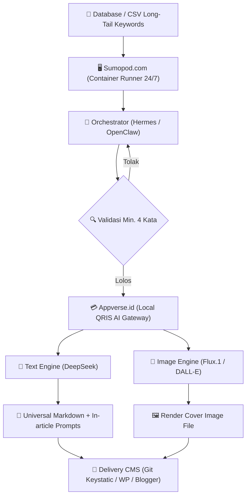

# Ayo SEO - AI Agent Senior SEO & Content Strategist

[](https://opensource.org/licenses/MIT)
[]()
[](https://andrean.web.id/)
[](https://github.com/ndrean-id)
[](https://www.linkedin.com/in/andrean-lp)
[]()
[]()
[]()
[-emerald.svg)]()

> 💡 **TL;DR / Ringkasan Cepat:**  
> **Ayo SEO** adalah open-source AI Agent plugin untuk **Google Antigravity** yang bertindak sebagai *Second Brain* (Otak SEO) sekaligus *Living SEO Library* (Perpustakaan Pengetahuan Hidup) milik **[Andre Wahyu Hermawan](https://andrean.web.id/)**. Didesain khusus untuk memproduksi artikel berstandar **Google E-E-A-T**, membangun hierarki **Topical Authority** (Pilar, Cluster, Glossary), serta mendistribusikan konten (*Repurposing*) ke media sosial dan infografis visual. Teroptimasi penuh untuk konversi bisnis nyata (Leads & Conversion Organik) pada SERP tradisional maupun mesin pencari generatif (**GEO & AEO** seperti Google AI Overviews, Perplexity, dan ChatGPT Search).

> 🧠 **Filosofi Proyek: The Living Library & Open Second Brain**  
> Di era pencarian modern, ilmu SEO bermutasi sangat cepat. Menyimpan wawasan di catatan pribadi yang terisolasi sering berujung pada kelusuhan strategi. Repositori ini dibangun secara terbuka (*public open-source*) sebagai **Living Library & Second Brain**: wadah hidup di mana setiap prinsip algoritma resmi, teknik data praktikum, dan eksperimen lapangan dikodifikasikan, diuji, dan diperbarui secara berkelanjutan. Siapa pun yang menemukan repositori ini dapat menggunakannya sebagai cetak biru optimasi berstandar industri kelas dunia.

---

## Profil Inisiator dan Arsitek Proyek (Author Showcase)

Repositori dan AI Agent ini dirancang serta dikurasi oleh:

| Profil Profesional | Detail & Reputasi Digital |
| :--- | :--- |
| **Author / Inisiator** | **Andre Wahyu Hermawan** |
| **Spesialisasi Utama** | **WordPress Technical SEO Specialist & AI Search Strategist (GEO/AEO)** |
| **Website Resmi** | **[andrean.web.id](https://andrean.web.id/)** *(Astro + Tailwind CSS + Cloudflare Pages, Skor Web 100/100)* |
| **LinkedIn** | **[linkedin.com/in/andrean-lp](https://www.linkedin.com/in/andrean-lp)** |
| **GitHub Portfolio** | **[@ndrean-id](https://github.com/ndrean-id)** |
| **YouTube Channel** | **[@andrean_lp](https://www.youtube.com/@andrean_lp)** |
| **Instagram** | **[@andrean.lp](https://www.instagram.com/andrean.lp/)** |
| **Positioning Statement** | Membantu pemilik bisnis dan kreator membangun aset web berkinerja tinggi yang siap mendominasi pencarian Google dan dikutip oleh AI Search Engine (*ChatGPT, Gemini, Perplexity, Claude*). |
| **Nilai Unik (UVP)** | Sinergi langka antara pemahaman strategi bisnis/konversi (*ex-digital marketing*) dan kemampuan eksekusi teknis langsung (*coding Astro JS, arsitektur headless WordPress, Cloudflare edge, dan Schema JSON-LD*). |

### Mengapa Repositori Ini Bersifat Terbuka untuk Publik?

1. **Transparansi & Pembuktian Kompetensi Nyata (Skin in the Game):**
   - Bukti nyata E-E-A-T (*Experience, Expertise, Authoritativeness, Trustworthiness*). Tidak ada rahasia di balik pintu tertutup; seluruh logika riset, arsitektur pilar-cluster, dan protokol adaptasi algoritma disajikan terbuka untuk diuji oleh siapa pun.
2. **Teknik Feynman (Mengajarkan untuk Mematangkan Keahlian):**
   - Sesuai prinsip praktikum SEO (*CH01-07: Berbagi Pengetahuan*), mengkodifikasikan ilmu ke dalam dokumentasi terstruktur adalah cara terbaik mempertajam intuisi teknis dan pemahaman analitik.
3. **Pintu Kolaborasi & Kemitraan Profesional:**
   - Sebagai etalase personal branding terbuka bagi pemilik bisnis, agensi pemasaran, atau calon mitra teknologi yang mencari spesialis teknis yang mampu menggabungkan strategi konten dengan arsitektur web modern.

---

## 📌 Sekilas Tentang Ayo SEO (Entity Snapshot)

| Parameter | Spesifikasi & Arsitektur |
| :--- | :--- |
| **Kategori** | AI Agent Plugin / SEO Strategy, Content Generation & Visual Repurposing Engine |
| **Sumber Rujukan Utama** | **[Google Search Central](https://developers.google.com/search)**, **[Moz Learn SEO](https://moz.com/learn/seo)**, **[Search Engine Journal](https://www.searchenginejournal.com/)**, **[Backlinko](https://backlinko.com/)**, **[Semrush Blog](https://www.semrush.com/blog/)**, & **[AIOSEO Blog](https://aioseo.com/blog/)** |
| **Platform Host** | Google Antigravity IDE & Antigravity CLI |
| **Model LLM Optimal** | Gemini 3.8 Flash High (Pilar, Cluster, Glossary, Repurpose) |
| **Standar Kualitas** | Google Helpful Content System, Quality Rater Guidelines (QRG), E-E-A-T |
| **Target Engine** | SERP Tradisional (Google, Bing) + AI Search Engines (Perplexity, Google AI Overviews, ChatGPT Search) |
| **Format Output** | Universal Markdown siap posting (termasuk Slug, Meta Title Title Case, Key Takeaways, FAQ Schema, Prompt DALL-E 3) |
| **Standar Visual** | **Syar'i Compliant (Default):** Karakter manusia *faceless* (tanpa mata, alis, hidung, mulut) & dilarang menampilkan hewan |
| **Integrasi CMS** | Headless Git-based (Keystatic, PagesCMS), WordPress REST API, Blogger API v3 |
| **Autopilot Stack** | Sumopod.com (Container Host) + Appverse.id (Local QRIS Gateway) + DeepSeek + Flux/DALL-E |

---

## 🌟 Kenapa Ayo SEO? (GEO & Information Gain)

Di era *Google Helpful Content System* dan menjamurnya *AI Search Engines*, memproduksi artikel menggunakan AI biasa sering kali menghasilkan teks klise (*AI slop*) yang rawan de-indexing dan diabaikan oleh mesin pencari generatif. 

**Ayo SEO memecahkan masalah ini dengan mengedepankan Information Gain, riset berbasis entitas, dan ekosistem multi-format:**

### Perbandingan: Generator AI Biasa vs. Ayo SEO

| Aspek Evaluasi | Generator Konten AI Biasa | Ayo SEO (Senior Specialist Mode) |
| :--- | :--- | :--- |
| **Alur Kerja** | Langsung membuat artikel tanpa analisis mendalam | Riset Search Intent, Entity Mapping, dan gap kompetitor sebelum menulis |
| **Hierarki Konten** | Artikel acak tanpa arsitektur SEO | Membangun ekosistem *Topical Authority* (Pilar ⇄ Cluster ⇄ Glossary) |
| **Gaya Bahasa (Tone)** | Kaku dan klise (*"Di era digital saat ini...", "Kesimpulannya..."*) | Bahasa santai, mengalir natural ("aku-kamu"), humanis, tanpa *wall-of-text* |
| **Strategi Judul** | Sering memakai clickbait murahan atau judul generik | **Hook Penasaran Etis (Curiosity Gap)**: CTR tinggi dan janji ditepati (anti *pogo-sticking*) |
| **GEO / AEO Ready** | Format polos tanpa struktur kutipan AI | Dilengkapi **Key Takeaways (TL;DR)** & **Skema FAQ** siap kutip oleh AI Search |
| **Visual & Gambar** | Tidak ada arahan visual atau menyarankan foto stock pasaran | Menyertakan **Prompt DALL-E 3 siap salin** (Inline + Cover 16:9) berstandar syar'i |
| **Distribusi Konten** | Berhenti setelah artikel teks selesai | Fitur **Content Repurposing** ke Carousel IG (3:4), Single Image AEO (3:4), & Infografis (9:16) |

---

## 🎓 Blueprint Belajar SEO Efisien: Dari Fondasi Menuju Leads & Konversi Organik

SEO modern bukan sekadar mengejar *vanity metrics* (lonjakan impresi atau ranking kata kunci tanpa hasil bisnis). Berdasarkan silabus praktikum **"Efektif Tingkatkan Leads & Conversion Organik dengan Data SEO"**, esensi utama SEO adalah menghasilkan prospek nyata (*qualified leads*) dan konversi penjualan melalui keputusan berbasis data (*data-driven SEO*).

Berikut adalah kurikulum komprehensif dari silabus praktikum tersebut yang diadopsi ke dalam arsitektur dan filosofi kerja Ayo SEO:

### 1. Pengertian SEO Modern: Dari Mesin Pencari Konvensional Menuju AI Search Engines (Perplexity.ai)

Di materi pembuka silabus praktikum **"Efektif Tingkatkan Leads & Conversion Organik dengan Data SEO"**, **Search Engine Optimization (SEO)** didefinisikan secara komprehensif, relevan, dan berorientasi masa depan:

> *"Search Engine Optimization (SEO) adalah serangkaian teknik yang digunakan untuk meningkatkan visibilitas dan peringkat sebuah situs web di halaman hasil pencarian mesin pencari seperti Google, Bing, Yahoo, dan bahkan mesin pencari berbasis AI seperti Perplexity.ai. Tujuannya adalah untuk mendapatkan lalu lintas organik (Organic Traffic) yang lebih banyak dari pengguna internet yang mencari informasi terkait dengan kata kunci yang relevan. SEO mencakup berbagai aspek, mulai dari perancangan dan pengoptimalan konten hingga aspek teknis dari situs web itu sendiri."*

#### A. Tiga Pilar Definisi Berdasarkan Silabus Praktikum

1. **Cakupan Multi-Engine (Lintas Mesin Pencari Konvensional & Generatif AI):**
   - Optimasi tidak lagi terkungkung pada Google semata, melainkan mencakup ekosistem pencarian global seperti **Bing**, **Yahoo**, dan mesin pencari berbasis AI generasi baru seperti **Perplexity.ai**, **ChatGPT Search**, dan **Google AI Overviews**.
   - Visibilitas di mesin pencari AI menuntut konten yang kaya sintesis jawaban langsung (*Answer Engine Optimization / AEO*), struktur data bersih, serta otoritas entitas yang kuat (*Generative Engine Optimization / GEO*).
2. **Tujuan Hakiki: Organic Traffic Berkualitas untuk Leads & Konversi:**
   - Mendatangkan audiens yang secara sadar dan aktif mencari solusi menggunakan kata kunci spesifik (*high-intent keywords*).
   - Trafik organik ini memiliki tingkat kepercayaan dan rasio konversi jauh lebih tinggi dibanding iklan berbayar karena berbasis kebutuhan murni pengguna (*inbound demand* vs *interruption marketing*).
3. **Spektrum Ganda: Arsitektur Konten & Keunggulan Teknis Situs:**
   - **Perancangan & Pengoptimalan Konten:** Menghadirkan artikel bernilai tinggi (*Helpful Content*), menjawab intensi pencari (*Search Intent*), dan menyajikan kebaruan informasi (*Information Gain*).
   - **Aspek Teknis Situs Web:** Kesiapan performa kecepatan (*Core Web Vitals*), keterindeksan bersih (*Crawlability & Indexability*), arsitektur siloing, hingga struktur data (*Schema JSON-LD*).

#### B. Perbandingan: SEO Klasik vs SEO Modern (Era Perplexity & GEO)

| Dimensi Perbandingan | Era SEO Klasik (2010-2022) | Era SEO Modern & AI Search (2023-2026+) |
| :--- | :--- | :--- |
| **Target Hasil Pencarian** | Memperebutkan posisi pada daftar tautan biru (*10 Blue Links*). | Menjadi sumber rujukan kutipan utama pada kotak sintesis AI (*AI Answer Engines & Citation Links*). |
| **Mesin Pencari Sasaran** | Google, Yahoo, Bing tradisional. | Google SERP + AI Overviews, Perplexity.ai, ChatGPT Search, Claude. |
| **Metrik Keberhasilan** | *Vanity metrics*: Lonjakan ranking dan impresi kata kunci semata. | *Business impact*: Lalu lintas organik tertarget, *qualified leads*, dan konversi penjualan. |
| **Fokus Pengoptimalan** | Kepadatan kata kunci (*keyword density*) dan jumlah tautan mentah. | Kejelasan konteks entitas semantik, standar E-E-A-T, dan performa teknis arsitektur web. |
| **Karakter Audiens** | Pembaca pasif yang mengklik judul sensasional (*clickbait*). | Pengambil keputusan yang mencari solusi spesifik, terpercaya, dan tuntas (*high-intent problem solver*). |

---

### 2. Tujuh Siklus Belajar SEO yang Efisien (The 7-Step Mastery Loop)

```text
  [01. Efisiensi 80/20] ──> [02. Literasi Global] ──> [03. Tool Stack Data]
            │                                                 │
            ▼                                                 ▼
  [04. Triad Komponen Utama (Tech - OnPage - OffPage)] <──────┘
            │
            ▼
  [05. Laboratorium Sendiri] ──> [06. Radar Algoritma] ──> [07. Berbagi & Otoritas]
```

1. **CH01-01: Cara Belajar SEO yang Efisien (Fokus Prinsip 80/20):**
   - Hindari jebakan *tutorial hell* atau membaca ratusan artikel tanpa eksekusi nyata.
   - Pahami 20% pilar yang menghasilkan 80% dampak: kepuasan *Search Intent*, keterindeksan teknis (*Crawlability*), dan kebaruan informasi (*Information Gain*).
2. **CH01-02: Kuasai Bahasa Inggris, Lalu Pelajari Dasar SEO:**
   - Seluruh rujukan primer dunia (dokumentasi Google Search Central, pengumuman algoritma Google, riset Moz, SEJ, Backlinko, Semrush, AIOSEO) dirilis pertama kali dalam bahasa Inggris.
   - Kemampuan membaca literatur bahasa Inggris memberikan keunggulan kompetitif 6-12 bulan lebih awal dibanding praktisi yang menunggu konten lokal diterjemahkan.
3. **CH01-03: Ketahui dan Pelajari Tools yang Diperlukan (Data-Driven Stack):**
   - Tinggalkan asumsi dan tebak-tebakan. Keputusan SEO wajib berlandaskan data:
     - **Audit & Kinerja Mesin:** Google Search Console (GSC), Google Analytics 4 (GA4), PageSpeed Insights.
     - **Riset Pasar & Celah Kompetitor:** Semrush, Ahrefs (Keyword Difficulty %, Search Intent, Content Gap).
     - **Audit Arsitektur Situs:** Screaming Frog SEO Spider, AIOSEO WordPress analyzer.
4. **CH01-04: Pelajari Tiga Komponen Utama SEO (The Holy Trinity):**
   - Wajib memahami pembagian kerja yang seimbang antara **Technical SEO**, **On-Page SEO**, dan **Off-Page SEO**.
5. **CH01-05: Praktik Nyata (Bikin Website dan Blog Sendiri - Skin in the Game):**
   - Teori SEO bernilai nol tanpa laboratorium uji coba. Membangun website dan blog sendiri memungkinkan kita melihat langsung bagaimana Googlebot merayapi situs, bagaimana indeks terbentuk, dan bagaimana traffic bereaksi terhadap perubahan konten.
6. **CH01-06: Selalu Up To Date dengan Perubahan SEO:**
   - Algoritma Google bersifat dinamis dan terus bermutasi (Core Updates, Spam Updates, Helpful Content, AI Overviews). Praktisi unggul memantau tren rujukan terpercaya setiap pekan.
7. **CH01-07: Berbagi Pengetahuan SEO Lewat Blog dan Media Sosial (Feynman Technique):**
   - Cara terbaik menguji dan mematangkan pemahaman adalah dengan mengajarkannya kembali ke orang lain. Membagikan intisari SEO lewat blog dan media sosial sekaligus membangun reputasi keahlian (*Authoritativeness*) di mata audiens dan industri.

---

### 3. Matriks Tiga Komponen Utama SEO (The Holy Trinity of SEO)

Tiga komponen utama SEO saling melengkapi dan tidak dapat dipisahkan:

| Komponen Utama | Fokus Kerja & Peran Utama | Contoh Implementasi Nyata di Ayo SEO |
| :--- | :--- | :--- |
| **1. Technical SEO** | **Fondasi Mesin:** Memastikan Googlebot dapat merayapi (*crawl*) dan mengindeks (*index*) website dengan cepat dan tanpa hambatan. | Audit Core Web Vitals, XML Sitemap, struktur URL bersih, HTTPS, penanganan status 404, dan arsitektur siloing. |
| **2. On-Page SEO** | **Relevansi & Nilai Konten:** Mengoptimasi konten di dalam halaman agar menjawab intensi pencari dan mudah dipahami mesin pencari AI. | Struktur H1-H3 logis, Meta Title Title Case, Key Takeaways (TL;DR), Skema FAQPage, serta internal linking sarang laba-laba. |
| **3. Off-Page SEO** | **Otoritas & Reputasi:** Membangun kepercayaan eksternal bahwa halaman websitemu layak direkomendasikan. | Backlink editorial dofollow, Skyscraper Technique (Konten 10x), digital PR, brand mentions, dan Social SEO loop. |

---

### 4. Mengapa Tiga Komponen Ini Wajib Bersinergi? (Prinsip Kursi Berkaki Tiga)

Di materi praktikum **CH01-04**, ditekankan bahwa optimasi website mustahil tercapai secara komprehensif tanpa mendalami ketiga komponen utama ini secara seimbang. Banyak praktisi pemula gagal mendominasi halaman 1 Google karena terjebak pada ilusi "satu peluru ajaib" (*silver bullet*) - misalnya hanya rajin memproduksi ratusan konten tetapi abai pada kesehatan teknis situs, atau sebaliknya, sibuk mengutak-atik kecepatan website hingga skor 100 tapi melupakan kualitas konten dan sinyal otoritas eksternal.

SEO pada hakikatnya adalah sebuah sistem simbiotik yang diibaratkan seperti **Kursi Berkaki Tiga (The Three-Legged Stool)**: jika salah satu kaki patah, seluruh kursi akan roboh tanpa ampun.

#### Tiga Skenario Kegagalan Fatal (The 3 Fatal Failure Scenarios):

1. **Skenario Fatal 1: On-Page & Off-Page Hebat, tapi Technical SEO Rusak**
   - **Kondisi:** Konten ditulis dengan standar 10x Skyscraper, riset kata kunci sangat tajam, dan backlink dari media ternama sudah mengalir deras. Namun, server sering mengalami *timeout (5xx)*, Core Web Vitals merah (LCP > 4 detik), struktur URL berputar-putar dalam canonical loop, atau tag `noindex` terselip tanpa sengaja.
   - **Dampak Fatal:** Googlebot bahkan tidak dapat merayapi (*crawl*) atau mengindeks (*index*) halaman tersebut. Seluruh riset berdarah-darah dan biaya backlink mahal langsung lenyap sia-sia di depan pintu gerbang.

2. **Skenario Fatal 2: Technical & Off-Page Sempurna, tapi On-Page SEO Buruk**
   - **Kondisi:** Website melesat secepat kilat (skor 100 di PageSpeed Insights), arsitektur teknis bersih tanpa cela, dan domain memiliki banyak backlink berkualitas. Namun, isi artikelnya dangkal (*thin content*), dipenuhi teks robotik (*AI slop*), menggunakan judul clickbait menipu, dan gagal memuaskan *Search Intent* pencari.
   - **Dampak Fatal:** Terjadi fenomena *pogo-sticking* massal (pengunjung mengklik website dari SERP lalu langsung menekan tombol *Back* dalam 3-5 detik). Algoritma *Google Helpful Content System* dan sinyal kepuasan pengguna (*User Engagement Signals*) langsung menghukum halaman tersebut hingga terdegradasi secara permanen.

3. **Skenario Fatal 3: Technical & On-Page Unggul, tapi Off-Page SEO Nol**
   - **Kondisi:** Website memiliki kecepatan tinggi, tata letak rapi, artikel super komprehensif (3.000+ kata) dengan E-E-A-T mendalam dan infografis visual orisinal. Namun, domain berstatus baru (*fresh domain*), nol backlink editorial, nol sebutan merek (*brand mentions*), dan langsung diterjunkan bersaing di kata kunci berkategori *High Difficulty*.
   - **Dampak Fatal:** Terkubur di halaman 3 atau 5 antah berantah. Google belum memiliki bukti eksternal yang memvalidasi reputasi situsmu untuk menandingi kompetitor yang sudah memiliki *Trust* dan *PageRank* mapan selama bertahun-tahun.

#### Analogi Mobil Balap: Cara Kerja Sinergi Tiga Komponen

| Komponen SEO | Analogi Mobil Balap Formula 1 | Konsekuensi Jika Diabaikan |
| :--- | :--- | :--- |
| **Technical SEO** | **Sasis, Mesin, & Aerodinamika:** Memastikan kendaraan siap melaju kencang di lintasan tanpa gangguan mesin. | Mobil mogok di pit stop (Googlebot gagal merayap & mengindeks situs). |
| **On-Page SEO** | **Bahan Bakar Kualitas Tinggi & Pengemudi:** Mengemudikan arah yang tepat sesuai navigasi sirkuit dan kebutuhan penonton. | Mobil kencang tapi tersesat atau kehabisan bensin (Konten tidak menjawab intensi pembaca). |
| **Off-Page SEO** | **Lisensi Balap, Reputasi Tim, & Pengakuan Asosiasi:** Tiket resmi agar diizinkan start di barisan terdepan. | Mobil tercepat dengan bahan bakar terbaik, namun tidak pernah diizinkan masuk sirkuit utama. |

---

### 5. Langkah-Langkah Operasional Tiga Komponen Utama (Actionable SOP Checklist)

Berdasarkan modul **Langkah-Langkah Praktis Komponen Utama SEO**, berikut adalah panduan tindakan konkret (*actionable SOP*) yang wajib dijalankan agar ketiga pilar bekerja secara harmonis:

#### A. Langkah-Langkah Technical SEO (Fondasi Mesin & Keterindeksan)
Fokus pada aspek teknis situs web untuk memastikan Googlebot dan bot mesin pencari AI dapat mengakses, merender, dan mengindeks halaman tanpa rintangan:
- **Kecepatan Halaman (Page Speed & Core Web Vitals):**
  - Pastikan metrik *Largest Contentful Paint (LCP)* berada di bawah 2.5 detik dengan mengompres aset gambar ke format WebP CDN dan meminifikasi skrip CSS/JS.
  - Jaga *Interaction to Next Paint (INP)* di bawah 200 milidetik dan *Cumulative Layout Shift (CLS)* di bawah 0.1 agar tata letak halaman stabil saat dimuat.
- **Struktur URL Bersih & Semantik (Clean URL Hierarchy):**
  - Gunakan URL slug yang ringkas, deskriptif, dan memuat kata kunci utama (contoh: `/panduan-seo-dasar/` alih-alih `/?p=1023&cat=9`).
  - Terapkan huruf kecil semua (*lowercase*), pisahkan kata dengan tanda strip biasa (`-`), dan hindari *stop words* yang berlebihan.
  - Bangun arsitektur direktori logis sesuai klaster topik (*siloing*).
- **Penggunaan HTTPS & Protokol Keamanan:**
  - Pasang sertifikat SSL/TLS valid di seluruh domain (Google mengunci HTTPS sebagai sinyal peringkat resmi sejak 2014).
  - Pastikan bebas dari galat *mixed content* (aset HTTP yang terpanggil di halaman HTTPS) dan lakukan redirect 301 otomatis dari `http://` ke `https://`.
- **Infrastruktur Keterindeksan (Crawlability):**
  - Daftarkan Peta Situs XML (*XML Sitemap*) yang dinamis ke Google Search Console.
  - Verifikasi file `robots.txt` agar tidak memblokir akses bot ke file CSS dan JavaScript penting.

#### B. Langkah-Langkah On-Page SEO (Relevansi & Nilai Konten)
Fokus pada penguasaan optimasi di dalam halaman agar konten memuaskan *Search Intent* manusia sekaligus mudah dipahami oleh mesin pencari semantik:
- **Optimasi Konten & Search Intent:**
  - Sajikan jawaban langsung atas keresahan pencari di bagian atas halaman menggunakan prinsip *Bottom Line Up Front (BLUF)* atau *Key Takeaways (TL;DR)*.
  - Buat konten yang mendalam, kaya bukti nyata (*Experience*), dan memberikan kebaruan informasi (*Information Gain*) di atas rata-rata kompetitor SERP.
- **Penggunaan Kata Kunci Semantik (Entity-Based Keywords):**
  - Tempatkan kata kunci utama secara alami pada 100 kata pertama, heading utama, dan body teks tanpa praktik *keyword stuffing*.
  - Perkaya konten dengan variasi entitas semantik, sinonim, dan istilah *Latent Semantic Indexing (LSI)* yang relevan dengan topik industri.
- **Optimasi Meta Tags Pemikat CTR:**
  - **Meta Title:** Panjang ideal 50-60 karakter, ditulis dalam format *Title Case*, mengandung target kata kunci di depan, serta memantik rasa penasaran (*Curiosity Gap*) yang etis.
  - **Meta Description:** Panjang ideal 130-155 karakter, merangkum solusi secara padat dan diakhiri kalimat ajakan bertindak (*Call to Action*).
- **Struktur Heading yang Disiplin & Hierarkis (H1-H3):**
  - Gunakan tepat 1 tag H1 sebagai judul utama artikel.
  - Pecah sub-topik pembahasan menggunakan tag H2, dan jabarkan rincian teknis menggunakan tag H3 secara tertib (ramah untuk *Table of Contents* dan pembaca layar).
  - Patuhi standar anti-mojibake: dilarang meletakkan emoji di dalam tag heading agar tidak merusak tautan anchor dan CMS database.
- **Aset Visual & Media:**
  - Sertakan gambar orisinal (misal render DALL-E atau tangkapan layar asli) dengan atribut `alt text` deskriptif yang ramah aksesibilitas.
  - Sematkan video YouTube edukatif yang relevan untuk melipatgandakan waktu tinggal (*dwell time*) pembaca.

#### C. Langkah-Langkah Off-Page SEO (Otoritas, Pemasaran, & Reputasi)
Fokus pada pembangunan sinyal kredibilitas eksternal agar domain memperoleh rekomendasi dan pengakuan dari dunia luar:
- **Pembangunan Backlink Berkualitas (Value-First Link Building):**
  - Prioritaskan perolehan *backlink editorial dofollow* dari website yang memiliki relevansi topik tinggi dan reputasi bersih (*relevance beats raw volume*).
  - Terapkan teknik *Skyscraper* (Konten 10x): bangun konten referensi paling otoritatif di niche-mu sehingga kreator lain secara sukarela menjadikannya rujukan rujukan ilmiah atau tutorial.
  - Tinggalkan taktik usang seperti spam blog komentar, tautan berbayar massal, atau private blog network (PBN) yang rentan sanksi algoritma Google Spam Update.
- **Pemasaran Konten (Content Marketing & Repurposing):**
  - Terapkan strategi *Content Atomization*: pecah satu artikel pilar panjang menjadi berbagai mikro-konten bernilai tinggi.
  - Ubah intisari artikel menjadi **Infografis Vertikal (9:16)** menggunakan skill `/ayo-seo-infografis` untuk dipasang di Pinterest dan dibagikan ke komunitas.
  - Ubah studi kasus artikel menjadi **Carousel Media Sosial (3:4)** menggunakan skill `/ayo-seo-repurpose-content` untuk memicu diskusi di LinkedIn dan Instagram.
- **Strategi Media Sosial & Brand Signals (Social SEO Loop):**
  - Manfaatkan media sosial sebagai pengungkit sinyal kepopuleran merek (*Brand Mentions*).
  - Susun naskah caption di media sosial dengan menaruh kata kunci di kalimat pertama agar profil dan postingan sosial media ikut terindeks dan muncul di Google Search Console.

---

### 6. Selalu Up To Date dengan Perubahan SEO: Radar Algoritma & Mindset Dinamis (CH01-06)

Di materi **CH01-06 ("Selalu Up To Date Dengan Perubahan SEO")**, ditekankan prinsip fundamental:
> *"Dunia SEO adalah dunia yang sangat dinamis, oleh karena itu, jangan pernah berhenti belajar untuk mendapatkan informasi baru."*

Mesin pencari seperti Google melakukan ribuan penyesuaian algoritma mikro setiap tahun, serta merilis pembaruan besar berkala (**Core Updates, Spam Updates, Helpful Content Updates, & AI Overviews Integration**). Praktisi yang berhenti belajar dan bersandar pada taktik kedaluwarsa akan tersingkir secara alami.

#### A. Bahaya Laten Menggunakan Taktik SEO Kedaluwarsa (Expired SEO Playbook)

| Era Taktik Lama (Kedaluwarsa & Berisiko) | Era SEO Modern (Berdasar Entitas, E-E-A-T, & GEO) | Risiko Jika Bertahan di Taktik Lama |
| :--- | :--- | :--- |
| **Keyword Stuffing & Penargetan Kaku:** Mengulang kata kunci persis berkali-kali secara tidak wajar. | **Semantic & Entity-Based SEO:** Memetakan konteks topik, sinonim alami, dan hubungan entitas semantik. | Terdeteksi spam oleh *Google Spam System* dan memicu penurunan peringkat drastis. |
| **Mass AI Generation Polos (AI Slop):** Menghasilkan ratusan artikel instan tanpa kurasi atau riset mendalam. | **Information Gain & Human Experience:** Menyajikan studi kasus riil, sudut pandang unik, dan data orisinal. | De-indexing massal pasca *Google Scaled Content Abuse Update*. |
| **Membeli Backlink PBN & Link Farm:** Menggunakan jaringan blog privat berkualitas rendah untuk manipulasi PageRank. | **Value-First Editorial Backlinks:** Membangun konten bernilai tinggi (*Skyscraper 10x*) yang disitasi secara sukarela. | Terkena penalti manual (*Manual Action*) atau tautan dinetralkan (*Link Spam Update*). |
| **Fokus Vanity Metrics (Ranking & Impresi Semata):** Mengincar trafik besar tanpa mempedulikan kesesuaian target pasar. | **Leads & Organic Conversion:** Membidik kata kunci komersial/transaksional yang menghasilkan prospek bisnis nyata. | Trafik tinggi tetapi nol konversi penjualan (*Zero ROI*). |

#### B. Radar Tiga Lapisan Sumber Informasi Terpercaya (The 3-Tier SEO Radar)

Agar tidak terjebak kabar burung (*hoax/rumor*) di media sosial, pantau perubahan industri melalui 3 lapisan radar terverifikasi:

1. **Lapisan 1: Sumber Primer Mesin Pencari (Official Engine Radar)**
   - **[Google Search Central](https://developers.google.com/search):** Rujukan mutlak untuk dokumentasi teknis, pembaruan pedoman webmaster, dan *Google Search Essentials*.
   - **Google Search Status Dashboard:** Memantau status sistem crawling, indexing, dan peluncuran update secara real-time.
   - **Pernyataan Resmi Google Search Liaison:** Memahami intensi di balik pembaruan algoritma langsung dari juru bicara resmi Google.
2. **Lapisan 2: Intelijen Industri & Big Data Global (Industry Intelligence)**
   - **Search Engine Journal (SEJ):** Analisis investigatif harian terhadap volatilitas SERP dan dampak pembaruan algoritma.
   - **Moz Learn SEO & Whiteboard Friday:** Pendalaman konseptual dan arsitektur tautan internal.
   - **Backlinko, Semrush Blog, & AIOSEO Blog:** Studi empiris berbasis analisis jutaan URL, pergeseran tren CTR, dan panduan on-page teknis.
3. **Lapisan 3: Laboratorium Mandiri (Skin in the Game Testing)**
   - Teori luar negeri wajib divalidasi langsung di website dan blog eksperimen sendiri.
   - Amati Google Search Console: ketika Google merilis update, periksa klaster mana yang naik dan klaster mana yang turun untuk menemukan pola sebab-akibat yang nyata.

#### C. Protokol 4 Langkah Menghadapi Google Core Update

Saat Google mengumumkan peluncuran pembaruan inti (*Core Update rollout*), jangan panik atau melakukan perubahan drastis secara membabi buta:
1. **Langkah 1: Tenang & Tahan Diri (No Knee-Jerk Reaction):**
   - Pembaruan inti Google biasanya memakan waktu 2 hingga 3 pekan untuk selesai diluncurkan secara global (*full rollout*). Volatilitas di masa peluncuran sangat tinggi; peringkat bisa naik-turun ekstrem sebelum stabil.
2. **Langkah 2: Pantau Data di Google Search Console:**
   - Setelah peluncuran selesai, bandingkan performa 28 hari sebelum dan 28 hari sesudah update di tab *Search Results* GSC. Identifikasi halaman mana yang kehilangan klik dan impresi.
3. **Langkah 3: Bedah Karakteristik Pemenang SERP (Winner Analysis):**
   - Cari kata kunci yang posisinya turun, buka halaman kompetitor yang baru saja naik ke peringkat 1-3.
   - Amati: Apakah mereka menyajikan data yang lebih baru? Apakah layout mereka lebih nyaman dibaca? Apakah mereka menyertakan video dan bukti pengalaman langsung?
4. **Langkah 4: Jalankan Content Refresh & Peningkatan Kualitas:**
   - Poles kembali artikel yang terdampak: perbarui data usang, lengkapi bagian yang kurang, sematkan video edukatif, dan pastikan kepuasan *Search Intent* terpenuhi tanpa basa-basi klise.

---

### 7. Tools dan Peralatan: Ekosistem Data-Driven SEO Stack (CH01-03 Praktikum)

Di materi **"Tools dan Peralatan"** pada silabus praktikum **"Efektif Tingkatkan Leads & Conversion Organik dengan Data SEO"**, ditekankan bahwa seorang praktisi modern tidak boleh bekerja dengan tebak-tebakan. Keputusan strategis SEO wajib berlandaskan pada *data-driven stack* yang terintegrasi dari riset, audit teknis, analisis analitik, hingga visualisasi laporan:

```text
  [01. Google Keyword Planner]  ──>  [02. Advanced Google Sheets]
        (Riset & Clustering)                 (Data Crunching)
                 │                                   │
                 ▼                                   ▼
  [03. Technical SEO Audit (GSC)] <── [04. Screaming Frog / Semrush]
        (Kesehatan & Indexing)               (Audit Arsitektur)
                 │                                   │
                 ▼                                   ▼
  [05. Google Analytics (GA4)]  ──>  [06. Looker Studio Dashboard]
        (User Journey & Leads)               (Visualisasi Bisnis)
```

#### A. Google Analytics (GA4): Melacak Perilaku Pengguna & Konversi Nyata
Bukan sekadar menghitung jumlah kunjungan (*pageviews*), GA4 difokuskan untuk mengukur efektivitas bisnis dari trafik organik:
- **Pelacakan Saluran Akuisisi Organik (Organic Search Acquisition):** Memisahkan trafik dari Google Search, Google Images, Bing, hingga rujukan AI Search.
- **Pengukuran Konversi (Event-Based Conversion Tracking):** Mengonfigurasi event konversi krusial seperti pendaftaran leads (`generate_lead`), pengisian formulir kontak, klik tombol WhatsApp/kontak, hingga transaksi produk (`purchase`).
- **Analisis Keterikatan (Engagement Rate & Dwell Time):** Mengukur durasi interaksi pengguna per sesi untuk memastikan artikel benar-benar dibaca tuntas dan menekan sinyal *pogo-sticking*.

#### B. Technical SEO Audit Checklist dengan Google Search Console (GSC)
GSC adalah "kaca pembesar" resmi langsung dari Google untuk mendeteksi penyakit teknis website sebelum trafik anjlok:
- **Audit Status Pengindeksan (Page Indexing Report):** Memantau dan memperbaiki halaman berstatus *Crawled - currently not indexed*, *Discovered - currently not indexed*, *Not found (404)*, dan galat redirect loop.
- **Evaluasi Core Web Vitals:** Memastikan seluruh URL lolos standar metrik LCP (< 2.5s), INP (< 200ms), dan CLS (< 0.1) pada data pengguna riil (*field data*).
- **Validasi Keamanan & Aksesibilitas:** Memeriksa laporan keamanan (malware/hacking), status kepatuhan HTTPS, dan keterbacaan pada perangkat seluler.
- **Alat Inspeksi URL (Live URL Inspection):** Melakukan uji coba perayapan live (*Test Live URL*) untuk memastikan Googlebot dapat membaca skrip DOM dan CSS halaman secara sempurna.

#### C. Mendalami SEO Tools Industri yang Sering Digunakan
Memadukan kelebihan masing-masing software unggulan industri untuk menutup celah kompetitor:
- **Screaming Frog SEO Spider:** Crawler desktop berdaya tinggi untuk mengaudit ribuan halaman sekaligus (menemukan rantai redirect 301, canonical tag yang salah, title duplikat, dan halaman terisolasi/*orphan pages*).
- **Semrush & Ahrefs:** Intelijen pasar untuk melacak estimasi trafik organik kompetitor, metrik tingkat kesulitan kata kunci (*Keyword Difficulty %*), profil backlink, dan fitur *Content Gap Analysis*.
- **AIOSEO & Yoast (WordPress Ecosystem):** Memastikan kepatuhan markup Schema JSON-LD (`FAQPage`, `Article`, `Product`), integrasi sitemap dinamis, serta panduan densitas on-page CMS.

#### D. Advanced Google Sheets untuk Percepatan Proses SEO
Spreadsheet bukan sekadar tempat mencatat, melainkan mesin otomasi dan pemrosesan data (*data crunching*):
- **Formula Esensial SEO:** Pemanfaatan `XLOOKUP`, `QUERY`, `FILTER`, dan `REGEXEXTRACT` untuk membedah ribuan URL, memisahkan path/kategori, dan mendeteksi duplikasi slug secara instan.
- **Fungsi Web Scraper Mandiri (`IMPORTXML`):** Mengekstrak tag Title, Heading H1, dan Meta Description dari puluhan URL kompetitor secara otomatis tanpa biaya tools langganan.
- **Konektor API & Add-on (Search Analytics for Sheets):** Menarik data query dan halaman dari Google Search Console melebihi batas tampilan antarmuka (menembus batas 1.000 baris hingga puluhan ribu baris data mentah).

#### E. Advanced Keyword Research & Clustering dengan Google Keyword Planner
Mengakses data pencarian langsung dari "dapur" Google dan mengelompokkannya secara cerdas:
- **Akurasi Volume Pencarian & CPC (Cost Per Click):** Menggunakan data resmi Google Ads untuk mengukur minat pencarian bulanan serta nilai komersial suatu kata kunci (CPC tinggi menandakan tingginya intensi transaksi).
- **Teknik Keyword Clustering Berbasis Entitas:** Mengelompokkan puluhan hingga ratusan variasi kata kunci turunan (*long-tail keywords*) yang memiliki intensi serupa ke dalam 1 klaster topik utama.
- **Pencegahan Kanibalisasi (1 Cluster = 1 Halaman Juara):** Menetapkan satu halaman pilar atau cluster induk untuk memayungi seluruh variasi kata kunci tersebut sehingga halaman-halaman di website sendiri tidak saling memangsa (*cannibalizing*) di SERP.

#### F. Praktik Membuat Laporan SEO dengan Looker Studio (Visualisasi Eksekutif)
Menerjemahkan jutaan baris data teknis menjadi dasbor visual interaktif yang mudah dipahami pemilik bisnis, klien, atau manajemen:
- **Integrasi Multi-Konektor:** Menggabungkan data dari Google Search Console (impresi, klik, CTR, posisi rata-rata) dengan Google Analytics 4 (konversi, leads, bounce rate) dalam satu layar.
- **Visualisasi Metrik Krusial:** Menampilkan grafik tren pertumbuhan klik organik dari waktu ke waktu, matriks posisi kata kunci top 10, dan performa halaman pilar vs cluster.
- **Analisis Pertumbuhan Year-over-Year (YoY):** Menghilangkan bias musiman (*seasonality*) dengan membandingkan performa periode berjalan terhadap periode yang sama di tahun sebelumnya guna membuktikan *Return on Investment (ROI)* dari strategi SEO.

---

## Sumber Rujukan Utama: 6 Pilar Otoritas SEO Dunia

Seluruh metodologi, sistem riset, dan SOP penulisan konten di **Ayo SEO** berpatokan langsung pada enam pilar otoritas SEO tertinggi di dunia: dokumentasi resmi dari mesin pencari Google (**[Google Search Central](https://developers.google.com/search)**), kurikulum edukasi SEO global (**[Moz Learn SEO](https://moz.com/learn/seo)**), media intelijen algoritma industri (**[Search Engine Journal](https://www.searchenginejournal.com/)**), masterclass eksekusi praktis dan link building (**[Backlinko](https://backlinko.com/)**), analitik big data marketing dan intelijen kompetitor (**[Semrush Blog](https://www.semrush.com/blog/)**), serta standar implementasi on-page teknis WordPress (**[AIOSEO Blog](https://aioseo.com/blog/)**).

### 1. Fondasi Resmi Mesin Pencari (Google Search Central)
Ayo SEO mengadopsi 4 pilar dokumentasi resmi Google Search Central sebagai fondasi tanpa kompromi:
- **[Google Search Essentials (Webmaster Guidelines)](https://developers.google.com/search/docs/essentials):** Kepatuhan teknis agar konten di-*crawl* dan diindeks secara bersih tanpa teknik manipulasi (*black-hat SEO*, *doorway pages*, atau *scaled content abuse*).
- **[Creating Helpful, Reliable, People-First Content](https://developers.google.com/search/docs/fundamentals/creating-helpful-content):** Menghasilkan artikel yang memecahkan masalah nyata pembaca, kaya *Information Gain*, dan bukan sekadar merangkum artikel lain di internet.
- **[Pedoman E-E-A-T & Google Search Quality Rater Guidelines (QRG)](https://developers.google.com/search/updates):** Menyelaraskan konten dengan 4 metrik evaluasi rater manusia Google: *Experience* (pengalaman langsung), *Expertise* (keahlian mendalam), *Authoritativeness* (otoritas topik), dan *Trustworthiness* (kepercayaan & akurasi fakta).
- **[Dokumentasi Teknis Penataan Halaman & Structured Data](https://developers.google.com/search/docs/appearance/structured-data/intro-structured-data):** Standar URL slug ringkas, meta tags Title Case, teks jangkar (*anchor text*) deskriptif, hingga implementasi data terstruktur (`FAQPage`, `Article`, `VideoObject`).

### 2. Standar Edukasi & Strategi Industri Global (Moz Learn SEO)
Sebagai pionir edukasi SEO dunia lewat mahakarya *The Beginner's Guide to SEO* dan *Whiteboard Friday*, **[Moz Academy / Learn SEO](https://moz.com/learn/seo)** menjadi rujukan kurikulum Ayo SEO untuk:
- **Topical Authority & Content Architecture:** Pemetaan topik secara terstruktur (Hierarki Pilar, Cluster, dan Glossary) untuk mendominasi *search intent*.
- **Link Equity & The Spider-Web Internal Linking:** Mengalirkan otoritas halaman secara merata menggunakan teks jangkar alami tanpa *link stuffing*.
- **Keyword Research & Search Intent Mapping:** Membedah intensi kata kunci informasional, transaksional, dan navigasional demi konversi yang terukur.
- **On-Page & Readability Standards:** Penataan hierarki heading logis (H1-H3), optimasi rasio klik tayang (CTR), dan format paragraf pendek ramah pembaca (*mobile readability*).

### 3. Intelijen Algoritma & Wawasan Industri Terkini (Search Engine Journal)
Sebagai media publikasi berita dan investigasi SEO harian terkemuka di dunia, **[Search Engine Journal (SEJ)](https://www.searchenginejournal.com/)** menjadi acuan Ayo SEO untuk:
- **Pemantauan Google Algorithm Updates:** Melacak peluncuran Google Core Updates, Spam Updates, Helpful Content system, dan fluktuasi volatilitas SERP secara real-time.
- **Dinamika AI Overviews & Generative Search:** Analisis mendalam pergeseran traffic akibat integrasi AI Search Engine dan strategi adaptasi SEO praktis.
- **Studi Kasus & Panduan Taktis Lapangan:** Wawasan berbasis data dari praktisi search marketing global untuk mengatasi content decay dan technical bugs.

### 4. Masterclass Praktis, Link Building, & Skyscraper Technique (Backlinko)
Didirikan oleh Brian Dean dan diakui secara global sebagai standar emas eksekusi SEO praktis berbasis data dan eksperimen nyata, **[Backlinko](https://backlinko.com/)** menjadi rujukan Ayo SEO untuk:
- **The Skyscraper Technique (Konten 10x):** Metodologi riset konten yang sudah terbukti menduduki peringkat teratas, lalu menciptakan konten yang jauh lebih mendalam, terstruktur, visual, dan kaya nilai tambah (*Information Gain*).
- **Link Building Berbasis Nilai (Value-First Outreach):** Strategi mendapatkan backlink editorial berkualitas tinggi secara organik melalui *Resource Page Link Building*, riset data industri orisinal, dan kemitraan konten tanpa teknik spam.
- **Audit On-Page Presisi Tinggi & UX Signals:** Optimasi rasio klik tayang (*Click-Through Rate Booster*), teknik penulisan pengantar anti-pogo-sticking (formula APP: *Agree, Promise, Preview*), dan penataan layout yang memaksimalkan waktu tinggal (*Dwell Time*).
- **Riset Empiris SERP Skala Besar:** Memanfaatkan studi analisis jutaan halaman pencarian Google dari tim riset Backlinko untuk memahami korelasi nyata antara panjang konten, kecepatan situs, dan performa ranking.

### 5. Big Data Marketing, Audit Kompetitor, & Technical Intelligence (Semrush Blog)
Sebagai salah satu platform analitik search marketing dan visibilitas online enterprise terbesar di dunia, **[Semrush Blog](https://www.semrush.com/blog/)** menjadi rujukan Ayo SEO untuk:
- **Keyword Intent & Difficulty Mapping:** Klasifikasi intensi pencarian presisi (*Informational, Commercial, Transactional, Navigational*) dan kalibrasi metrik *Keyword Difficulty* (KD%).
- **Competitive Gap Analysis (Audit Celah Kompetitor):** Metodologi melacak celah kata kunci (*missing & weak keywords*) yang dikuasai kompetitor untuk merebut pangsa trafik organik.
- **Standar Technical SEO & Site Health:** Parameter audit arsitektur situs tingkat lanjut (*Core Web Vitals*, *crawl budget optimization*, indeksabilitas, dan penataan kanonikal).
- **Studi Tren SERP Berbasis Miliaran Data:** Wawasan berbasis basis data masif global untuk memahami pergeseran algoritma Google, dampak fitur AI Search, dan tren perilaku pencari.

### 6. Implementasi On-Page CMS & Ekosistem WordPress (AIOSEO Blog)
Sebagai salah satu pelopor plugin SEO WordPress terpopuler di dunia dengan lebih dari 3 juta pengguna aktif, **[AIOSEO Blog](https://aioseo.com/blog/)** menjadi rujukan Ayo SEO untuk:
- **WordPress On-Page Checklist & Content Auditing:** Standar optimasi judul, meta description, keterbacaan (*readability*), dan densitas kata kunci praktis di lingkungan CMS WordPress.
- **Schema Markup & Rich Snippets WordPress:** Panduan implementasi data terstruktur bebas galat (`FAQPage`, `Article`, `HowTo`, `Product`, `LocalBusiness`) untuk memenangkan tampilan kaya di SERP.
- **Internal Link Automation & Orphan Content Rescue:** Metodologi penemuan konten terisolasi (*orphan pages*) dan distribusi *link equity* otomatis di dalam ekosistem blogging.
- **SEO E-Commerce WooCommerce & Local SEO:** Strategi optimasi katalog produk digital/fisik dan visibilitas pencarian berbasis peta/lokal (*Google Business Profile*).

---

## 🚀 6 Kemampuan Utama (Core Features & Skills)

Ayo SEO menyediakan rangkaian *skills* lengkap untuk kebutuhan produksi hingga distribusi konten:

### 1. 🏛️ Mode Pilar (`/ayo-seo-pilar [Topik]`)
- **Fungsi:** Panduan komprehensif, luas, dan mendalam (2.500 – 4.000+ kata) yang memayungi topik besar industri.
- **Struktur Ahli:** Dilengkapi Daftar Isi (*Table of Contents*) ber-anchor links, konsep *10x Pillar Page* / *Resource Hub*, validasi persona audiens & topik *evergreen*.
- **Visual Otomatis:** Otomatis menghasilkan **Prompt Cover Artikel 16:9** dan prompt DALL-E gambar sisipan di sela-sela teks.
- **Standar E-E-A-T:** Wajib mengutip riset otoritatif internasional (Dofollow) dan menyertakan rekomendasi topik cluster pendukung.
- **Rekomendasi Model:** `Gemini 3.8 Flash (High)`.

### 2. 🎯 Mode Cluster (`/ayo-seo-cluster [Topik]`)
- **Fungsi:** Pembahasan tajam dan spesifik (1.200 – 2.000 kata) yang menjawab satu masalah detail (*long-tail keywords* 4+ kata).
- **Tugas Utama:** Membangun *Internal Link* kembali ke Artikel Pilar untuk menyalurkan *PageRank* dan memperkuat *Topical Authority*.
- **Visual Otomatis:** Menghasilkan prompt cover artikel 16:9 dan prompt gambar pendukung di dalam artikel.
- **Rekomendasi Model:** `Gemini 3.8 Flash (High)`.

### 3. 📖 Mode Glossary (`/ayo-seo-glossary [Istilah]`)
- **Fungsi:** Penjelasan definisi ringkas (500 – 800 kata) yang ramah pemula untuk menjawab search intent "Apa itu X".
- **Tugas Utama:** Menjembatani pengunjung awal (*awareness stage*) ke artikel pilar atau penawaran produk untuk menekan *bounce rate*.
- **Rekomendasi Model:** `Gemini 3.8 Flash (High)`.

### 4. 📱 Repurpose Content (`/ayo-seo-repurpose-content`)
- **Fungsi:** Memecah artikel panjang menjadi micro-content viral untuk media sosial berbasis **Content Atomization**.
- **Alur Interaktif:** Agen menganalisis artikel dan menawarkan 3–5 sudut pandang (*angles*), pilihan format, serta gaya visual melalui modal interaktif.
- **2 Pilihan Format:**
  1. **Carousel IG/LinkedIn (6 Slide, Rasio 3:4):** Mengikuti formula storytelling Storiq (*Hook -> Problem -> Solusi 1-3 -> CTA*), lengkap dengan prompt copywriting, prompt visual DALL-E, caption SEO, dan Alt Text.
  2. **Single Image AEO (Rasio 3:4):** Gambar berfokus pada tipografi tebal pertanyaan (Hook), sedangkan jawaban tuntas disajikan di kolom caption agar diindeks Google sebagai referensi AEO.

### 5. 📊 Infografis Vertikal (`/ayo-seo-infografis`)
- **Fungsi:** Merangkum poin inti artikel menjadi prompt pembuatan **Infografis Vertikal (Rasio 9:16)**.
- **Kegunaan:** Sangat cocok disisipkan di badan artikel blog agar tidak monoton (*anti wall-of-text*) atau di-pin ke Pinterest untuk menjaring *backlink* organik.

### 6. 🖼️ Cover Artikel Generator (`/ayo-seo-cover`)
- **Fungsi:** Generator prompt DALL-E 3 khusus untuk *Featured Image* blog dengan aspek rasio **16:9 (Landscape)**.
- **Prinsip Bersih:** Diinstruksikan tegas tanpa teks di dalam gambar (*No Text/Typography*) untuk menghindari cacat halusinasi typo AI.
- **Guardrail E-E-A-T:** Memberikan peringatan otomatis agar menggunakan foto asli jika artikel membahas review produk fisik/kuliner.

---

## ⚡ Daftar Lengkap Slash Commands

| Command | Fungsi Utama | Rasio Visual Default | Rekomendasi Model |
| :--- | :--- | :---: | :--- |
| `/ayo-seo` | **General Router** (Konsultasi ide, pemilihan pilar/cluster/glossary) | - | Fleksibel |
| `/ayo-seo-pilar [Topik]` | Membuat **Artikel Pilar** komprehensif + Cover 16:9 | 16:9 | **Gemini 3.8 Flash (High)** |
| `/ayo-seo-cluster [Topik]` | Membuat **Artikel Cluster** pendukung + Cover 16:9 | 16:9 | **Gemini 3.8 Flash (High)** |
| `/ayo-seo-glossary [Istilah]`| Membuat **Artikel Glossary** ringkas | - | **Gemini 3.8 Flash (High)** |
| `/ayo-seo-repurpose-content` | Repurpose artikel ke **Carousel (6 Slide)** atau **Single Image AEO** | 3:4 (Portrait) | **Gemini 3.8 Flash (High)** |
| `/ayo-seo-infografis` | Merangkum artikel menjadi prompt **Infografis Vertikal** | 9:16 (Story) | **Gemini 3.8 Flash (High)** |
| `/ayo-seo-cover` | Membuat prompt DALL-E khusus **Cover Artikel (Featured Image)** | 16:9 (Landscape) | **Gemini 3.8 Flash (High)** |

---

## 🚦 Panduan Ritme Publikasi & Anti-Spam (Publishing Cadence)

Kemudahan memproduksi artikel berkualitas dalam hitungan menit sering memicu godaan untuk mempublikasikan puluhan artikel sekaligus setiap hari. Di mata Google (khususnya pasca *Google Spam & Scaled Content Abuse Update*), lonjakan volume tanpa struktur klaster yang matang adalah sinyal bahaya yang dapat memicu status *"Discovered - currently not indexed"* atau penalti domain.

Ayo SEO menganjurkan formula kerja sehat **"1 Pilar - 4 Cluster - 1 Siklus"** untuk membangun *Topical Authority* alami:

### 1. Siklus Mingguan Ideal (The Topical Loop)

```text
[Senin]                [Selasa - Kamis]              [Jumat]              [Sabtu - Minggu]
1 Artikel Pilar   ->   3 Artikel Cluster      ->     1 Glossary /     ->  Evaluasi & Repurpose
(Fondasi Induk)        (Prajurit Penopang)          Internal Linking      (Sosmed / Istirahat)
```

- **Hari 1 (Fondasi):** Buat 1 Artikel Pilar (`/ayo-seo-pilar`) sebagai induk topik besar (2.500-4.000+ kata). Pasang cover 16:9 dan rapikan Table of Contents.
- **Hari 2-4 (Penopang):** Buat 1 Artikel Cluster per hari (`/ayo-seo-cluster`) yang membedah subtopik spesifik dari pilar. Wajib pasang *internal link* yang mengalir kembali ke artikel pilar.
- **Hari 5 (Kamus Istilah):** Buat 1 Artikel Glossary (`/ayo-seo-glossary`) untuk mendefinisikan istilah teknis yang paling relevan.
- **Akhir Pekan (Distribusi & Validasi):** Jangan menulis artikel baru. Gunakan `/ayo-seo-repurpose-content` atau `/ayo-seo-infografis` untuk mendistribusikan intisari ke Instagram/Pinterest guna menjaring trafik rujukan awal.

### 2. Matriks Kecepatan Aman Berdasarkan Usia Domain

| Fase / Usia Website | Batas Frekuensi Publikasi yang Sehat | Fokus Strategis |
| :--- | :--- | :--- |
| **Website Baru (< 3 Bulan)** | **2-3 artikel / minggu** (Maksimal 1 artikel / hari) | Membangun kepercayaan Google, menjaga kualitas indeks, dan menghindari sandbox. |
| **Website Berkembang (3-12 Bulan)** | **4-5 artikel / minggu** (1 artikel / hari kerja) | Memperluas klaster topik yang sudah mulai mencatat impresi di Google Search Console. |
| **Website Mapan / Authority (> 1 Tahun, DA 25+)** | **1-3 artikel / hari** | Menutup celah *content gap* kompetitor secara agresif pada berbagai kategori. |

### 3. Prinsip 80/20 (Human-in-the-Loop)
- **80% Beban Kerja AI:** Riset sudut pandang, entity mapping, pemetaan intent, outline, dan drafting ribuan kata diselesaikan oleh Ayo SEO.
- **20% Sentuhan Kurasi Manusia:** Luangkan 10-15 menit untuk membaca cepat, menyempurnakan cerita/studi kasus nyata, memvalidasi link, serta menyematkan cover gambar. Sentuhan inilah yang menjamin skor *Helpful Content* bernilai tinggi.

### 4. Aktivitas Penunjang Kualitas (Sambil Menunggu Jadwal Publikasi)

Saat kamu mematuhi ritme sehat 1 artikel per hari, jangan biarkan jeda waktu 24 jam terbuang percuma. Inilah aktivitas bernilai tinggi yang bisa kamu lakukan untuk mendongkrak skor E-E-A-T artikelmu ke peringkat 1 Google:

1. **🎬 Embed Video YouTube Relevan (Booster Dwell Time & Multi-Modal):**
   - **Apakah menambah kualitas artikel? SANGAT BESAR!** Menyematkan video YouTube buatanmu sendiri (atau video edukatif yang relevan) membuat waktu tinggal pengunjung (*dwell time*) melonjak drastis karena mereka menonton video 3-5 menit di halamanmu.
   - **Sinergi Google & YouTube:** Google memprioritaskan konten multi-modal (teks + video) dan artikelmu berpeluang tampil dengan *Video Rich Snippet* di SERP utama atau tab "Videos".
   - **Bukti E-E-A-T Nyata:** Menjelaskan topik lewat video dengan suara atau layarmu sendiri adalah bukti otentik *Experience* dan *Expertise* yang tidak bisa diproduksi oleh AI teks biasa.
   - **Tips Teknis:** Pasang schema `VideoObject` di CMS agar Googlebot mengenali metadata video tersebut secara instan.

2. **🎨 Generate Visual Orisinal (Cover 16:9 & Infografis 9:16):**
   - Gunakan prompt dari `/ayo-seo-cover` untuk membuat *Featured Image* bergaya profesional (misal: 3D clay faceless tanpa teks).
   - Buat infografis vertikal via `/ayo-seo-infografis` untuk memecah kejemuan membaca (*anti wall-of-text*) dan pin ke Pinterest untuk mendatangkan *backlink* gratis.
   - Selalu kompres gambar ke format **WebP** di bawah 100 KB dan isi **Alt Text** deskriptif yang memuat kata kunci.

3. **📸 Injeksi Tangkapan Layar Asli (Real Screenshots):**
   - Ambil tangkapan layar langsung dari laptop atau aplikasimu sendiri, beri tanda panah atau sorotan merah. Google Vision API mendeteksi gambar orisinal dan memberi skor *Information Gain* tinggi.

4. **🕸️ Rajut Jaringan Internal Link (The Spider Web):**
   - Buka 2-3 artikel lama yang relevan di websitemu, cari kalimat yang cocok, dan buat tautan ke artikel baru yang baru saja terbit dengan teks jangkar (*anchor text*) yang alami.

5. **📱 Distribusi Konten (Social SEO Loop):**
   - Jalankan `/ayo-seo-repurpose-content` untuk memecah artikel menjadi Carousel Instagram (3:4) atau Single Image AEO (3:4).
   - Tulis caption yang memuat kata kunci di kalimat pertama dan isi Alt Text di pengaturan lanjutan Instagram agar postingan sosmedmu ikut terindeks di Google Search Console.

6. **🔍 Monitoring & Analisis di Google Search Console (GSC):**
   - Periksa apakah artikel yang diterbitkan kemarin sudah terindeks.
   - Amati kata kunci baru yang mulai memunculkan impresi. Jika ada artikel dengan impresi tinggi namun klik rendah, poles ulang hook Meta Title dan Meta Description-nya untuk mendongkrak CTR.

7. **🔄 Content Refresh (Penyegaran Artikel Lama):**
   - Setiap 3-6 bulan sekali, perbarui data tahun, perbaiki tautan mati (*broken links*), dan tambahkan 1-2 FAQ baru pada artikel lama agar posisinya tetap kokoh di halaman 1 Google.

---

## 🛡️ Playbook Menjaga Peringkat Agar Tidak Turun (Rank Retention Strategy)

Menduduki peringkat #1 di Google bukanlah "tiket kemenangan seumur hidup", melainkan posisi yang wajib dirawat secara berkala. Banyak pemilik website terjebak dalam siklus memproduksi konten baru secara membabi buta hingga melupakan artikel-artikel lama yang sebenarnya sudah menghasilkan trafik dan siap digeser kompetitor.

Pelajari 5 strategi pertahanan wajib dari para praktisi SEO senior untuk menjaga agar peringkat websitemu tetap kokoh:

### 1. Hukum 80/20: Content Refresh (Penyegaran Konten Berkala)
Google sangat mencintai **Freshness (Kebaruan Informasi)**. Artikel komprehensif yang duduk di peringkat 1 hari ini bisa merosot dalam 6-12 bulan jika datanya usang.
- **Tindakan Rutin (Setiap 3-6 Bulan):**
  - Perbarui angka tahun pada judul dan isi konten (misal: dari 2025 ke 2026).
  - Cek tautan eksternal (*outbound links*), segera ganti jika ada link mati (*broken link/404*).
  - Tambahkan 1-2 FAQ baru atau wawasan tren tools terbaru yang sedang ramai dibahas audiens.
  - Tambahkan studi kasus atau tangkapan layar baru agar Googlebot melihat adanya *fresh update*.

### 2. Eliminasi Sinyal Mematikan: Pogo-Sticking
*Pogo-sticking* terjadi saat pencari mengklik websitemu dari SERP, namun dalam 5 detik langsung menekan tombol *Back* dan mengklik website kompetitor di bawahmu. Bagi algoritma Google, ini sinyal bahwa halamanmu mengecewakan atau tidak relevan.
- **Pertahanan Utama:**
  - **Tepati Janji di Judul:** Judul boleh memantik rasa penasaran (*Curiosity Gap*), tetapi dilarang keras menipu (*deceptive clickbait*).
  - **Sajikan Jawaban Instan (TL;DR):** Tempatkan *Key Takeaways* di awal artikel agar pembaca langsung tahu mereka berada di tempat yang tepat.
  - **Dwell Time Booster:** Sematkan video YouTube, infografis vertikal, atau tabel data interaktif untuk menahan pengunjung berlama-lama di halamanmu.

### 3. Disiplin Anti-Kanibalisasi Kata Kunci (1 Keyword = 1 Halaman Juara)
Ketika website bertambah besar, sering kali pemilik web memproduksi artikel baru yang menargetkan kata kunci yang hampir sama persis dengan artikel yang sudah ada.
- **Risiko Fatal:** Dua halaman dari websitemu sendiri akan saling "bermusuhan" di SERP. Google bingung menentukan mana halaman otoritas utama, hingga akhirnya **keduanya sama-sama anjlok ranking-nya**.
- **Solusi Arsitektur:** Selalu konsisten pada formula **Topical Cluster**. Satu kata kunci utama hanya boleh dimiliki oleh 1 Artikel Pilar atau 1 Artikel Cluster. Topik turunan harus berperan sebagai pendukung dan menautkan *internal link* ke halaman induk, bukan malah menyainginya.

### 4. Perawatan Sarang Laba-Laba (Internal Linking Maintenance)
Internal link adalah pembuluh darah yang mengalirkan otoritas (*PageRank*) ke seluruh website.
- Jangan biarkan ada artikel yang terisolasi (*orphan pages*).
- Setiap kali menerbitkan artikel baru hari ini, luangkan waktu 5 menit untuk membuka 2-3 artikel lama yang relevan, lalu sisipkan tautan alami menuju artikel baru tersebut dengan teks jangkar (*anchor text*) yang bervariasi dan kontekstual.

### 5. Deteksi Dini Gejala Penurunan di Google Search Console (GSC)
Buka Google Search Console secara berkala dan gunakan tabel diagnosa cepat ini untuk melakukan penyelamatan sebelum ranking benar-benar anjlok:

| Gejala di GSC | Diagnosa Masalah | Solusi Penyelamatan Cepat |
| :--- | :--- | :--- |
| **Impresi Stabil, tapi Klik Menurun** | Judul atau Meta Description kalah menarik dibanding kompetitor baru di SERP. | Poles ulang H1 dan Meta Title dengan formula *Curiosity Gap* yang lebih segar dan tingkatkan daya pikat CTR. |
| **Impresi & Posisi Rata-rata Turun Perlahan** | Terjadi pembusukan konten (*content decay*) atau kompetitor membuat konten yang jauh lebih lengkap (10x Content). | Lakukan *Content Refresh*: lengkapi data statistik baru, sematkan video YouTube, dan perbanyak poin FAQ. |
| **Posisi Turun Drastis Mendadak (Drop > 10 Peringkat)** | Kemungkinan kanibalisasi kata kunci, masalah teknis indeks (noindex/canonical bug), atau terdampak Core Update. | Audit URL duplikat, periksa status indexing di GSC, dan evaluasi kepatuhan E-E-A-T pada halaman tersebut. |

---

## 📊 Lanskap CMS Global & Alokasi Fokus Platform (Data-Driven Strategy)

Banyak pemula di bidang SEO terjebak kebingungan: *"Platform apa yang paling banyak digunakan di luar negeri, dan ke mana saya harus mengalokasikan energi belajar?"*

Berdasarkan data riset resmi dari **[W3Techs](https://w3techs.com/technologies/overview/content_management)** (otoritas data teknologi web global), berikut adalah peta pangsa pasar CMS dunia dan strategi alokasi energi yang direkomendasikan bagi praktisi SEO modern:

### 1. Data Pangsa Pasar CMS Global (W3Techs Industry Benchmark)

| Peringkat | Platform | Pangsa Pasar CMS | % Seluruh Web di Dunia | Peran Utama & Ekosistem Industri |
| :---: | :--- | :---: | :---: | :--- |
| **#1** | **WordPress** | **~62.5%** | **~43.1%** | **Raja Mutlak.** Blog, portal media, B2B, affiliate, dan arsitektur Headless modern. |
| **#2** | **Shopify** | **~6.5%** | **~4.5%** | **Raksasa E-Commerce.** Toko online DTC (Direct-to-Consumer) global (US/Eropa). |
| **#3** | **Wix** | **~3.8%** | **~2.6%** | **No-Code UMKM.** Bisnis lokal, studio, dan praktisi solo (drag-and-drop). |
| **#4** | **Squarespace** | **~3.1%** | **~2.1%** | **Kreatif & Portofolio.** Dominan di pasar kreatif Amerika Serikat. |
| **#5** | **Joomla** | **~2.4%** | **~1.7%** | **CMS Tradisional.** Instalasi lama skala institusi (tren menurun). |

*(Catatan: **WooCommerce** adalah bagian dari ekosistem WordPress yang menguasai sekitar **13%** transaksi e-commerce mandiri global).*

### 2. Formula Alokasi Energi 80/20 (Fokus Praktisi SEO)

Menguasai semua CMS secara bersamaan akan membuatmu menjadi generalist yang serba nanggung. Terapkan prinsip alokasi fokus berbasis data pasar:

- **80% Energi (Fokus Utama & Fondasi): WordPress & Arsitektur Web Modern**
  - WordPress memegang hampir separuh internet. Di sinilah volume pekerjaan SEO (audit teknis, Schema JSON-LD, optimasi Core Web Vitals, dan content publishing) paling melimpah ruah di pasar global (Upwork, LinkedIn).
  - Integrasikan keahlian WordPress dengan arsitektur modern (*Headless WordPress + Astro JS / Cloudflare edge*) untuk menciptakan diferensiasi nilai tinggi (*unfair advantage*) yang dicari agensi modern.
- **20% Energi (Senjata Cadangan): Dasar E-Commerce Shopify**
  - Cukup pelajari struktur URL Shopify, kanonikal produk/koleksi, dan optimasi kecepatan dasar. Klien e-commerce luar negeri bersedia membayar tarif tinggi untuk perbaikan teknis toko mereka.
- **Platform Lainnya (Wix, Squarespace, Webflow):**
  - Cukup pahami prinsip dasar on-page dan indexing-nya sebagai pengetahuan adaptif saat menangani migrasi situs ke WordPress atau Astro.

---

## 🕋 Standar Visual Syar'i (Faceless & Tanpa Hewan)

Ayo SEO memiliki aturan global terikat pada `rules/AGENTS.md` mengenai kepatuhan visual:
1. **Dilarang Menampilkan Hewan:** Seluruh prompt gambar DALL-E yang dihasilkan agen tidak akan menyertakan hewan jenis apa pun.
2. **Karakter Tanpa Wajah (Faceless Illustration):** Jika prompt memuat karakter manusia, agen **wajib mutlak** menambahkan instruksi tegas agar digambar dalam gaya *faceless* (wajah kosong sepenuhnya: tanpa mata, tanpa alis, tanpa hidung, dan tanpa mulut).
3. **Status:** Aturan ini bersifat **default dan selalu aktif** demi kenyamanan pengguna muslim tanpa mengurangi estetika modern (*3D Clay, Minimalist Vector, Isometric*).

---

## 🎯 Standar Optimasi GEO & AEO (Generative Engine Optimization)

Agar konten mudah dikutip oleh mesin pencari AI (**Google AI Overviews, Perplexity, ChatGPT Search**), Ayo SEO menyematkan parameter wajib:

1. **Intisari Instan (Key Takeaways / TL;DR):**  
   Diletakkan tepat di awal artikel dengan prinsip *Bottom Line Up Front (BLUF)* sebagai umpan kutipan langsung AI.
2. **FAQ Berbasis Conversational Search:**  
   Pertanyaan menggunakan bahasa pencarian alami manusia dengan jawaban padat (2–3 kalimat langsung ke sasaran). Bagian ini dilengkapi panduan pemasangan Schema `FAQPage`.
3. **Teknik Curiosity Gap Beretika:**  
   H1 dan Meta Title (50–60 karakter berformat *Title Case*) memantik rasa penasaran tanpa clickbait manipulatif guna mencegah *pogo-sticking*.
4. **Social SEO Loop:**  
   Memanfaatkan pengindeksan media sosial oleh Google Search Console melalui konten repurposing yang kaya *keyword* dan *Alt Text*.

---

## 🤖 Arsitektur Autopilot & Programmatic SEO (Blueprint Masa Depan)

Ayo SEO dirancang siap pakai untuk ekosistem *Autonomous Agentic Orchestrator* (seperti **Hermes** atau **OpenClaw**) dengan infrastruktur ramah developer Indonesia (pembayaran lokal QRIS):



### Komponen Autopilot Stack:
- **Runner Host:** **Sumopod.com** (Container / Cloud management lokal untuk *runtime* skrip antrean 24/7).
- **API Gateway (Proxy):** **Appverse.id** (AI Gateway lokal pendukung QRIS/GoPay tanpa perlu kartu kredit internasional).
- **LLM Engine (Brain):** **DeepSeek** (Efisien, cepat, dan penalaran logis tajam untuk artikel informasional).
- **Image Engine (Renderer):** **Flux.1 / Stable Diffusion** via Appverse untuk menghasilkan file gambar cover otomatis.
- **Target CMS:** Keystatic (Git Push), WordPress REST API, atau Blogger API v3.
- **Sistem Keamanan:** Terkunci 100% pada artikel cluster *Evergreen* (min. 4 kata) guna melindungi reputasi E-E-A-T domain.
- **Rate Limiting & Anti-Spam Guardrail (Maksimal 1 Artikel / Hari):** Penjadwalan eksekusi autopilot dikunci default dengan jeda minimal 24 jam per artikel (cron harian). Jika operator mencoba memaksa *bulk publishing*, sistem wajib mengeluarkan log peringatan resiko penalti *Google Scaled Content Abuse* dan kehabisan *crawl budget*.

> Seluruh panduan teknis ini tercatat di [rules/AUTOPILOT_ARCHITECTURE.md](rules/AUTOPILOT_ARCHITECTURE.md).

---

## 📦 Panduan Instalasi

Pasang plugin Ayo SEO ke Antigravity lokalmu:

```bash
# 1. Clone repositori Ayo SEO
git clone https://github.com/ndrean-id/ayo-seo.git

# 2. Salin ke folder plugin Antigravity
cp -r ayo-seo ~/.gemini/config/plugins/ayo-seo
```

*Restart Antigravity IDE atau buka sesi baru untuk mengaktifkan seluruh kemampuan Ayo SEO.*

---

## ❓ Pertanyaan Yang Sering Diajukan (FAQ)

### Apa bedanya Ayo SEO dengan prompt penulisan artikel biasa di ChatGPT?
Ayo SEO bukan sekadar generator teks sekali pakai. Ini adalah agen terstruktur dengan SOP lengkap: riset search intent, entity mapping semantik, E-E-A-T guideline, sistem linking editorial dofollow, aturan visual syar'i faceless, hingga pembuatan prompt turunan media sosial.

### Mengapa gambar di Ayo SEO menggunakan format prompt DALL-E siap salin?
Google sangat mengutamakan orisinalitas dan *Information Gain*. Menggunakan foto stock gratisan (Unsplash/Pexels) rawan dianggap duplikat oleh Google Vision API. Dengan membuat prompt unik DALL-E (atau merendernya via API), aset visual websitemu 100% unik dan bernilai SEO tinggi.

### Apakah postingan Instagram dari hasil repurpose benar-benar terindeks Google?
Ya! Google Search Console kini secara resmi mendukung pemantauan akun sosial media (Instagram, TikTok, X, YouTube). Kalimat pertama pada caption dan Alt Text yang dihasilkan Ayo SEO dirancang khusus agar diindeks Google Search.

---

## 📝 Ringkasan Versi Terbaru (Changelog Highlights)

- **v1.33.0 (2026-11-24):** Penambahan rekonseptualisasi **Pengertian SEO Modern: Dari Mesin Pencari Konvensional Menuju AI Search Engines (Perplexity.ai)** mencakup cakupan multi-engine, esensi organik trafik untuk leads & konversi, spektrum ganda konten vs teknis, serta tabel komparasi SEO Klasik 10 Blue Links vs Era GEO/AEO.
- **v1.32.0 (2026-11-24):** Penegasan filosofi **The Living SEO Library & Open Second Brain**, showcase profil arsitek proyek **Andre Wahyu Hermawan (WordPress Technical SEO Specialist & AI Search Strategist)**, integrasi badge reputasi digital, manifesto transparansi E-E-A-T, serta kanal kolaborasi & konsultasi resmi.
- **v1.31.0 (2026-11-24):** Penambahan arsitektur **Tools dan Peralatan: Ekosistem Data-Driven SEO Stack (CH01-03 Praktikum)** meliputi GA4 event tracking, GSC technical checklist, Screaming Frog & Semrush, Advanced Google Sheets (IMPORTXML, Regex, API connector), Keyword Clustering Google Keyword Planner, dan dasbor visualisasi Looker Studio.
- **v1.30.0 (2026-11-24):** Penambahan panduan **Selalu Up To Date dengan Perubahan SEO: Radar Algoritma & Mindset Dinamis (CH01-06)** mencakup perbandingan risiko taktik kedaluwarsa vs SEO modern, radar 3 lapisan sumber informasi terpercaya, dan protokol 4 langkah menghadapi Google Core Update.
- **v1.29.0 (2026-11-24):** Penambahan panduan eksekusi **Langkah-Langkah Operasional Tiga Komponen Utama SEO (Actionable SOP Checklist)** untuk Technical SEO (Core Web Vitals, URL semantik, HTTPS), On-Page SEO (Search Intent, entitas semantik, CTR meta tags, hierarki heading), dan Off-Page SEO (backlink berkualitas, repurposing infografis/carousel, dan Social SEO loop).
- **v1.28.0 (2026-11-24):** Penambahan analisis mendalam **Sinergi 3 Komponen Utama SEO (Prinsip Kursi Berkaki Tiga, 3 Skenario Kegagalan Fatal, & Analogi Mobil Balap)** dari kurikulum praktikum CH01-04 pada Blueprint Belajar SEO Efisien.
- **v1.27.0 (2026-11-24):** Penambahan **Blueprint Belajar SEO Efisien: Dari Fondasi Menuju Leads & Konversi Organik** (7 siklus pembelajaran efisien, penguasaan bahasa Inggris untuk literasi global, tool stack data SEO, laboratorium blog mandiri, serta matriks The Holy Trinity: Technical, On-Page, Off-Page SEO) dan penegasan konsep Ayo SEO sebagai *Second Brain & Living SEO Library*.
- **v1.26.0 (2026-11-24):** Integrasi **AIOSEO Blog** (https://aioseo.com/blog/) sebagai pilar ke-6 rujukan implementasi On-Page CMS, Schema Markup WordPress, penyelamatan orphan content, dan integrasi e-commerce WooCommerce.
- **v1.25.0 (2026-11-24):** Integrasi **Semrush Blog** (https://www.semrush.com/blog/) sebagai pilar ke-5 rujukan Big Data kata kunci, Content Gap Analysis kompetitor, dan audit teknis kesehatan arsitektur website.
- **v1.24.0 (2026-11-24):** Integrasi **Search Engine Journal (SEJ)** (https://www.searchenginejournal.com/) dan **Backlinko** (https://backlinko.com/) sebagai pilar rujukan intelijen algoritma real-time, metodologi Skyscraper Technique (Konten 10x), strategi link building berbasis nilai, serta pembaruan rekomendasi model LLM ke **Gemini 3.8 Flash (High)**.
- **v1.23.0 (2026-11-24):** Integrasi **Moz Academy / Learn SEO** (`https://moz.com/learn/seo`) sebagai standar rujukan edukasi dan strategi industri global (Topical Authority, Link Equity, Search Intent Mapping, dan On-Page Readability) mendampingi fondasi resmi Google Search Central.
- **v1.22.0 (2026-11-24):** Penambahan penegasan **Google Search Central** (`https://developers.google.com/search`) sebagai sumber rujukan dan fondasi standar utama (Google Search Essentials, Helpful Content System, Quality Rater Guidelines E-E-A-T, dan Structured Data), serta pembaruan repositori git resmi ke `ndrean-id/ayo-seo`.
- **v1.21.0 (2026-10-12):** Penambahan panduan *Lanskap CMS Global & Alokasi Fokus Platform (Data-Driven Strategy)*. Merangkum data riset resmi W3Techs mengenai dominasi WordPress (62.5% CMS share) dan Shopify, serta formula alokasi energi 80/20 bagi praktisi Technical SEO untuk membidik pasar global.
- **v1.20.0 (2026-10-11):** Penambahan *Playbook Menjaga Peringkat Agar Tidak Turun (Rank Retention Strategy)*. Panduan pertahanan posisi #1 Google mencakup strategi Content Refresh 80/20, eliminasi sinyal pogo-sticking, disiplin anti-kanibalisasi kata kunci, perawatan jaringan internal link, serta tabel diagnosa dini performa Google Search Console.
- **v1.19.0 (2026-10-11):** Penambahan panduan *Aktivitas Penunjang Kualitas Konten (Downtime Value-Adds)*. Panduan mendalam tentang dampak masif embed video YouTube (dwell time & multi-modal E-E-A-T), injeksi tangkapan layar asli, perajutan internal link, audit GSC, dan strategi penyegaran konten (*content refresh*).
- **v1.18.0 (2026-10-11):** Integrasi *Rate Limiting & Anti-Spam Guardrail (Rule #4)* pada arsitektur Autopilot. Penjadwalan eksekusi dikunci maksimal 1 artikel per 24 jam dengan jeda antrean otomatis dan mekanisme peringatan/edukasi wajib jika operator mencoba memaksa *bulk publishing*.
- **v1.17.0 (2026-10-11):** Penambahan panduan komprehensif *Ritme Publikasi & Anti-Spam (Publishing Cadence)*. Memperkenalkan formula kerja *1 Pilar - 4 Cluster - 1 Siklus*, matriks kecepatan publikasi aman berdasarkan usia domain, serta prinsip *80/20 Human-in-the-Loop* guna mencegah penalti Google Scaled Content Abuse.
- **v1.16.0 (2026-10-10):** Standarisasi karakter aman dan proteksi Anti-Mojibake. Larangan keras penggunaan em-dash/en-dash (`—`, `–`) di judul/heading (diwajibkan menggunakan tanda hubung `-` keyboard standar) dan larangan menyisipkan emoji di dalam Heading (H1-H4) guna mencegah bug karakter rusak (`–`, `â☒`, `???`) di CMS dan parser TOC.
- **v1.15.0 (2026-10-10):** Penambahan skill `/ayo-seo-cover` (Prompt Cover 16:9 tanpa teks), serta pembuatan prompt cover otomatis pada metadata artikel pilar dan cluster.
- **v1.14.1:** Penyesuaian rasio default Single Image AEO menjadi `3:4 (Portrait)` untuk keterbacaan optimal di layar smartphone.
- **v1.14.0:** Penambahan format Single Image AEO (pertanyaan di visual, jawaban lengkap di caption) pada fitur repurpose.
- **v1.13.0:** Pembuatan caption Instagram SEO-friendly dan Alt Text otomatis pada fitur repurpose carousel.
- **v1.12.1:** Standardisasi rasio visual bawaan: Carousel 3:4 dan Infografis 9:16.
- **v1.12.0:** Penambahan skill `/ayo-seo-infografis` (Infografis vertikal) dan injeksi prompt gambar otomatis di badan artikel.
- **v1.11.0:** Pembaruan sistem *Content Atomization* pada repurpose (memecah 1 artikel menjadi 3–5 pilihan sudut pandang).
- **v1.10.0:** Penerapan aturan global **Standar Visual Syar'i** (Faceless illustration & tanpa hewan) di seluruh agen dan skill.
- **v1.9.0:** Peluncuran skill `/ayo-seo-repurpose-content` berbasis alur 6 slide Storiq.
- **v1.8.0:** Peningkatan Artikel Pilar berbasis wawasan pakar (Daftar Isi anchor links, 10x Pillar/Hub concept, persona evergreen).
- **v1.7.0:** Optimasi GEO & AEO repositori secara menyeluruh serta teknik judul *Curiosity Gap* etis.

---

## Kolaborasi, Konsultasi, dan Kontak

Tertarik berdiskusi seputar arsitektur SEO modern, konsultasi optimasi web berkecepatan tinggi, atau penjajakan proyek kolaborasi?

- 🌐 **Website Resmi & Portofolio:** [andrean.web.id](https://andrean.web.id/)
- 💼 **LinkedIn:** [Andre Wahyu Hermawan](https://www.linkedin.com/in/andrean-lp)
- 🐙 **GitHub:** [@ndrean-id](https://github.com/ndrean-id)
- 📺 **YouTube:** [@andrean_lp](https://www.youtube.com/@andrean_lp)
- 📸 **Instagram:** [@andrean.lp](https://www.instagram.com/andrean.lp/)
- 💡 **Diskusi Teknis:** Jangan ragu membuka [GitHub Issues](https://github.com/ndrean-id/ayo-seo/issues) untuk saran, diskusi, atau kontribusi fitur!

---

## 📄 Lisensi
Didistribusikan secara open-source di bawah lisensi [MIT License](LICENSE).
